# The queue drain and its merge

`scripts/drain.py` drains the queue: `/ratchet:feature` with no ticket builds every agent-ready ticket, each in a work tree of its own, and merges them one at a time (ADR 0023). The script decides what needs no judgement and keeps what must outlive a session. `plan` says what each ticket is, `open` makes a ticket's work tree and branch only when the plan starts it, `update` rebases a built branch onto the default branch, `check` runs the publish check of ADR 0060 on a ticket's branch, `land` runs the merge with no forge and closes the ticket with what the judge printed, `close` removes a work tree and writes the ticket's note, `clean` removes leftover work trees, and `report` prints what merged, what waits and what is parked. `scripts/merge.py` is the merge `land` runs: it merges the branch in a scratch work tree, asks the judge and runs `check` on the result, and moves the default branch forward only when both are green.

The drain promises that an interrupted drain loses no work and repeats nothing (ADR 0023). Each command finishes from what git holds when it is run again: `update` abandons a rebase it left and starts over, `land` records a merge that landed, `clean` records the merge of a branch whose note does not yet say it, and every command first puts back what a killed `merge.py` left. One drain runs on a repository at a time: `clean --all` takes a lease and is refused while another drain is alive, and the report ends it. This page writes the drain down as a state machine, and says which of these promises the code keeps. For the publish check it says what the code does: `drain.py check` runs it, and the model holds the steps.

The model is `hooks/tests/drain_model.py`. The tests in `hooks/tests/test_drain_model.py` check each rule on every step the model reaches. They also take the model's steps on real repositories, where the real `drain.py` and `merge.py` must leave what the model says (`hooks/tests/drain_world.py`). The steps of the expiry graph, ADR 0064's turn, are not taken on a real repository yet: the scripts do not do them, as [below](#what-the-script-change-of-adr-0064-must-do) says.

## Scope

The model has three graphs.

The main graph is one drain on one repository with no forge:

- three tickets, `a`, `b` and `c`, where `b` is blocked by `a`, under a cap of one; and `d` and `e`, the two parts `drain.py split` files when the agent splits `a` as too large, where `e` is blocked by `d` (ADR 0046);
- the drain's commands in any order, what the agent does in a work tree, a commit a role of a pipeline run makes on the branch, the publish check, the agent's split of `a`, what the owner does, an upgrade that makes the preflight ask the `Flag:` line, and a stale index lock git leaves;
- a kill of `update`, `close`, `land` or the `merge.py` it runs between two of their effects;
- each ticket playing one part. The agent and a role commit only in `a`, whose branch goes the whole way to merged, and the agent leaves work uncommitted only in `c`, the ticket the cap holds back. `b`, which waits on `a`, is only opened. A kill stops `update` and `land` only in `a`, and `close` only in `c`;
- the agent splits only `a`, in a clean tree before any commit, as the spec stage's estimate stops it. The parts are local tickets, committed on the default branch with the split. `d` and `e` are only opened, built, judged and landed. Once `a` is split no command names it, the owner's one edit of it is to close it, and the upgrade comes only before a split;
- the owner edits a ticket at most once, the agent leaves work uncommitted once, a role commits once, and the retry count of a ticket left waiting stops at three, past which nothing reads it;
- the guard's gate, as a choice of the model. The guard refuses `git commit`, `am`, `cherry-pick` and `revert` in a queue work tree whose start no `check --final` has passed. With the gate every commit step goes through it, so a role never commits and the agent commits only after the check: that is the drain as it runs. Without the gate the model keeps the record of what breaks where a commit gets past the guard, which reads only the commands a session runs. There a role commits only on a start no check has passed: before its run returns, or after a check without `--final`, which the skill runs after a run that errored, in the resume that follows. And there the agent commits before the check only in `a`: in `d` and `e` its commits obey the gate either way;
- the skill runs `check` after a run returns, so only on a start no check has passed, of a ticket its note does not hold. A check without `--final` comes only in `a`. A check that cannot read the present state, and one that finds only a rebase left unfinished, come only in `a`, on a branch with commits of its own;
- a project whose binding asks the `Flag:` line and that is not deployed, where `b` and `c` state their line and `a` does not. Before the upgrade that ships ADR 0061 the preflight asks no ticket for it, and after it the preflight refuses `a` until the owner lands its line. The owner's landing of the line is their one edit of a history;
- a judge that passes a branch only when its verdict record is its last commit and the branch holds the default tip; a `check` that is always green; and tickets no two of which change the same file, so nothing conflicts.

The lease graph is two drains on one repository and one ticket's work tree. Its first step says how the drains run: each in a session of its own, or both under one long-lived process. Then each drain takes the lease, opens the ticket, leaves a draft or starts a program in its tree, lands the ticket, reports, cleans, stops or dies, in any order. `land` is three steps: up to the `merge.py` it runs, the merge `merge.py` lands, and the close after it. `land` holds the drain's lock for its checks and again for its close, and not while `merge.py` runs, so every other command can run in between.

A landing is seen by three locks of the kernel's, each freed when its holder dies. `land` holds the ticket's landing lock all the way through. It also holds a private lock, in a file of a fresh name it passes to `merge.py` in `RATCHET_LANDING`. `merge.py` holds a merge lock of its own on the branch from its start to its end, and once it holds it, it probes the private lock: held, its `land` is alive and it goes on; free or gone, its `land` has stopped, and it merges nothing. Every command reads the landing lock and the merge lock. A kill can stop `land` in three places:

- `land` and its `merge.py` together before the merge, as a session's end or a shell's timeout ends both; or `land` alone after the merge and before its close;
- `land` alone before its `merge.py` has probed it. For that instant no lock is held, and every command acts as with no landing. The `merge.py` then finds its `land` gone and stops, having merged nothing;
- `land` alone once its `merge.py` has probed it. The merge lock is held, so every command of either drain sees a merge running. The `merge.py` then lands the merge or ends having landed nothing.

While the landing is alive, either drain's agent can also run `update`, `close --outcome parked` or a second `land` on the ticket. The landing drain's own agent does so when its shell gave up waiting on `land`. A second `land` in the instant before a killed `land`'s `merge.py` probes it starts a merge of its own, so two `merge.py` of one ticket run: the first stops at its probe, and the second lands under its live `land`, or meets the merge lock the first holds past its tries and stops, and its `land` closes nothing.

The expiry graph is the drain's turn of ADR 0064: a local feature, the unit `.scratch/<slug>/`, that two tickets share, `a` and `c`, neither blocked by the other. A unit expires when every ticket in it is resolved, and the change of the last of them to land deletes it. The graph holds:

- the unit on the default branch, with one `## Answers` line on a ticket of it, and the brief's `## In the owner's words`;
- each ticket's branch: the agent's content commit at the default tip, which resolves the ticket and commits its spec; `documents.py expire` after it; the agent's verdict record; `drain.py update`; the verdict record of a judge-again run after an update; and `drain.py land`, with a kill before its note;
- the owner's one records edit, an `## Answers` line landed on a ticket of the unit while the unit is on the default branch; and the owner's squash of a branch by hand;
- these steps in any order, each ticket built once. So the two land in either order, and the second lands on a branch built before the first landed, which `update` brings up to date, or after it.

`land` stands for every judged merge here: the drain's, a forge's merge job and the owner's own run of the merge entry point. Each asks the judge, which refuses a branch that is behind, so the graph does not tell them apart. It leaves out what the main graph holds: the cap, the trees, the holds but the judge's, the notes but whether one records the merge, the publish check and the other kills. Each commit of the agent here follows a check with `--final`, and `update` makes its own, so the guard's gate refuses none of them and the graph is the gated drain's. The two tickets stand for any two of a unit: the parts of a split are filed in the unit of the split ticket, and from then on they are tickets of it like any other.

The steps ADR 0064 asks of the drain are each a keep of the graph, and the tests take each one away in turn to find the rule it keeps:

| Keep | Says |
| --- | --- |
| `UPDATE_EXPIRE` | `update` runs `expire` once its rebase is done. |
| `CARRY` | On a modify/delete conflict in the unit, `update` takes the incoming edit, then runs `expire`, which deletes it again and carries its `## Answers` line. |
| `ONCE` | `expire` carries only a line the brief does not hold yet. |
| `RESOLVE` | `update` resolves a modify/delete conflict whose every path is in a unit `expire` lists, where it would otherwise stop for Reconcile. |
| `JUDGE` | The judge refuses a change that leaves a unit it made expired, and `ratchet-lowered` one that deletes a ticket or spec and drops one of its `## Answers` lines from the brief. |
| `HISTORY` | A judge-again run reads the spec from the parent of the newest commit on the branch that deleted it. |
| `NOTE` | A command on a ticket finds it by the note written when it opened, not by its file. |

What it leaves out is listed [at the end](#left-out).

## State

| Part | Values |
| --- | --- |
| Each ticket's work tree | none; clean; uncommitted work; uncommitted work behind a stale index lock; a rebase under way, the tree detached at the default tip |
| Each ticket's branch | none; no commit of its own; commits, the verdict record not last; commits, the verdict record last; commits, the verdict record last and certifying a tree the branch no longer has |
| Whether the branch holds the default tip, and whether it is merged | yes or no |
| Whether the verdict record was written on the tip the branch holds now | yes or no. No file holds it. The model keeps it so that a rule can read it |
| Whether a role of a pipeline run committed on the branch | yes or no, until the branch merges. A role's brief forbids it, and the guard refuses it, so with the gate it stays no. No file holds it: the model keeps it so that rules 11a and 11b can read it |
| Whether the branch moved from the start its note records | yes or no. It is what the publish check reads: the branch's head against the start's (ADR 0060). Once a check passed the start nothing reads it, until `update` records a new start |
| Whether `a` was split | no, and `d` and `e` are not filed; split, `a` open and held; or split, and the owner has closed `a` |
| The drain's note on the ticket | none; or opened, merged, waits or parked, or split. A note can hold the ticket, on the text it was written on, count retries, owe a report, and carry `update`'s mark that a rebase began or `close`'s mark that it has not yet removed the tree. The note of a ticket with a branch holds the start `open` or `update` recorded, and the mark `passed` once a check passed it |
| The ticket's text, and its stashes | the text the owner wrote first or after an edit; how many stashes hold its uncommitted work |
| What the preflight asks of `a`, the ticket with no `Flag:` line | nothing, before the upgrade; its `Flag:` line, which it lacks; or nothing more, once the owner has landed the line. Once `a`'s branch holds a commit no command reads it again, so the model keeps it as before the upgrade there |
| What a killed `merge.py` left | its scratch work tree; and the ticket whose fast-forward of the default branch was cut off half-way, its files in the default branch's work tree, one part-written, and its index locked |

The plan reads a ticket as `drain.plan` does: `merged` when its branch is, the ticket still to be marked resolved, `held` when its note holds it on the text it has now, `built` when its branch holds a commit the default branch does not, `building` when it has a work tree, `waiting` while its blocker can still merge, `refused` when it cannot or when the preflight refuses the ticket itself, and `buildable` otherwise. The preflight reads only a ticket with no tree and no commit of its own. A blocker is read by its open or closed state alone, as `drain.pending` reads it: a blocker that is closed, by its merge or by the owner, is met, and the note of a split blocker is not read. A split ticket stays open, and its note holds it.

From the start the main graph reaches 49,223 states and 699,349 steps with the guard's gate, and 70,866 states and 1,029,910 steps without it. Its sizes without the gate as its steps came: before a role's commit was a step, 12,863 states and 190,251 steps. With that step, which repeats every state `a`'s branch reaches after a commit on the branch a role committed on, and before the upgrade and the `Flag:` line, 22,238 states and 332,594 steps. Before the split, 24,312 states and 363,475 steps; the split adds 8,934 states, in which the parts are built while `b` waits and `c` goes on. Before the publish check, 33,246 states and 479,008 steps. With it, 49,115 states and 682,505 steps: the check adds the note's start and its mark, and whether the branch moved from the start, and the agent may commit in `a` before the check, which then parks it. With a split blocker read as its parts, 47,959 states and 668,689 steps, and 39,200 states and 542,560 steps where the agent kept the skill's order, the check before its first commit. With the check without `--final`, 47,959 states and 672,710 steps: it adds no state, since green marks nothing and a branch that moved is parked as the check with `--final` parks it. With the upgrade a commit on the default branch, 70,866 states and 1,028,750 steps: an upgrade under an open tree leaves its branch behind. With the check that changes nothing after an `update` cut off once it moved the branch, as many states and steps with the gate, and without it as many states and 1,029,910 steps. Before the gate read `update`'s mark, 54,571 states and 785,151 steps with the gate.

| Part of the lease graph | Values |
| --- | --- |
| How the drains run | not yet said; each in a session of its own; or both under one process |
| The lease | none, or held by drain 1 or drain 2 |
| Each drain | its session alive or not; draining or stopped; whether it holds its token, which `clean --all` prints on stderr and a later command passes back as `--drain` |
| The ticket's work tree | none, or opened by drain 1 or drain 2; a draft in it; a program running from it; a draft kept as a stash |
| A landing | none, or the drain whose `land` is past its checks and has not yet closed, with its merge landed or not yet. It is alive while `land` holds the lock on its ticket, which it takes before its checks |
| A `merge.py` whose `land` was killed past its probe | none, or the drain whose `land` it was. It holds the merge lock until it lands the merge or ends |
| A `merge.py` whose `land` was killed before its probe | none, or one still starting. It holds no lock, and it can only stop |
| The merge | not merged; merged and no note says so; a note no report has printed says so; printed |
| Whether the ticket's note holds it | yes or no. Only `close --outcome parked` writes a hold, in the instant before a killed `land`'s `merge.py` probes it, where no landing is seen. The tests read the note's hold back after every step |

From the start the lease graph reaches 4,583 states and 60,124 steps.

| Part of the expiry graph | Values |
| --- | --- |
| The default branch | whether it holds the unit; the `## Answers` lines in the unit's files, or once it is gone those it held; the lines in the brief, in order; the tickets of the unit resolved there |
| Each ticket's branch | none; the content commit, `expire` not yet run; `expire` ran, no verdict record; the verdict record last; a rebase stopped on a conflict, left for Reconcile |
| The base the branch sits on | a version of the default branch: its tip, or an older one |
| What the branch's `expire` commits did | whether they deleted the unit, and the lines they carried to the brief |
| Whether a commit on the branch deletes its spec | yes once `expire` ran, until the owner squashes the branch by hand |
| Whether `update` moved the branch | yes or no. Where it did, the next verdict record is a judge-again run's |
| Whether the ticket merged, and whether a note says so | yes or no |
| Whether the judge refused it for its unit, so that `land` holds it | yes or no |
| Whether a judge-again run found no spec | yes or no. No file holds it: the model keeps it so that rule 12d can read it |
| Whether the owner landed their line | yes or no |

From the start the expiry graph reaches 1,237 states and 2,752 steps.

## Steps

| Step | What it does |
| --- | --- |
| `drain.py open` | makes the ticket's work tree and a branch at the default tip, when the plan starts it, and records the branch's head in the note as the start, with no mark |
| the agent commits; the agent commits the verdict record; the agent leaves work uncommitted | in the ticket's tree. The agent is the session that runs the pipeline, and it commits after the run returns. With the gate it commits only once a check with `--final` has passed the start the note records: before that the guard refuses the commit. Without the gate the model lets it commit before the check in `a` |
| `drain.py check` | the check with `--final`, which says the run is over: the publish check, in the ticket's tree against the note's start; a branch with commits of its own and no tree gets one under the cap first. Green marks the start `passed`. A branch that moved is closed as parked with the reason that a role published, its work stashed, and held until its text changes. Where the note holds `update`'s mark and the branch is not at the tip it marks, an `update` was cut off after it moved the branch: the check reads no tree and changes nothing |
| `drain.py check without --final` | the check the skill runs after a run that errored, before its resume. It makes the tree and parks a branch that moved as the check with `--final` does. Green marks nothing, so where the tree is there it changes nothing |
| `drain.py check` cannot read the present state | with `--final` or without: closes the ticket as waiting, to be retried, the start left without the mark |
| `drain.py check` finds only a rebase left unfinished | nothing moved, so with `--final` it marks the start `passed`, and closes the ticket as waiting with the conflict close's reason, to be retried. Without `--final` it closes the ticket the same and marks nothing |
| an upgrade makes the preflight ask the `Flag:` line before deployment | once, while `a`'s branch holds no commit of its own, and not while a cut-off fast-forward locks the index: the plugin ships ADR 0061, and the upgrade commits the binding on the default branch, which moves its tip. From then on the plan refuses `a`, which has no `Flag:` line, and so `b`, which waits on it |
| the owner lands the `Flag:` line of `a` | commits the line to `a`'s text on the default branch, which moves the default tip and changes its text as the owner's edit does. It is the owner's one edit of the history |
| a role of the pipeline run commits | only without the gate: in `a`'s clean tree, on a branch with no commit of its own or one `update` rebased for a rejudge, on a start no check has passed: before the run returns, or in a resume after a check without `--final`. The branch then holds a commit, its verdict record not last. With the gate the guard refuses each such commit, so a role never commits |
| `drain.py update` | rebases the branch when the default branch has moved, first making the work tree of a built branch that has none, and after the rebase dropping a last commit that is the verdict record. On a branch with commits of its own and a start no check passed, it first runs the check as `check` does, once it has a tree: green marks the start `passed` before the rebase begins, and a branch that moved is parked. A rebase that moved the branch records its new head as the start, with no mark. On a landed branch it records the merge and does not rebase |
| the check of `drain.py update` cannot read the present state | `update` is refused, having made the tree it would check, and changes nothing else |
| `drain.py land` | refuses a start no check passed, after a held ticket and before `merge.py`. Otherwise it runs `merge.py`, and closes the ticket as merged, as waiting for a reason the drain resolves itself, or held for the owner |
| `drain.py close --outcome parked` | writes the note that holds the ticket, then removes the tree with its uncommitted work kept as a stash |
| `drain.py split` | files the parts `d` and `e`, closes `a` as `split` with the parts in its note's `children`, holds it on its text, and removes its tree. The parts of a local ticket are files the checkout does not yet hold, and the plan starts nothing until they are committed, so the step commits them too, which moves the default tip |
| the owner closes the ticket | sets the split ticket's status to done on the default branch, which moves the default tip and changes its text. It is the owner's one edit of the history |
| `drain.py clean`, `drain.py clean --all` | removes each tree of a merged branch, or every tree, after recording each merge no note says |
| `drain.py report` | records each merge no note says, then prints each close and merge not yet printed |
| the owner edits the ticket | commits a change to its text on the default branch, which moves the default tip |
| git leaves a stale index lock; the owner removes it | in `c`'s tree |
| a kill | stops `update` mid-rebase or after it; `close` before its discard or after its stash; `land` before its note, before its discard or after it; or the `merge.py` that `land` runs, before its fast-forward or in the middle of it |

Every command first puts back what a killed `merge.py` left, and so does a command that is then killed: it sweeps the scratch work tree and puts back a fast-forward cut off half-way. So no command reads a ticket's text while a cut-off fast-forward holds the merge's.

On the lease graph, each drain can: `clean --all`, with its token, or with `--take-over`; `open a`; let its agent leave a draft or start a program in its tree; `land a` up to the `merge.py` it runs; `report`, with its token or without; `clean`; stop with its session still open; or end its session. Under one process a session's end ends both drains. A program can end. A landing goes on by its own steps: its `merge.py` lands the merge, then `land` closes the ticket. A kill can stop `land` in the three places [above](#scope). A `merge.py` whose `land` was killed past its probe lands the merge, or is killed itself before it lands. One whose `land` was killed before its probe takes the merge lock, finds the private lock free, and stops. That is one step here: the instant it holds the merge lock before it stops is [left out](#left-out). When a second `land` runs in that instant, its `merge.py` may meet that merge lock past its tries; then both stop in one step, and the second `land` closes nothing.

While a landing is seen, either drain can also run `update a`, `close --outcome parked a` or `land a` on its ticket. Each is refused and changes nothing. While `land` holds the landing lock, `update` and `close` print ``<command>: a landing of `<branch>` is running in another command; nothing was done; wait for it to end, then run plan: the landing records the ticket's outcome itself`` and exit 3, and a second `land` prints its own line and exits 2. While only the merge lock is held, `update` and `close` print ``<command>: a merge of `<branch>` is running in another command; nothing was done; wait for it to end, then run plan`` and exit 3, and a second `land` prints ``land: a merge of `<branch>` is running in another command; run land again once it ends`` and exits 2. `report` and `clean` leave the ticket alone either way, and `clean --all` keeps its tree with ``kept: <tree>: `<branch>` has a landing running`` or ``has a merge running``. `open a` changes nothing there either: the plan does not start the ticket, whose branch has commits or has merged. The graph has `update` and `close` only while a landing is alive or in the instant before a killed `land`'s `merge.py` probes it. Outside those they are the main graph's steps.

On the expiry graph:

| Step | What it does |
| --- | --- |
| the agent commits | the ticket's content commit, on a branch at the default tip: it resolves the ticket in the unit and commits its spec. Once a ticket, while the unit is on the default branch |
| `documents.py expire` | after the content commit, in a commit of its own. It deletes the spec. Where every ticket of the unit is resolved at the branch's head, it deletes the unit too, and appends to the brief each of the unit's `## Answers` lines the brief does not hold yet |
| the agent commits the verdict record | on a branch `update` has not moved |
| `drain.py update` | rebases the branch onto the default tip, dropping a last verdict record. Where the branch deleted the unit and the default branch has since changed a file of it, the rebase meets a modify/delete conflict whose every path is in the unit. `update` takes the incoming file and runs `expire`, which deletes it again and carries the incoming line. Otherwise it runs `expire` once the rebase is done, which deletes the unit where the tip resolved every other ticket of it |
| a judge-again run commits the verdict record | on a branch `update` moved. It reads the spec from the parent of the newest commit on the branch that deleted it, and finds none where no commit there deletes it |
| `drain.py land` | the judged merge, of a branch whose verdict record is last and that holds the default tip. The judge refuses a change that leaves a unit it made expired, or that deletes the unit and drops one of its lines from the brief, and `land` then holds the ticket for the owner. Run again on a merge no note says, it records the merge |
| a kill before the note stops `drain.py land` | the merge lands, and no note says so |
| the owner squashes by hand the branch | its commits as one, after `expire` and before a verdict record: no commit on it deletes the spec |
| the owner lands an `## Answers` line on a ticket of the unit | once, while the unit is on the default branch, which moves its tip |

## Rules

The promises are thirty-seven rules, each about a step. The model numbers them, and the tests and this page use the numbers. The module names each `Rule` and its number, as `Rule6a`.

| Rule | Says | In Python | In TLC |
| --- | --- | --- | --- |
| 1 | No more tickets build at once than the cap. | holds | holds |
| 2 | Uncommitted work is never lost. | holds | holds |
| 3 | The default branch moves only to a judged merge. | holds | holds |
| 4 | A branch does not land on a review of an older base. | holds | holds |
| 5 | A merge is recorded and reported exactly once. | holds | holds |
| 5a | A report writes only what it prints, and a merge no note says. | holds | holds |
| 6 | A held ticket stays held until its text changes. | holds | holds |
| 6a | A ticket its note holds merges only once the owner edits it. | holds | holds |
| 7 | A ticket whose blocker waits on the owner is refused. | holds | holds |
| 7a | A ticket the plan refuses is never opened (ADR 0061). | holds | holds |
| 7b | Once the owner lands a refused ticket's `Flag:` line, neither it nor a ticket waiting on it is refused (ADR 0061). | holds | holds |
| 7c | A ticket that waits on a split ticket is never opened before every part of it has landed (ADR 0046). | holds | not checked: no run takes a split |
| 7d | A ticket that waits on a split ticket is not refused while every part can still land, and is buildable once every part has landed (ADR 0046). | holds | not checked: no run takes a split |
| 8 | A killed command recovers by running again or by `clean --all`. | holds | holds |
| 10 | `clean --all` leaves no queue work tree. | breaks in 5 steps, with the gate and without it | breaks in the work run, by the same 5 steps |
| 11a | A branch a role committed on is never landed (ADR 0060). | holds | holds |
| 11b | A branch a role committed on is never committed on after its run (ADR 0060). | holds with the gate; breaks in 3 steps without it, by two commits the guard refuses | holds in the gated life run; breaks in the life run without the gate, by the same 3 steps |
| 9 | A second drain never removes a work tree a live first drain uses. | breaks in 4 steps | breaks in 4 steps, by the same run |
| 9a | A second drain removes it only where the docstring says the two look alike. | breaks in 7 steps | breaks in 7 steps, by the same run |
| 9b | A drain that has stopped never blocks the next. | breaks in 4 steps | breaks in 4 steps, by the same run |
| 9c | A drain that is gone never blocks the next. | holds | holds |
| 9d | A report ends no lease but its own drain's. | breaks in 3 steps | breaks in 3 steps, by the same run |
| 9e | A merge is printed by exactly one report across both drains. | holds | holds |
| 9f | No drain discards the tree of a landing another live drain runs. | holds | holds |
| 9g | A landing's close keeps a merge another command recorded meanwhile. | holds | holds |
| 9h | No command but the landing itself removes the tree or writes the note of a live landing. | holds | holds |
| 9i | A ticket whose note holds it is not merged by the drain. | holds | holds |
| 9j | A landing is seen until its `land` and every merge of it that can still land have ended. | holds | holds |
| 9k | A landing is not seen once its `land` and every merge of the branch have ended. | holds | holds |
| 9l | No close is written while a merge that can still land is alive, but by its own landing. | holds | holds |
| 9m | At most one merge of the ticket that can still land is alive at a time. | holds | holds |
| 12 | No step leaves the default branch holding a unit expired at its tip: the last ticket of it to land deletes it (ADR 0064). | holds | holds |
| 12a | No ticket's merge is refused for a unit it left or an `## Answers` line it dropped (ADR 0064). | holds | holds |
| 12b | Wherever the unit is gone, on the default branch or at a branch's head, each of its `## Answers` lines is in the brief once (ADR 0064). | holds | holds |
| 12c | No update stops on a conflict whose every path is in a unit `expire` lists (ADR 0064). | holds | holds |
| 12d | A judge-again run finds the spec (ADR 0064). | breaks in 6 steps, by the owner's squash by hand | breaks in 6 steps, by a run as short |
| 12e | A `land` killed after its merge records the merge when run again, though the merge deleted the ticket's file (ADR 0064). | holds | holds |

Rules 1 to 8, 7a to 7d, 10, 11a and 11b are on the main graph, 9 to 9m on the lease graph, and 12 to 12e on the expiry graph. In Python the main rules are proved on the whole main graph, with the gate and without it, the lease rules on the whole lease graph, and the expiry rules on the whole expiry graph, with every keep and with each keep taken away. Each main rule holds or breaks the same both ways but 11b, which breaks only without the gate. TLC checks the main rules on four runs of the main graph, as [below](#the-rules-in-the-modules) says, and the lease rules on the whole lease graph.

In rules 7, 7c and 7d a ticket that waits on a split ticket waits on its parts: the method builds a split ticket as its parts, and it is done when they are (ADR 0046). A part can still land while the plan keeps it buildable, building, built or waiting, or once it has. Rule 7 reads the parts as the blockers: a ticket that waits on a held part is refused.

In 9f, 9h and 9l a live landing is a `land` that runs, or a `merge.py` it started that can still land. A `merge.py` whose `land` died before its probe can land nothing, so it keeps no landing alive. Rule 9g holds because no step reaches what it forbids: while a landing is alive no other command records its merge, which is rule 9h, so the landing's close never meets a merge recorded by another command. It stays as a rule so that a change that lets one in breaks it.

Three rules were worded again with the fix below, and two are new, each for a reason:

- 9i says "by the drain". The owner may still merge a held ticket by hand, which no step of the lease graph is.
- 9j said a landing is seen while its `land` or its `merge.py` is alive. A `merge.py` that has not passed its probe can land nothing once its `land` is dead, and it holds no lock then, so the rule is now about a merge that can still land. The code before the fix breaks it in 5 steps, at the kill of `land` alone.
- 9k said a landing is not seen once its `land` and its `merge.py` have ended. The merge lock is the branch's, not one `merge.py`'s, so the rule now says every merge of the branch.
- 9l and 9m are new. They say what the case of two `land`s across the instant must keep: no close is written for the ticket while a merge of it that can still land is alive, except by the landing that owns that merge, and the ticket is never merged twice. The code before the fix breaks 9l in 6 steps, by a `close --outcome parked` after the kill of `land` alone, and 9m in 6 steps, by a second `land` there.

Rule 11 said that a branch a role committed on is never committed on after its run, nor landed, and broke in 3 steps, as nothing checked the branch. With the check it is two rules, since the two halves rest on different things. Rule 11a, never landed, rests on the drain alone: `land` refuses a start no check passed, only a check with `--final` or `update`'s own check passes a start, each passes only a branch that has not moved from it, and only `open` and `update` record a start, `update` after its own check. A check without `--final` marks nothing, so a role that commits in the resume after it leaves a start `land` refuses. So it holds with the agent's commits free on a branch a role committed on. Rule 11b, never committed on, rests on the guard: the drain cannot stop a commit, and the guard refuses one in a queue work tree whose start no check with `--final` has passed, or whose note holds `update`'s mark. With the gate a role never commits, and the agent commits only after the check, so 11b holds on every step of the gated main graph. Without the gate the agent may commit first, and 11b breaks by the pinned run below. Beside the rules, the tests check that every merge on the main graph, with the gate and without it, is of a branch whose start a check passed.

With the gate the check never reads a role's commit on the main graph. It finds a branch moved from its start in one place only: after a kill of `update` past the rebase of a branch with no commit of its own, which moved the branch to the new tip before `update` recorded the new start. The shortest run is `drain.py open a`; `the owner edits ticket a`; `a kill after the rebase stops drain.py update a`. There the note still holds `update`'s mark, the tip the branch had before the rebase, and the branch is no longer at that tip. The check reads this before it reads the tree. It says the update was cut off after it moved the branch and that `update` must run again, exits 3, and changes nothing: it parks nothing, writes no note and passes no start. It cannot tell the drain's move from a role's commit, so it judges neither. The next `update` finishes the rebase and records the new start, and the check after it is green. Before, the check parked the ticket there with the reason that a role published, though the drain had moved it, and held it until the owner edited it (#232). `test_a_check_after_an_update_killed_past_the_rebase_of_a_bare_branch_says_to_run_update_again` replays the run. The search in the tests checks that every check of a branch moved from its start, on the gated main graph, changes nothing. Each comparison with a real repository also checks that `drain.cut_off` says what the model's `cut_off` says.

The guard's gate reads the mark too. A commit in the ticket's tree is refused from the moment `update` marks its rebase until a later check with `--final`, whatever `passed` says: the model's `commit_refused` and the guard's `awaiting_final` say so alike. Before, the gate read only `passed`, which `update` keeps, so on the gated main graph the agent committed on a branch an `update` cut off had moved, in 5 steps: `drain.py open a`; `drain.py check a`; `the owner edits ticket a`; `a kill after the rebase stops drain.py update a`; `the agent commits a`. The search in the tests now checks that on the gated main graph no commit of the agent or a role is a step on a ticket whose note holds the mark, cut off or mid-rebase, and that without the gate one is (`committed_while_marked`). A first fix made `update` unpass the start with its mark, but a recovering `update` then checked the old start and parked the orchestrator's allowed commit as a role's, so `update` keeps `passed` and the guard reads the mark instead. `test_an_update_cut_off_after_the_agent_committed_on_a_passed_start_parks_nothing` replays the agent's commit after the check, a kill of `update` at each of the model's two points, and the `update` that recovers: nothing parks and no rule breaks.

Rules 9i and 9m stand for "no ticket ends held and merged" and "no ticket ends merged twice". The lease graph has one merge, which a step lands only from not merged, so it cannot hold two; 9m forbids the two live merges that a second merge would need.

### Where a rule breaks

Rules 7c and 7d held once `preflight.blockers` read a split blocker, open or closed, as its parts, for `drain.pending` and the one-ticket preflight alike. Before, 7c broke in 4 steps (`drain.py open a`; `drain.py split a`; `the owner closes ticket a`; `drain.py open b`: the closed blocker was met and `b` started before its parts), and 7d in 2 (`drain.py open a`; `drain.py split a`: the held blocker made `drain.settled` refuse `b` for good). `test_a_ticket_waiting_on_a_split_ticket_the_owner_closed_waits_for_its_parts` and `test_a_ticket_waiting_on_a_split_ticket_waits_for_its_parts_then_starts` replay both runs.

Each break is pinned in the tests by the shortest run to it, and each run is replayed on a real repository, where the real scripts do what the model says. The docstring of `drain.py` accepts each one but 11b, which no script closes: the guard does, and 11b breaks only without its gate.


- 10, in 5 steps: `drain.py close --outcome parked a`; `drain.py open c`; `the agent leaves work uncommitted in c`; `git leaves a stale index lock in the tree of c`; `drain.py clean --all`. The docstring says: "A work tree whose uncommitted work git cannot stash (a stale lock, a merge left unfinished, a damaged index) is not removed". Rule 2 holds there: the work stays in the tree.
- 11b, in 3 steps without the gate: `drain.py open a`; `a role of the pipeline run commits in a`; `the agent commits the verdict record of a`. The role commits before its run's check, and the agent records its verdict before it runs the check, so it commits on the role's commit. With the gate the guard refuses both commits, and neither is a step. Rule 11a holds there: `land` refuses the branch, whose start no check passed, and the check parks it. `test_the_agent_that_commits_before_the_check_commits_on_a_branch_a_role_committed_on` replays the run, and before each of the two commits asks the real guard, which refuses it. This was rule 11's run, and its `land` merged the role's commit: `test_land_refuses_a_branch_a_role_committed_on_whose_start_no_check_passed` replays that `land`, which now refuses.
- 9, in 4 steps: `one long-lived process runs both drains`; `drain 1: drain.py clean --all`; `drain 1: drain.py open a`; `drain 2: drain.py clean --all`. The docstring says that "two drains run by one process on one repository, with drain 1 between commands and nothing running from its tree, cannot be told apart". Rule 9a, which allows only that, holds there.
- 9a, in 7 steps: `each drain runs in a session of its own`; `drain 1: drain.py clean --all`; `drain 1: drain.py open a`; `drain 1: drain.py land a, up to the merge.py it runs`; `drain 2: drain.py clean --all --take-over`; `drain 1: a kill stops its land and its merge.py before the merge`; `drain 2: drain.py clean --all`. The owner takes over while drain 1 is alive, and the docstring says that "`--take-over` replaces one whose drain is gone for good". It accepts what follows: "a landing that drain runs keeps its tree while it runs, and the next `clean --all` takes the tree once that landing has ended, its work all committed". The take-over leaves the tree of drain 1's live landing. Once that landing is killed, drain 2's next `clean --all` takes the tree. The kill came before the merge, so it records no merge.
- 9b, in 4 steps: `each drain runs in a session of its own`; `drain 1: drain.py clean --all`; `drain 1: stops, its session still open`; `drain 2: drain.py clean --all`. The docstring says: "A drain is alive while a process of its own is". A drain that stopped with its session open blocks the next until the owner says `--take-over`. Rule 9c, which asks only that a drain whose processes are all gone block nothing, holds.
- 9d, in 3 steps: `one long-lived process runs both drains`; `drain 1: drain.py clean --all`; `drain 2: drain.py report`. The docstring says that `report` "ends the lease of its own drain only (by its token, or when no other drain is alive)", and under one process no other drain is seen alive. In sessions of their own a report ends another drain's lease only when none of that drain's processes is alive.

### What the model found, and the code now does

The model found six defects, and the code was changed until none of them is a run of the model. The breaks that remain are the five above, which the docstring accepts. Each fix has a replay on a real repository:

1. A ticket parked while its fast-forward was cut off merged with no edit (rules 6a and 8). `close` read the ticket from the default branch's work tree, which the cut-off fast-forward left holding the merge's text, part-written, and held the ticket on that text. The next `land` put the text back, so the ticket was held no longer. Now every command first puts back what a killed `merge.py` left, so `close` holds the ticket on the owner's text and `land` refuses it (`test_a_close_after_a_cut_off_fast_forward_puts_it_back_first_and_holds_the_ticket_on_its_text`).
2. Under one process a second drain's report ended the first drain's lease, and with no lease `rival` looked for no program, so the second drain's `clean --all` ended the first drain's program and took its tree (rule 9a). Now `rival` sees a program running from a queue tree with a lease or with none, and that `clean --all` is refused (`test_under_one_process_a_program_refuses_clean_all_once_a_report_ended_the_lease`).
3. Under one process a second drain's `clean --all`, report or `clean` recorded the merge of a live landing and removed its tree (rule 9f). Now `clean --all` keeps the tree of a live landing (`drain.in_flight`), with `--take-over` or not, and report and `clean` leave a merge alone while its landing runs (`test_one_process_running_both_drains_leaves_a_live_landing_alone_and_it_is_printed_once`, `test_a_take_over_leaves_a_live_landing_and_takes_its_tree_once_the_landing_is_killed`).

The next three came once the lease graph let either drain's agent run `update` and `close` on the ticket of a live landing, before its merge lands and after. `update`, `close` and `split` did not read the landing's lock.

4. The other drain's `close --outcome parked` removed the tree of a landing whose `merge.py` still ran (rule 9f).
5. `close`, and `update` once the merge had landed, wrote the note and removed the tree of a live landing, from either drain (rule 9h). `update` recorded the merge with the reason "the merge landed, and the run that landed it stopped before it said so", which was false: the landing was still running.
6. A `close --outcome parked` while `merge.py` ran held the ticket, and `merge.py`, which reads no note, merged it anyway. The landing's close then wrote merged over the hold (rule 9i).

One guard fixed all three. While a landing of the ticket runs, `update`, `close` and `split` print that it runs, change nothing and exit 3 (`drain.act_on`). The replays are `test_a_close_as_parked_while_the_merge_runs_is_refused_and_the_landing_merges_it`, `test_another_drains_close_as_parked_while_the_merge_runs_is_refused_and_reported_once` and `test_an_update_and_a_close_after_the_merge_are_refused_and_the_landing_records_it`. Two more replays go past the lease graph. In `test_an_update_while_the_merge_runs_is_refused_and_the_landing_waits_as_behind` the default branch moves before the landing. Before the guard, `update` rebased the branch under the landing and dropped its verdict record, so the merge refused it and the landing held it for the owner. Now `update` is refused, the merge refuses the branch as behind, and the landing closes it as waiting, not held. The plan then calls it built and says to `update` it and judge it again. `test_a_split_while_the_merge_runs_is_refused_and_files_no_part` shows `split` refused with no part filed.

Two runs past the lease graph as it was then were fixed the same way, each replayed where a real landing is in flight. A second `land` of the ticket, from either drain, could run the merge again or close the ticket while the first was mid-merge. Now it is refused within about a second, changes nothing and exits 2, and the first landing records its merge once (`test_a_second_land_while_one_is_in_flight_is_refused_and_the_merge_printed_once`). That step is now on the lease graph. A `clean --all` under a live landing whose earlier close had been cut off before its discard finished that close and removed the tree the landing was using. Now it keeps the tree and the mark of a branch whose landing is alive (`test_clean_all_under_a_live_landing_keeps_the_tree_and_mark_a_killed_close_left`).

The last came once the lease graph let a kill stop `land` alone, its `merge.py` running on.

7. `land` started `merge.py` with no lock any command read, so a kill of `land` alone freed the landing lock while `merge.py` judged, checked and landed. Every command of either drain then met no landing, and four rules broke. A `close --outcome parked` held the ticket and removed its tree, and `merge.py`, which reads no note, merged it: the next report printed the ticket parked, and the one after printed it merged (rules 9h and 9i). The same drain's `clean --all`, or another drain's `clean --all --take-over`, removed the tree under the merge in flight (rules 9f and 9h). The landing was unseen from the kill on (rule 9j). A second `land` there started a second merge of the ticket, and an `update` rebased the branch under the merge in flight.

The fix holds three locks of the kernel's, none of them inherited by a child (ADR 0058). `land` holds the landing lock and a private lock, whose file it names to `merge.py` in `RATCHET_LANDING`; `merge.py` holds a merge lock on the branch for its whole run, and probes the private lock to learn whether its `land` is alive. `drain.landing_holder` reads the landing lock and the merge lock, so a landing is seen while its `land` or its `merge.py` past the probe is alive, and a `merge.py` before its probe stops once it finds its `land` gone. `merge.py` only reads the private lock file: it never creates, changes or removes it, and the file of a `land` that is gone stays until a `clean` sweeps it. A variable that names anything but a regular private lock file directly in the repository's git directory makes `merge.py` print `merge: RATCHET_LANDING names no landing of this repository; nothing was merged` and return 2, merging nothing; `hooks/tests/test_merge.py` tests it. On the code before the fix the replays below were each a break; now each is refused or left alone:

- `test_a_close_update_or_split_while_a_killed_lands_merge_runs_is_refused_and_it_lands_once`: `close --outcome parked` from either drain, `update` and `split` print the merge-only line and exit 3, changing nothing and filing no part. Once the merge lands, a report records it once and prints it once, and no note holds the ticket.
- `test_clean_all_while_a_killed_lands_merge_runs_keeps_its_tree_and_it_lands_once`, from the same drain and by `--take-over`: `clean --all` keeps the tree with ``has a merge running``. The report after the merge records it, removes the tree and prints it once.
- `test_a_second_land_while_a_killed_lands_merge_runs_is_refused_and_closes_nothing`, from either drain: `land` prints ``land: a merge of `<branch>` is running in another command; run land again once it ends``, exits 2 and changes nothing. One merge lands.
- `test_a_land_killed_before_its_merge_probes_it_merges_nothing_and_a_close_then_holds_it`: `land` is killed while its `merge.py` waits to start. No lock is held. Another drain's `close --outcome parked` holds the ticket, and a `clean` sweeps the private lock file. The `merge.py` then prints `merge: the land that started this merge has stopped; nothing was merged; run land again` and returns 2; nothing is merged. A later `land` is refused as held, and the report prints the ticket parked, not merged.
- `test_two_lands_across_the_instant_land_once_under_the_live_land_or_close_nothing`: a second `land` starts in that instant. In either order of the two `merge.py`, the first stops at its probe and the second lands under its live `land`, which records it. When the first holds the merge lock past the second's tries, the second prints ``merge: a merge of `<branch>` is already running; nothing was merged``, and its `land` prints ``land: `<command>` stopped (exit 2); run land again to finish it``, exits 2 and closes nothing; the next `land` lands it.
- `test_a_process_the_merges_check_or_shell_leaves_running_does_not_keep_the_landing_seen`: a process that the merge's `check`, or the shell of the merge entry point before `merge.py`, leaves running holds none of the three locks. Once `land` ends, or its `merge.py` past the probe ends, no landing is seen, and the merge is recorded and printed once.

The merge lock has a side effect. The owner's own run of the merge entry point on a ticket's branch holds it too, so the drain sees a merge running and refuses the ticket's commands with the merge-only lines. `test_an_owners_hand_merge_is_seen_as_a_merge_running_and_one_merge_lands` replays it three ways. With the hand merge first, `update`, `close` and `land` are refused and the next `land` records the owner's merge. With `land`'s `merge.py` past its probe first, the hand merge prints ``merge: a merge of `<branch>` is already running; nothing was merged`` and returns 2, and `land` closes its own merge. With the hand merge taking the lock while `land`'s `merge.py` waits to start, that `merge.py` meets the lock and stops, and `land` closes nothing.

### The turn of ADR 0064

The judge refuses a branch that is behind, so a branch lands only on the tip it was brought up to. Its `expire` ran after that update, and saw every ticket of the unit that landed before it, so the last to land is the one whose `expire` deleted the unit. That is how rule 12 holds, in either order of the landings and whichever branch was built first. The judge's own check of the unit stands behind it: with `update`'s `expire` the drain never offers the judge a change that left the unit, so taking the judge's check away alone breaks no rule.

Each keep taken away breaks a rule, by these shortest runs:

- Without `UPDATE_EXPIRE`, 12a breaks in 9 steps: `the agent commits a`; `the agent commits c`; `documents.py expire runs on a`; `documents.py expire runs on c`; `the agent commits the verdict record of a`; `drain.py land a`; `drain.py update c`; `a judge-again run commits the verdict record of c`; `drain.py land c`. Each was built while the other was open, so neither `expire` deleted the unit. `c`'s update brought in `a`'s landing and ran no `expire`, so the judge refuses `c`, which leaves the unit its change made expired, and `land` holds it for the owner.
- Without `UPDATE_EXPIRE` and `JUDGE` both, 12 breaks by the same 9 steps: the judge lands `c`, and the default branch holds the expired unit.
- Without `CARRY`, 12b breaks in 8 steps: `the agent commits a`; `documents.py expire runs on a`; `the agent commits the verdict record of a`; `drain.py land a`; `the agent commits c`; `documents.py expire runs on c`; `the owner lands an Answers line on a ticket of the unit`; `drain.py update c`. `c`'s `expire` deleted the unit, and the owner then answered on a ticket of it. The update resolves the conflict to the deletion alone, so the owner's line is in neither the unit nor the brief. 12a breaks in 10, the same run and `a judge-again run commits the verdict record of c`; `drain.py land c`, where `ratchet-lowered` refuses `c`.
- Without `ONCE`, 12b breaks by the same 8 steps: the update's `expire` reads the incoming file, which holds the unit's first line as well as the owner's new one, and carries both. `c`'s first `expire` carried the first already, so the brief holds it twice.
- Without `RESOLVE`, 12c breaks by the same 8 steps: the update stops on the conflict, and the ticket waits for Reconcile.
- Without `HISTORY`, 12d breaks in 5 steps: `the agent commits a`; `documents.py expire runs on a`; `the owner lands an Answers line on a ticket of the unit`; `drain.py update a`; `a judge-again run commits the verdict record of a`. The judge-again run reads the spec in the work tree, where `expire` deleted it.
- Without `NOTE`, 12e breaks in 9 steps: `the agent commits a`; `documents.py expire runs on a`; `the agent commits the verdict record of a`; `drain.py land a`; `the agent commits c`; `documents.py expire runs on c`; `the agent commits the verdict record of c`; `a kill before the note stops drain.py land c`; `drain.py land c`. `c`'s merge deleted its ticket's file, so `land` run again finds no such ticket, as `drain.py` answers a ref today, and records nothing.

With every keep, 12d breaks in 6 steps, by the owner's squash by hand: `the agent commits a`; `documents.py expire runs on a`; `the owner squashes by hand the branch of a`; `the owner lands an Answers line on a ticket of the unit`; `drain.py update a`; `a judge-again run commits the verdict record of a`. ADR 0064 accepts it: "A branch squashed by hand loses the commit that deleted the spec. A judge-again run then falls back on the ticket and the verdict's assumptions."

`expire` converges. On every branch the drain leaves past its content commit, with every keep, a second run of `expire` changes nothing. Without `UPDATE_EXPIRE` some branch an update left is one where `expire` would still delete the unit.

ADR 0064 lists tests for the builders. Here is where the model takes each:

- One ticket waits, a second lands, and the first is merged by hand later; and a forge merges two changes out of build order. Both tickets are built while the other is open, and either lands first; the last is brought up to date and lands, and its `expire` deleted the unit (`test_whichever_ticket_lands_last_deletes_the_unit_and_carries_its_line`). A hand merge and a forge's merge are the same judged merge here.
- Split parts land after the sibling that ran `expire`. Once filed, the parts are tickets of the unit like `a` and `c`. The split itself is [left out](#left-out).
- A records edit to the unit lands between a ticket's `expire` and its update. That is the run of 8 steps above, which with every keep lands with both lines in the brief once (`test_a_records_edit_between_expire_and_update_reaches_the_brief_once_and_lands`).
- A judge-again run after two updates reads the deleted spec: the second update across the owner's edit (`test_a_judge_again_run_after_two_updates_reads_the_deleted_spec`).
- A fix commit after the description, the `expire` commit after it, and a hand squash. The hand squash is rule 12d's run. The change description is the route's and the merge's, and is left out.

### The rules in the modules

`exports()` writes nine modules. Six carry the rules, each as a rule on a step. TLA+ cannot see a step that leaves every variable as it was, so a module holds each state once for each set of step rules the step into it broke. The rules are computed in Python, so TLC checks that a module carries them and finds the shortest runs to them. It does not prove them a second way.

The whole main graph is too large to export on every test run: at 12,863 states its module was 15 MB, and writing it took about 8 seconds. So TLC checks the main rules on four runs of it. Each run is the part of the main graph its start reaches by some of the model's own steps, so each of its states and steps is one of the graph, and a rule breaks on a step of it exactly where it breaks on that step of the graph.

- `DrainLanding`, the landing run: every step but those on `c`, a role's commit, a check without `--final` or that cannot read, the upgrade, the `Flag:` line and the steps no run takes, with every commit through the guard's gate. Ticket `a` is built, checked, judged, landed or parked, with every kill of `update`, `land` and `merge.py`, and `b` waits on it. It reaches 408 states and 4,164 steps. No step rule breaks, so the module has as many.
- `DrainWork`, the work run: the steps on `c` and on the queue but the upgrade, and parking `a`, which lets the cap start `c`. The agent leaves work uncommitted, git locks the index, and kills stop `close`. No step of it commits, so it is the same with the gate and without it. It reaches 240 states and 2,337 steps. One step rule breaks, so the module has 270 states and 2,643 steps.
- `DrainTicketLifeGated`, the life run with the gate: every step but those on `c`, the kills and the steps no run takes, and the upgrade only where no branch's tip matters, with every commit through the guard's gate. Ticket `a` is opened, checked with `--final` or without, built by the agent once the check has passed, judged, landed or parked, the upgrade refuses it until the owner lands its `Flag:` line, and `b` waits on it. No role commits. It reaches 203 states and 1,770 steps. No step rule breaks, so the module has as many.
- `DrainTicketLife`, the same life run without the gate, the record of what the gate prevents. The agent may commit before the check, and a role before its run's check or after a check without `--final`. It reaches 407 states and 3,937 steps. One step rule breaks, rule 11b, so the module has 422 states and 4,091 steps.
- `DrainLease`: the whole lease graph, 4,583 states and 60,124 steps. Four step rules break, so the module has 5,207 states and 71,616 steps.
- `DrainExpiry`: the whole expiry graph with every keep, 1,237 states and 2,752 steps. One step rule breaks, rule 12d, so the module has 1,313 states and 2,948 steps. The graphs with a keep taken away are proved in Python alone.

No run takes a split, a check that finds only a rebase left unfinished, with `--final` or without, an `update` whose check cannot read, or an upgrade under `a`'s open tree, so that the life run stays a module the statechart tool draws whole. Only the search in the tests reaches them.

With the gate the landing, work and gated life runs reach 698 of the main graph's 49,223 states and 7,001 of its 699,349 steps. Without it the landing, work and life runs reach 902 of its 70,866 states and 9,168 of its 1,029,910 steps; the gated life run is part of the life run. TLC does not check a step where both `a` and `c` have gone further than that: `c` building while `a` is built, judged or landed, `b` opened while `c` is, or `update` and `land` on `c`. So rule 1, the cap, never meets two trees there. No run takes a split, so no module holds `d` or `e`, and rules 7c and 7d hold on each module only because nothing there is split. The search in the tests proves every rule on every state and step of the whole main graph, with the gate and without it, and gives each break the same shortest run as TLC, and the only run to the breaks of 7c and 7d.

The whole main graph was checked by TLC once, by hand, on the model before a role's commit was a step, when it had 12,863 states. `model_tla.export` wrote all of `drain_model.graph()` with the same step rules as one module of 15,244,560 bytes. No test writes that module, so this page names no SHA-256 for it. With every rule but 10, TLC reached 13,560 states and counts 200,583 states generated, and found no error. The module has more states than the graph's 12,863 because it holds a state once more where a step into it broke rule 10, as `DrainWork` does. Run with rule 10 alone, TLC breaks it by the same 5 steps as above. The run took 16 minutes on four workers and 6 GB of memory, so no test repeats it. The main graph has changed since, with rules 7a to 7d, 11a and 11b, the split, the check and the guard's gate, and this run has not been repeated on it: run it again, with the gate and without it, with rules 7c, 7d and 11b each alone as well.

## The real scripts against the model

The tests hold the real `drain.py` and `merge.py` to the model in four ways:

- every pinned run above, and the steps of past defects on the way, are replayed on a real repository, which must read back as the model says after each step new to the run;
- each kind of kill is taken where it first leaves a state of its own, on a landed ticket and on one not landed: 10 runs, each followed by a report and the killed command run again;
- random runs of 8 steps take the gated model's steps on a real repository, and compare after each one. Before each step the run asks the real guard about every commit step the model without the gate offers there, takes one only where the guard lets it through, and fails where the guard and the gated model disagree. It must meet both a commit the guard refuses and one it lets through;
- two real drains, as two sessions or under one process, take every decision the code makes on the lease and on a live landing, the refusals by either lock included: 78 decisions in 11 walks of 149 steps, with 17 landings. A `land` in flight runs as a process of its own, and its `merge.py` is held before its merge lock, at its check, or once done. A kill of `land` alone is SIGKILL to its pid. After each step the test reads the landing lock and the merge lock itself, and the merge lock must be held exactly where the model has a `merge.py` past its probe whose `land` is gone. Each pinned lease run is replayed too.

Where a real command and the model disagree, the test prints the run and what each says.

Each comparison also asks the real guard whether it refuses a commit in each ticket's queue work tree. The model answers with `commit_refused`: a commit is refused where a tree stands and its start no check passed, or its note holds `update`'s mark. Those are the commit steps the gated model leaves out: the agent's commit before the check, where rule 11b breaks without the gate, every commit of a role, which the model takes only before its run's check or after a check without `--final`, and every commit after an `update` was cut off. A commit goes through once a check with `--final` passed the start, also in a tree a drain stopped in before its commit. It is refused in a tree a killed `update` left mid-rebase, also on a start its own check passed (`test_a_commit_goes_through_after_the_final_check_and_not_in_a_rebase_a_kill_left`). The guard agrees on every state the tests compare. It finds the drain's note by the work tree, not by the branch checked out, so a tree a killed `update` left detached mid-rebase on a start no check passed is refused like any other.

## Charts

The main rules were checked on `DrainLanding.tla`, SHA-256 `cf151c9ce9bc371559ee74596f98f65021ad87b7127b3b922803f3da6c46e898`, `DrainWork.tla`, SHA-256 `16990b08c9f0af3febda912ed271b0b9643e50c6783616d855241756bc99b67b`, `DrainTicketLifeGated.tla`, SHA-256 `44e8d30035777aad60819c945f438295630bd45c44671103abe90b2f2cc46911`, and `DrainTicketLife.tla`, SHA-256 `902b078723946d1f2b4296181f5ba7309c75be6ebb339bafc97469eb0c79363b`. On `DrainLanding` TLC reached 408 states. Run again with every rule, it counts 4,165 states generated: the start and 4,164 steps. Every main rule holds there. On `DrainWork` TLC reached 270 states, and run again with only the rules that hold, it counts 2,644 states generated: the start and 2,643 steps. Rule 10 breaks there, by the run above, and the others hold. On `DrainTicketLifeGated` TLC reached 203 states, and run with every rule it counts 1,771 states generated: the start and 1,770 steps. Every main rule holds there, 11b with them. On `DrainTicketLife` TLC reached 422 states, and run again with only the rules that hold, it counts 4,092 states generated: the start and 4,091 steps. Rule 11b breaks there, by the run above, and the others hold.

The lease rules were checked on `DrainLease.tla`, SHA-256 `d8dcc245916be657678b56ad5471ff8d97346db4904020e1b9b0b9fa5fbd46a6`. TLC reached 5,207 states. Run again with only the rules that hold, it counts 71,617 states generated: the start and 71,616 steps, as many as the module has. Rules 9c, 9e, 9f, 9g, 9h, 9i, 9j, 9k, 9l and 9m hold. Rules 9, 9a, 9b and 9d break, each by the run above. Once both drains' sessions have ended no step is left, so the module tells TLC that a state with no step out is no deadlock.

The expiry rules were checked on `DrainExpiry.tla`, SHA-256 `acd0c8bb195b9f6fdd98fab761dcf182170d9285d48ba93eac658c1ba8eb186e`. TLC reached 1,313 states: the graph's 1,237, and 76 that a step into them broke rule 12d. Run with only the rules that hold, it counts 2,949 states generated: the start and 2,948 steps, as many as the module has. Rules 12, 12a, 12b, 12c and 12e hold. Rule 12d breaks, with one worker in 6 steps, as the search's run does: `the agent commits a`; `the owner lands an Answers line on a ticket of the unit`; `documents.py expire runs on a`; `the owner squashes by hand the branch of a`; `drain.py update a`; `a judge-again run commits the verdict record of a`. It is the search's run with the owner's line landed before `expire` in place of after it. Once both tickets have landed, or one is held, no step is left, so the module tells TLC that a state with no step out is no deadlock.

The charts of a kill are drawn from `DrainLanding.tla`, the chart of uncommitted work from `DrainWork.tla`, the chart of the upgrade from `DrainTicketLifeGated.tla`, and the chart of a role's commit from `DrainTicketLife.tla`, since with the gate no role commits. Five charts are drawn from summaries, each the graph seen through the few values the chart shows. `DrainLife.tla`, SHA-256 `5337dc011a212d540ee14e52732fe96c607991bbab119a1975c12cbfb53584f2`, is the life run with the gate, seen through what the plan and the note say of ticket `a`. `DrainLeaseShown.tla`, SHA-256 `4284a6774bcfbb061fe332b5cf5d0abc316a8d67b6a85f9225fa3d75d1baa6ba`, is the whole lease graph seen through how the drains run, the lease's holder and whether it drains, has stopped or is gone, the landing, the merge, and a `merge.py` whose `land` was killed before its probe or after. It leaves out the other drain's session and whether it drains, which no chart reads, so that it stays under the 500 states the statechart tool draws. `DrainExpiryShown.tla`, SHA-256 `ff92f49e453eeebf823d255701214cd8af4572b309ab4d2ead8c42d0182a5b97`, is the expiry graph seen through whether the default branch holds the unit, how many of its tickets have landed, whether a branch not yet landed deletes it, and whether that branch lacks a line the default branch holds. A box groups states, and an arrow from a box leaves every state in it.

### One ticket's life

Drawn from `DrainLife.tla`, where TLC reached 158 states and 1,401 steps: 9 states and 21 arrows. It does not draw the 1,131 steps that stay in one state. The agent commits only once a check with `--final` has passed the start, and no role commits: the guard refuses both before. So no commit moves the branch from its start before a check, and no check here parks a branch that moved. A ticket is held when `close` parks it or `land` refuses it, and only the owner's edit frees it. A check that cannot read holds the ticket once it has waited its retries. Without the gate a role's commit takes the agent's arrow, and `check` with `--final` or without, and the check `update` runs, park the branch it moved, as the [chart of a role's commit](#a-roles-commit-on-the-branch) shows. After the upgrade the preflight refuses a ticket with no `Flag:` line, and the owner's landing of the line frees it as an edit does. The run takes the upgrade only before `a` has a work tree: one under its open tree leaves its branch behind, which only the search in the tests takes. A branch judged on an older tip goes back through `update`, and only a branch judged on the tip, whose start a check passed, lands.

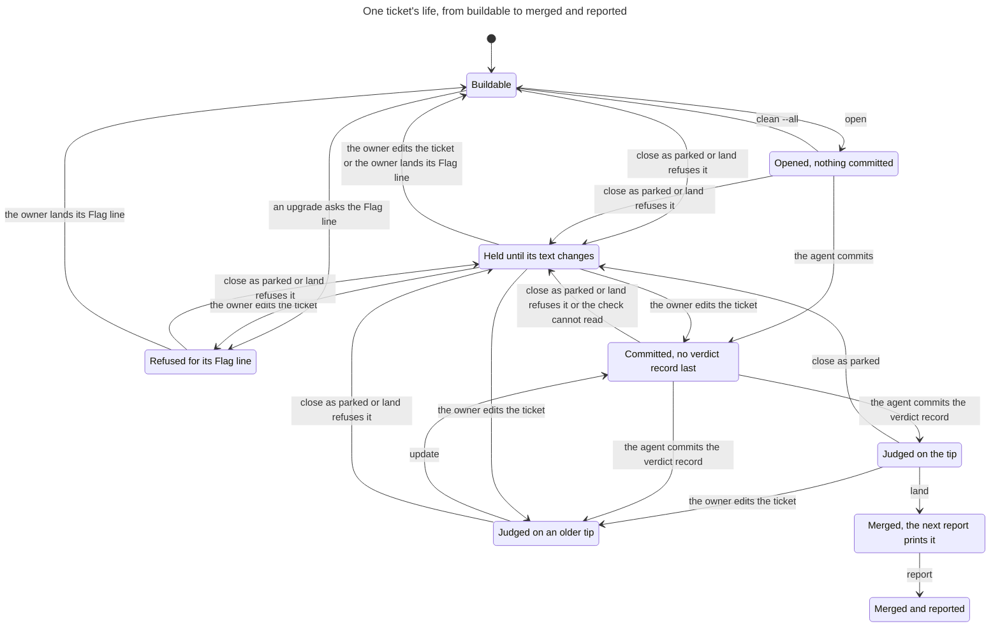

### A role's commit on the branch

Drawn from `DrainTicketLife.tla`, where TLC reached 422 states and 4,091 steps: 7 states and 13 arrows. It does not draw the 3,566 steps that stay in one state. This chart is the drain without the guard's gate, the record of what the gate prevents: with the gate the guard refuses every commit of a role on this chart, and the agent's verdict record before the check, so none of these runs is taken and the marks of rule 11b are gone. Without the gate a role commits before the run returns, or in a resume after a check without `--final`, which marks nothing and so stays in one state. The check after the run, or the one `update` runs, finds the branch moved from its start and parks it, and only the owner's edit frees it. A check of a branch no role committed on passes its start, and only then does `land` merge it. Where the agent records its verdict before the check, it commits on the role's commit, which is where rule 11b breaks; the check parks that branch too. `clean --all`, or a check that cannot read, removes the tree and leaves the start unpassed, and the next check makes the tree again and parks the branch.

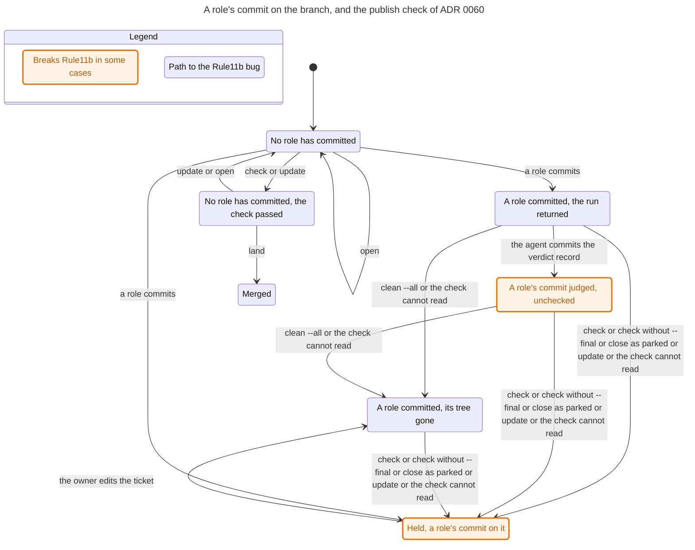

### The upgrade and a ticket with no `Flag:` line

Drawn from `DrainTicketLifeGated.tla`, where TLC reached 203 states and 1,770 steps: 6 states and 14 arrows. It does not draw the 1,594 steps that stay in one state. The upgrade that ships ADR 0061 makes the preflight ask every ticket for its `Flag:` line, before deployment as after. The plan refuses `a`, which has none, and `b` with it, since `b` waits on a ticket the drain cannot merge (rule 7). `open` refuses both (rule 7a). The owner's landing of `a`'s line releases `a`, and `b` waits on it again (rule 7b). Once `a`'s branch holds a commit the preflight does not read it again, so an upgrade after that refuses nothing. With the gate the agent's commit after the check is the one way to that branch, and no rule breaks on this run. Without the gate a role's commit is a second way, and rule 11b breaks there, as the chart before this one shows.

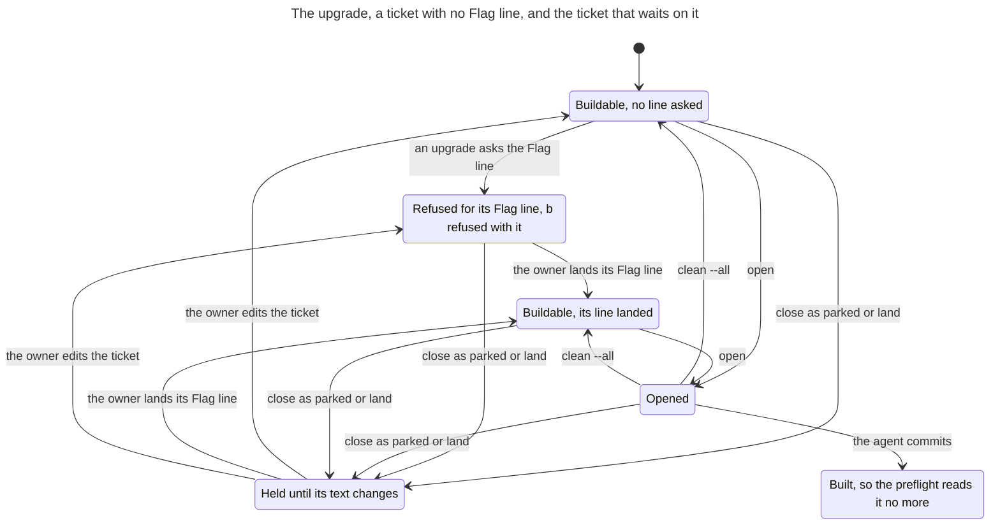

### A kill of `update`

Drawn from `DrainLanding.tla`, where TLC reached 408 states and 4,164 steps: 3 states and 5 arrows. It does not draw the 3,799 steps that stay in one state. A rebase cut off leaves the tree detached, and the next `update`, `land`, `close` or `clean --all` abandons it. A kill after the rebase leaves the old verdict record last, certifying a tree the branch no longer has, and the next `update`, `land` or `close` finishes from there.


### A kill of `land` after `merge.py`

Drawn from `DrainLanding.tla`: 4 states and 8 arrows. It does not draw the 3,301 steps that stay in one state. Wherever `land` is cut off after the merge, a later command records the merge once and removes the tree.

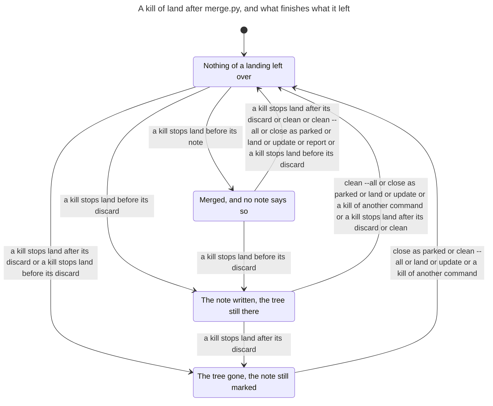

### A kill of `merge.py`

Drawn from `DrainLanding.tla`: 3 states and 6 arrows. It does not draw the 3,541 steps that stay in one state. A kill before the fast-forward leaves the scratch work tree, and one in the middle of it leaves the default branch's work tree part-written. Every command, and every kill of another command, puts it back first.

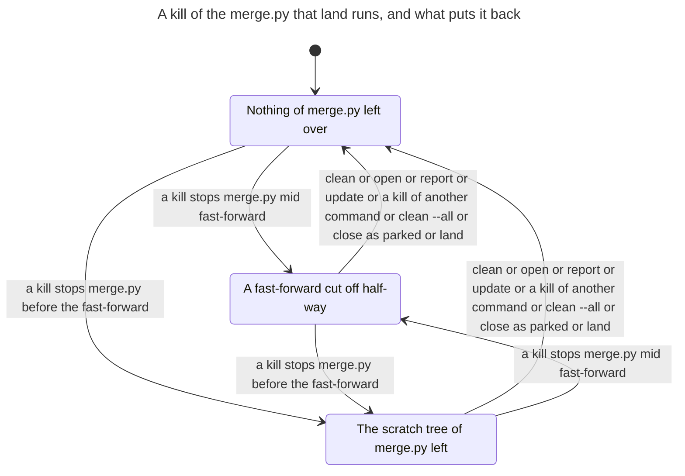

### Uncommitted work in a ticket's tree

Drawn from `DrainWork.tla`, where TLC reached 270 states and 2,643 steps: 5 states and 15 arrows. It does not draw the 1,917 steps that stay in one state. Uncommitted work behind a stale lock is where rule 10 breaks: `clean --all` cannot stash it, so it leaves the tree with the work in it. The owner removes the lock, and the next `clean --all` or `close` keeps the work as a stash.

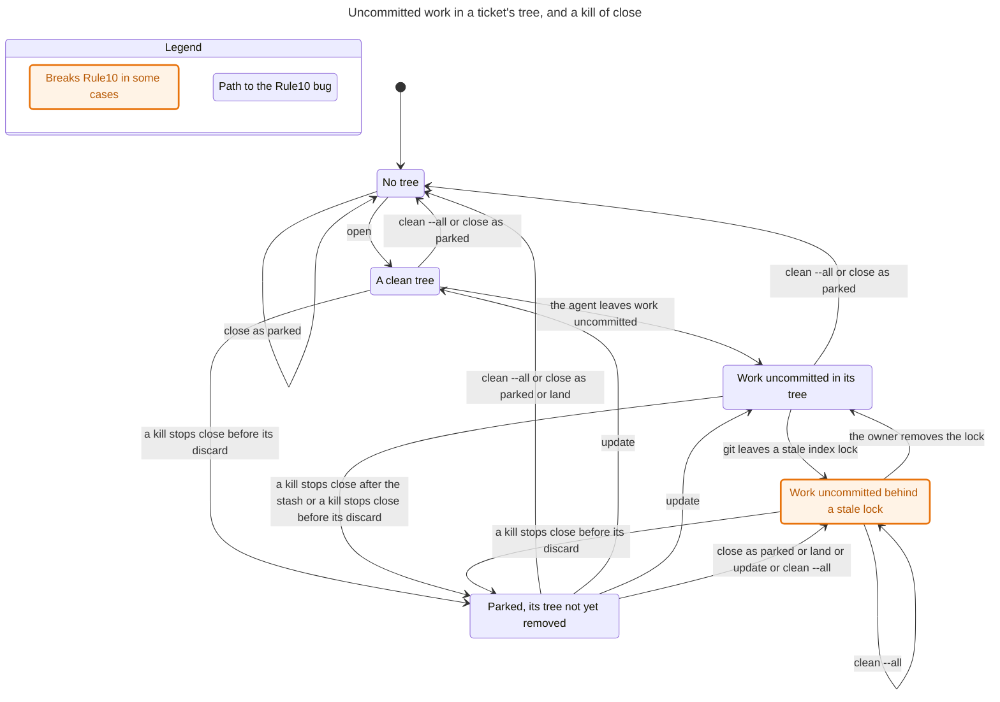

### The lease

Drawn from `DrainLeaseShown.tla`, where TLC reached 241 states and 4,970 steps: 9 states and 18 arrows. It does not draw the 3,688 steps that stay in one state. The two drains are alike, so a step is named by its drain's part: the lease's holder, or the other drain. In sessions of their own, the other drain takes the lease from a holder that is gone, and from one that has stopped only with `--take-over`. Under one process it takes it from one that has stopped, and its report ends the lease of a holder still draining, which is where rule 9d breaks. The holder's report without its token keeps the lease while a program runs from its tree.

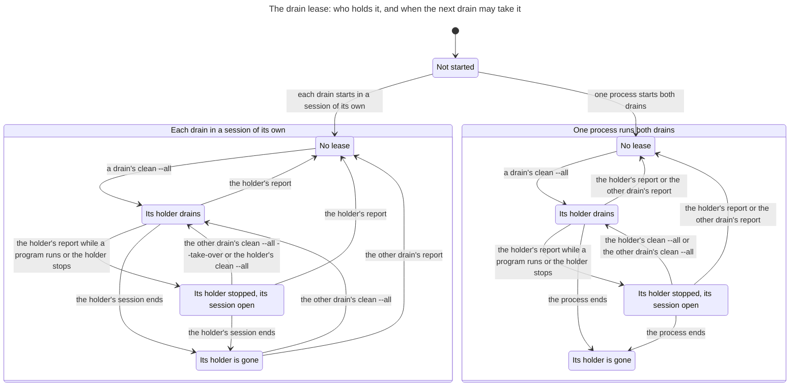

### A landing in flight

Drawn from `DrainLeaseShown.tla`: 7 states and 11 arrows. It does not draw the 4,146 steps that stay in one state. While `merge.py` runs, `land` holds no drain lock, so every other command can run, before the merge lands and after. `land` holds the lock on its own ticket (`ratchet-landing-` and a hash of the branch) from before its checks until it ends, and a `merge.py` past its probe holds its merge lock (`ratchet-merge-lock-` and the same hash) until it ends. By these two locks no other command records the merge or removes the tree while the landing is alive, even once its `land` is killed alone. `report`, `clean` and `clean --all` leave the ticket alone. `update`, `close` and a second `land` are refused and change nothing, so they stay in one state and the chart does not draw them. The landing's own close records the merge. After a kill a report, `clean`, `clean --all`, `update` or `close` records it, and after a kill before the merge the ticket is not landed. A `merge.py` whose `land` was killed before its probe lands nothing, so this chart draws it as not landed; the next chart draws it.

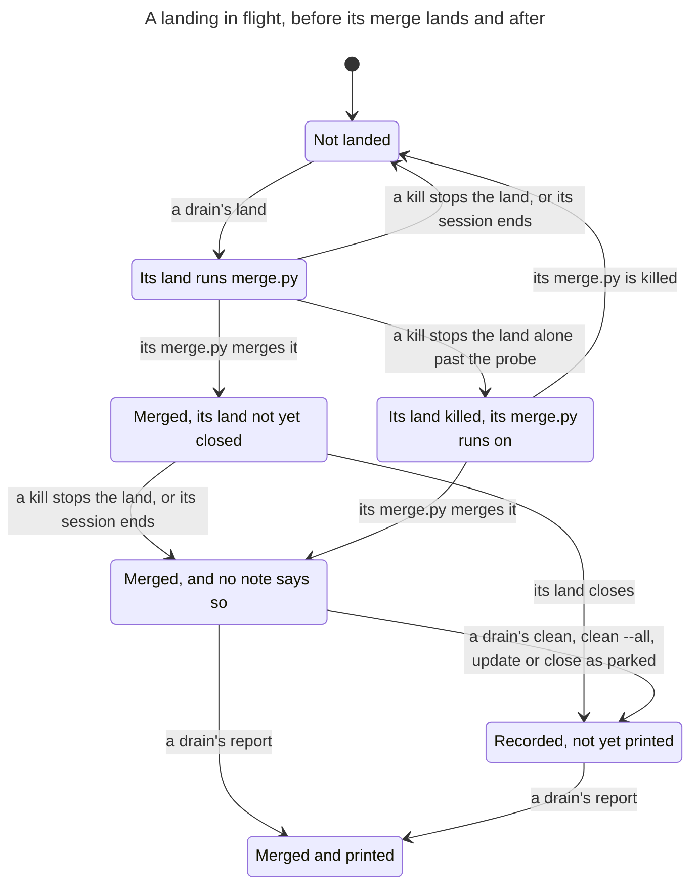

### A `land` killed alone

Drawn from `DrainLeaseShown.tla`: 6 states and 15 arrows. It does not draw the 4,594 steps that stay in one state. A kill of `land` alone before its `merge.py` probes it holds no lock, so every command acts as with no landing; the `merge.py` then finds the private lock free and stops. A second `land` in that instant runs a merge of its own, which lands under it, or meets the merge lock of the first `merge.py` past its tries, so that both stop and the second `land` closes nothing. A kill of `land` alone past the probe leaves the merge lock held until its `merge.py` lands the merge or is killed. If that was the second `land`, the first `merge.py` may still be starting, so a kill of the second one's `merge.py` goes back to the first kill. Once the ticket is merged, the chart before this one goes on.

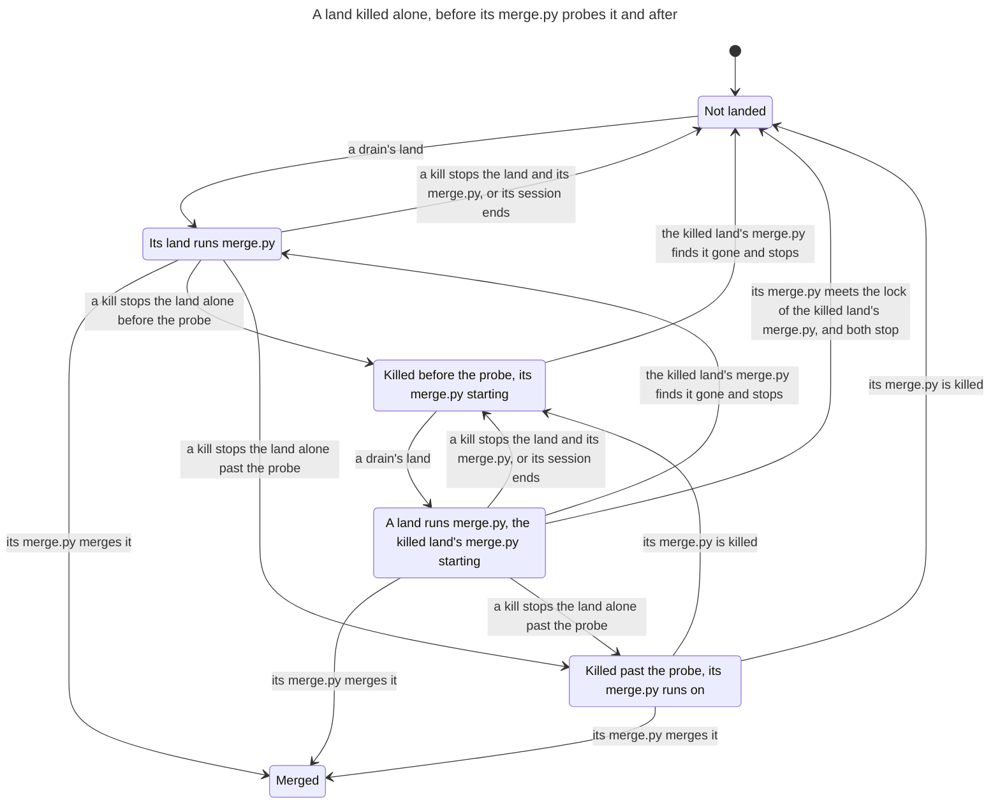

### Where two drains break a rule

Drawn from `DrainLease.tla`, where the tool draws only the shortest run to each rule that breaks: 13 states and 14 arrows. The states say how the drains run, who holds the lease, and where drain 1's tree and landing are. The steps have the model's own names, as the tests give the runs, with a comma after the drain for the colon.

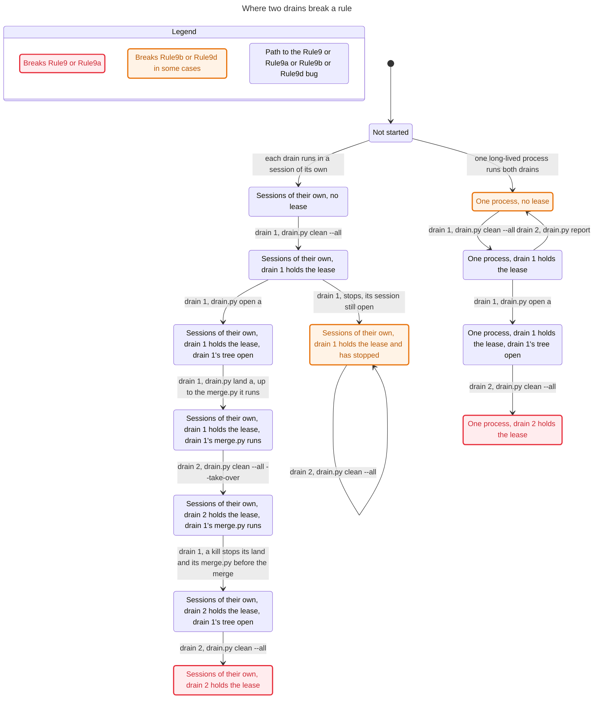

### A unit two tickets share

Drawn from `DrainExpiryShown.tla`, where TLC reached 5 states and 61 steps: 5 states and 6 arrows. It does not draw the 44 steps that stay in one state: the commits, the verdict records, the squash by hand, and an update or an `expire` that deletes nothing. Neither ticket's `expire` deletes the unit while the other is open. Once one has landed, the other's `expire` deletes it: on a branch built after the landing, or by the `update` that brings an older branch up to the landing. An `## Answers` line the owner lands after the branch was built is not on it, and the next `update` takes the edit, runs `expire` again and carries the line. The branch that deleted the unit lands it gone, with every line in the brief. With every keep no arrow breaks a rule here; rule 12d's run, the owner's squash by hand, stays in one state.

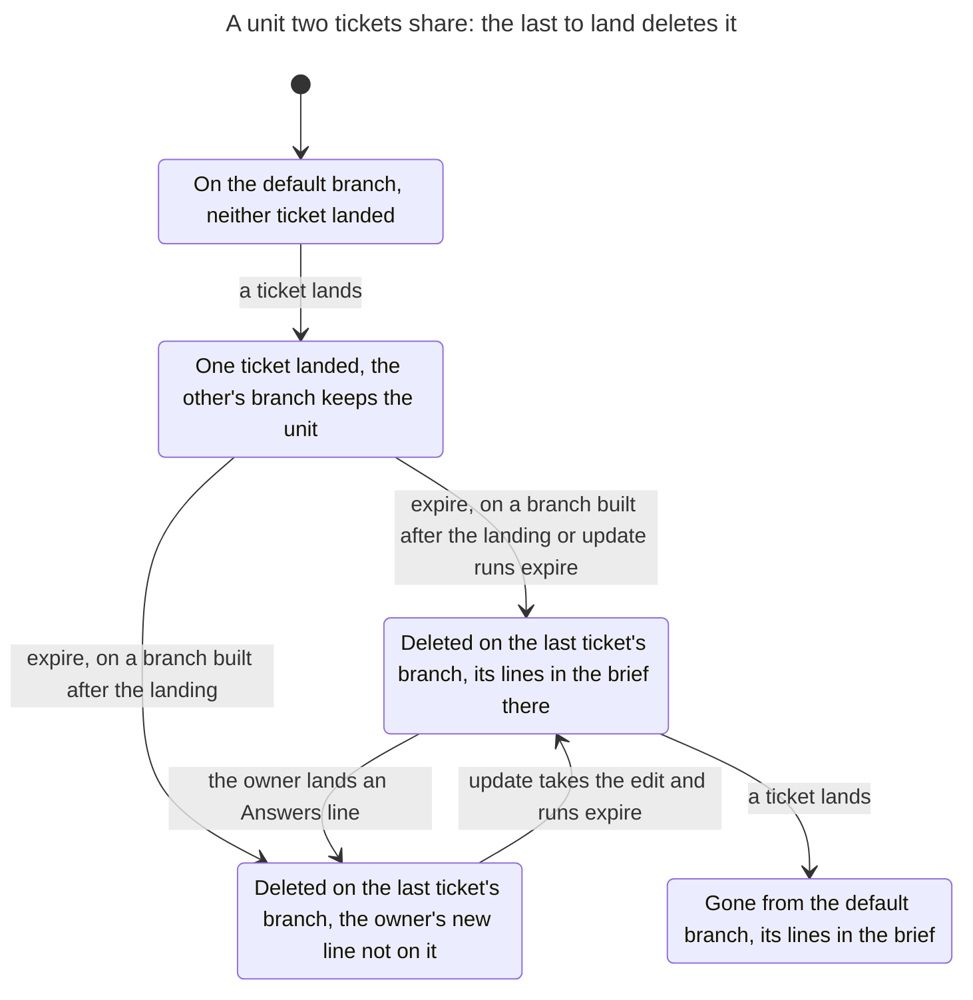

## Left out

- Forge mode. With a remote `land` is not used: the skill opens a pull request and the forge's merge job merges it. So a role's push and a role's pull request are left out too: the role's step here is a commit on the local branch, while ADR 0060's check also compares the remote branch and the open pull request. On the expiry graph `land` stands for the forge's merge job too, which asks the same judge.
- A move of the branch in a queue work tree that is not a `commit`, `am`, `cherry-pick` or `revert`, which the guard gates: a `merge`, `reset`, `update-ref` or `pull`. The role's step here is a commit, so with the gate no role moves the branch, and the publish check is left to find such a move.
- Which role commits, and more than one commit by roles in a run. The publish check runs once per run, not once per role, so one commit stands for any number.
- A ticket an older drain opened, whose note holds no `start`. `land` refuses it, and `check` changes nothing; the way out is `close --outcome waits`, and the next drain's `open` records a start.
- A run that errors and its resume, as steps of their own. The model has the check the skill runs between them, without `--final`, and a role's commit after that check stands for the resume, a step only without the gate: with it the guard refuses that commit. A check of a start a check already passed, which the skill never runs, as [above](#what-the-next-script-change-must-do) says.
- A check of a ticket its note holds, which no run reaches, and the way a rebase is left unfinished: here the check finds one after a rebase that did not conflict.
- More than two drains on the lease graph, and more than one ticket's work tree there.
- More than three tickets besides the parts, a cap above one, a ticket whose run errors, a conflict on rebase or merge, and a red `check`. The judge gives two reasons here: `behind`, which the drain resolves itself, and a verdict record that is not last, which it does not. Its other reasons act as the second.
- A split of `b` or `c`, of a ticket with commits of its own, into more than two parts, or refused and parked as too large; a part split again, which `split.py` refuses; and the parts' other steps: `update`, `close`, the owner's edit and the kills.
- An owner's edit of a split ticket, and a command on it. The edit of an open split ticket frees its hold, and the drain then builds it whole again: `queue_notes.split_into` reads an open ticket's parts only while the note's digest is its text, and a closed ticket's parts whatever its text. A split note with no parts is refused as malformed.
- The instant a local split's parts are written and not yet committed. The checkout then holds work uncommitted, and the plan starts nothing, `not started, the checkout is not fit`. Nothing in the feature skill commits them.
- A forge, where the parts are issues, committing them moves no tip, and closing the split ticket leaves its text, so its note's digest still matches.
- A kill at a point the model does not cut: in `open`, `report` or `clean`, and in `close` after its discard, which leaves what the whole `close` leaves but for the mark that only a retry reads. A kill in `merge.py` before its fast-forward, in the merge or in `check`, leaves its scratch work tree and nothing else, so the model takes one kill there.
- A command refused while a git command still runs in the default branch's work tree, where the cut-off fast-forward left its files, so they cannot be put back yet. The command exits 2, reads no ticket and writes no note. It still sweeps the scratch work tree a killed `merge.py` left. `hooks/tests/test_drain_safety.py` tests it (`test_a_command_is_refused_while_a_cut_off_fast_forward_cannot_be_put_back`).
- The lines ``clean: a landing of `<branch>` is running in another command, so it is left alone`` and ``clean: a merge of `<branch>` is running in another command, so it is left alone``, which `clean` prints for a live landing whose tree is gone. A landing on the lease graph always has its tree.
- A `clean --all` that meets a live landing whose earlier close was cut off before its discard. The lease graph has no mark of a discard under way, and the main graph has one drain. `test_clean_all_under_a_live_landing_keeps_the_tree_and_mark_a_killed_close_left` replays it.
- An `update` while the merge runs on a default branch that has moved. On the lease graph only the merge moves the default branch. `test_an_update_while_the_merge_runs_is_refused_and_the_landing_waits_as_behind` replays it.
- `close --outcome waits` and `close --outcome merged` while a landing runs. The lease graph has only `close --outcome parked` there. `hooks/tests/test_drain_safety.py` tests all three outcomes with the landing's lock held (`test_a_close_is_refused_while_a_landing_of_the_ticket_holds_its_lock`).
- The other ways a command refuses or stops: `update` on uncommitted changes, a tree over the cap, a pushed branch or a rebase git cannot abort; `land` when the merge entry point exits with neither 0 nor 1 for a reason other than the merge lock, where it closes nothing and says to run it again; `close --outcome merged` typed by hand on a branch that is not merged; the 30 seconds a command waits for the drain's lock before it is refused.
- The instant a `merge.py` whose `land` was killed before its probe holds the merge lock and has not yet stopped. The graph folds taking the lock, the probe and the stop into one step. In that instant a command is refused once with the merge-only line, and a second `land` once, as ADR 0058 accepts. The graph keeps its effect on a second `land`'s `merge.py`, which can meet that lock past its tries; `test_a_merge_that_meets_a_held_merge_lock_stops_and_its_land_closes_nothing` in `hooks/tests/test_drain_safety.py` tests a merge that meets it.
- The instant between the fast-forward of a `merge.py` past its probe and its exit, when the merge has landed and the merge lock is still held. The graph lands the merge and ends that `merge.py` in one step. There `report` prints ``report: a merge of `<branch>` is running in another command, so it is left alone``; `test_a_report_says_a_merge_whose_land_was_killed_alone_is_left_alone` in `hooks/tests/test_drain_safety.py` tests the line.
- A `clean` that removes a `land`'s private lock file between `land` creating it and locking it. The `merge.py` then finds the file gone and stops, having merged nothing, and `land` closes nothing and says to run it again. ADR 0058 accepts it. Nothing wrong lands.
- A session's end and a `merge.py` whose `land` was killed alone. The model takes that `merge.py` to outlive the session, as a process the session did not wait on can. A session's end that also ends it is the kill of `land` and its `merge.py` together.
- An owner's own run of the merge entry point on a ticket's branch, as a step of either graph. It holds the merge lock, so the drain sees it as a merge running; `test_an_owners_hand_merge_is_seen_as_a_merge_running_and_one_merge_lands` replays it.
- Two probes at one instant. A probe takes a lock exclusively for an instant. `update`, `close`, `split`, `report` and `clean` probe under the drain's lock, and `land`'s first probe does not, so `land`'s can meet one of theirs. Then that command reads a landing and refuses once with exit 3, or leaves the ticket alone once, or `land` reads a merge and refuses once with exit 2. It fails closed, and the next `plan` goes on.
- `split`, as a step of the lease graph. `test_a_split_while_the_merge_runs_is_refused_and_files_no_part` replays it while a landing runs, and `test_a_split_is_refused_while_a_landing_holds_its_lock_and_files_nothing` in `hooks/tests/test_drain_safety.py` tests it with the landing's lock held.
- The processes `discard` ends when they run from a tree it removes.
- A `merge.py` killed after it took its scratch lock and before it made the work tree, and one killed after the fast-forward and before it exits.
- A hold that ends because its cause landed: a path the run named, or a safeguard or review it owed. In the model only the owner's edit frees a held ticket.
- How a process is known to be alive. The scripts read `/proc`; where it is missing no other drain is seen.
- Whether the sweep of an empty merge scratch directory leaves what the model says. The replays do not compare it.
- A second drain between `settle`'s note and its discard. `settle` runs whole under the drain's lock, so no other drain's command runs there.
- `merge.py --records`, which lands the owner's records with no ticket and takes no merge lock.
- What the plan reads besides the tickets: the preflight but a missing `Flag:` line, a checkout not fit to build on, the agents a drain may start, and the report's text.
- A `Flag:` line on a ticket's spec, a split's parts, and a ticket on a forge's tracker. Here the owner lands the line on the ticket itself, so the landing changes its text and frees a hold. A line landed on the spec frees no hold of the ticket's.
- The merge judge's reasons of ADR 0061: `unflagged` on new surface before deployment, the key a yes names, and the full closure, under which a change that adds surface under the owner's no waits for the owner while an open labelled ticket reads a yes. The model abstracts the judge, as the record says. To the drain each is a reason it does not resolve itself, so `land` holds the ticket, and only the owner's edit frees it here.
- A project that has declared `deployed`, where the preflight asks the `Flag:` line already, before the upgrade.

On the expiry graph:

- What the route owns of ADR 0064: a unit already expired at the merge base, which no change deletes and the route names a records change for; the records check that lets a change delete a file `expire` lists; the owner's agreement on a labelled ticket and its spec; the change description as a marked commit; the kinds, `conformance` and the prune pass.
- A third ticket of the unit, and an open ticket elsewhere that names a file of the unit as its parent or blocker. A unit here expires when both its tickets are resolved.
- The split, and the owner's close of the split ticket. A split ticket stays open until the owner closes it, so its unit expires only then, whichever part lands last; no command of the drain closes it.
- An `## Answers` line on a ticket's own spec. `expire` carries it to the brief when it deletes the spec, so two tickets built on one tip would each append a line to `## In the owner's words`. The second to land would meet a conflict in the brief on its update, which is no file of a unit, so Reconcile would get it as ADR 0064 says. Here only the unit's files hold a line, and only the change that deletes the unit appends to the brief.
- A conflict outside the unit, a rebase Reconcile finishes, and a hand merge or a forge's merge that runs no judge.
- More than one records edit by the owner, a records edit that closes a ticket of the unit, and one after the unit is gone.
- The cap, the trees, the holds the main graph reads, the publish check and its start, and the kills but the one of `land` before its note.

The real scripts agree with the model on the runs above, the kills, the random runs and the lease walks. They are not compared on every step of the main graph or the lease graph, and on no step of the expiry graph.

## What the next script change must do

The publish check of ADR 0060 is on the main graph, and `drain.py` runs `scripts/publish_check.py` as the model says:

- **The start.** `open` writes `publish_check.start_of(tree, branch, gh)` into the note as `start`, and prints it in its JSON, with `forge: null` where there is no forge. It writes no `passed`. `open` makes the branch at the default tip again, so it never keeps a start a run left.
- **`check <ticket>`.** It runs under the drain lock, and is refused like `update` while a landing runs. A branch with commits of its own and no work tree gets one under the cap, as `update` makes one: a session that dies after its run leaves the branch, and the next drain's `clean --all` removes the tree. Then it runs `publish_check.check` in the tree against the note's start. Green prints the check's green line, marks the start `passed` only when given `--final`, and exits 0. Without `--final` it judges and parks exactly the same and writes no mark. A branch that moved closes the ticket as parked with the reason `a role published: <the line of each move>`, its work stashed as `<branch>: blocked run`, held until the ticket's text changes and never retried, and exits 1. Only a rebase left unfinished closes it as waiting with the conflict close's reason, marks the start `passed` when given `--final`, since that check read that nothing moved, and exits 3. A present state it cannot read closes it as waiting with the check's line, with no mark, and exits 3. That line must start with a code in `queue_notes.MECHANICAL`, or the close holds the ticket in place of retrying it. `check` writes `refs: ` before the line. With no `start` in the note it says why, changes nothing and exits 2. Where the note still holds `update`'s mark of the tip before its rebase and the branch is not at that tip (`drain.cut_off`), it prints ``check: <ticket> is not checked: its update was cut off after it moved the branch; run `update` again``, changes nothing and exits 3, before it makes or reads a tree.
- **`update`.** On a branch with commits of its own whose start is not passed, once it has a tree and before it rebases, it runs the check as `check` does, and parks a branch that moved. On green it marks the start `passed` before the rebase begins. A rebase that moves the branch, and one that finishes what a killed `update` left, then record the new head as the start, with no mark; after a conflict the start is `start_of(..., rebase_onto=base)`. An `update` that does not move the branch records no new start. Its own check still runs first on a branch that has a tree, commits of its own and a start not passed, and marks the start or parks the branch; a current branch with no tree is answered before any check. When its check cannot read the present state, `update` is refused with exit 3 and closes nothing.
- **`land`.** After it refuses a held ticket and before `merge.py`, it refuses a start not passed, and a note with no start, with exit 3 and "run `drain.py check <ticket> --final` first". The skill passes `--final` only on its last check, before its commit; a check after a run that errored, before a resume, runs without it.

The feature skill runs `check` after every run returns, before any close or commit, and its exit decides.

The model showed five of these, each by a rule that broke on a draft of it:

- `update` checks only a branch with commits of its own. A check of a branch with none marked its start, and a kill of `update` mid-rebase then left that mark on a branch whose tree `clean --all` removes, where neither the whole `update` nor none of it leaves one. Rule 8 broke by `drain.py open a`; `the owner edits ticket a`; `a kill mid-rebase stops drain.py update a`. A branch with no commit of its own holds none a role made, and its rebase records a new start.
- `update` marks the start `passed` before the rebase begins. Without the mark a run killed after the rebase leaves the branch rewritten under the old start, and the next `update` checks it and reads the rebase as a role's move.
- `update` is refused when its check cannot read. When it closed the ticket as waiting, as `check` does, it ended the hold of a parked ticket with no edit, and rule 6 broke by `drain.py open a`; `the agent commits a`; `drain.py check a`; `the owner edits ticket c`; `the check of drain.py update cannot read the present state of a`.
- `check` makes a tree only for a branch with commits of its own. When it made one for a branch with none, it opened a ticket the plan refuses, and rule 7a broke by `drain.py open a`; `drain.py check cannot read the present state of a`; `an upgrade makes the preflight ask the Flag: line before deployment`; `drain.py check a`. A branch with no commit and no tree is buildable, and `open` records a new start.
- The check after a run that errored must not mark the start. The skill runs it before a resume, and a role can commit in the resume. With a role free to commit after a check passed, rule 11a broke in 5 steps, the agent committing only after a check: `drain.py open a`; `drain.py check a`; `a role of the pipeline run commits in a`; `the agent commits the verdict record of a`; `drain.py land a`. The skill's check after the resume reads the role's commit, but a session that dies first leaves the mark for `land`. The model holds no resume, so the change says how: `check` marks only on `--final`, a flag that says the run is over. A check that leaves the flag out marks nothing, and `land` then refuses and names the check. The model now holds the check without the flag, and on that run `land` refuses: `test_land_refuses_a_branch_a_role_committed_on_in_the_resume_after_a_check_without_final` replays it on a real repository, with the check without the flag in its second step. Rule 11a holds on every step of the main graph with that check in it. The role's commit in the third step and the agent's verdict record in the fourth follow no check with `--final`, so the guard refuses both; without the gate rule 11b breaks there as on its pinned run. Nor may a check of a start already passed be skipped: it is what reads a resume's commit. The skill never runs one after its own commits.

These tests were expected failures until the change, and now pass:

- `test_land_refuses_a_branch_a_role_committed_on_whose_start_no_check_passed`: rule 11b's run, then `land`, which refuses;
- `test_check_records_the_start_and_marks_it_passed_in_the_note`: `open` prints the start and writes it in the note, and `check --final` marks it;
- `test_a_check_after_a_run_that_died_makes_the_tree_and_parks_a_branch_a_role_committed_on`: `check` after `clean --all`;
- `test_update_checks_a_start_no_check_passed_and_parks_a_branch_a_role_committed_on`: `update`'s own check;
- `test_a_check_that_cannot_read_leaves_the_start_unpassed_and_the_retrys_update_checks_it`: the close is retried, and its retry's `update` checks;
- `test_update_is_refused_when_its_check_cannot_read_the_present_state`.

`drain_world.py` runs the real `check --final`, or `check` with no flag for the model's check without it, and reads `start` and `passed` back from the note. A check that cannot read takes one step of the model, since the code reads no flag there; the world runs it with `--final`, and `test_a_check_that_cannot_read_marks_nothing_with_the_flag_or_without_it` runs it without. So the check's own verdicts are held to the model by `test_a_check_without_final_parks_a_branch_that_moved_as_the_last_check_does`, `test_a_check_without_final_that_finds_only_an_unfinished_rebase_leaves_the_start_unpassed`, `test_the_check_parks_a_branch_a_role_committed_on_and_holds_it_until_its_text_changes`, `test_a_moved_update_records_a_new_start_and_its_rejudge_lands_once_checked_again`, `test_a_check_that_finds_only_an_unfinished_rebase_passes_the_start_and_the_ticket_waits` and `test_a_check_after_an_update_killed_past_the_rebase_of_a_bare_branch_says_to_run_update_again`, and by every replay whose run takes `drain.py check`. The random runs take every step of the model.

Rules 7a and 7b hold on the code as it is: `drain.py` already refuses to open a ticket the preflight refuses, and lifts the refusal of a ticket that waits on one once that one is buildable again. What they need of the preflight, which the model reads only as a refusal, it now does: it asks a ticket of an asked type for its `Flag:` line before deployment as after (ADR 0061). The scripts under test ship it already, so the tests' upgrade step commits a binding that declares a type the catalogue asks the line of, as the route's world does, and the real preflight refuses `a`.

## What the script change of ADR 0064 must do

No script does the expiry graph's steps yet: `documents.py` is not written, and `drain.py` and `merge.py` do not run it. So no real repository takes them, and the comparisons above leave the expiry graph out. The tests prove its rules on the model alone. The change must keep each rule the model holds:

- **`documents.py expire`.** It deletes the feature's spec, and a unit every ticket of which is resolved at the head, in a commit of its own, and appends to the brief each `## Answers` line of what it deletes that the brief does not hold yet (`ONCE`). The lines are dated, so it compares a line without its date. Run again, it changes nothing.
- **`drain.py update`.** Once its rebase is done it runs `expire` (`UPDATE_EXPIRE`). On a modify/delete conflict whose every path is in a unit `expire` lists, it takes the incoming file, runs `expire` and goes on (`RESOLVE`, `CARRY`). Any other conflict stops as now, for Reconcile. Its own commits come before the start it records (ADR 0060), or the next check finds the branch moved from its start and parks it as a role's commit; the expiry graph holds no start, so it does not show this.
- **A judge-again run.** It reads the spec from the parent of the newest commit on the branch that deleted it (`HISTORY`).
- **`drain.py land`, and every command that takes a ticket.** It finds a ticket its own landing deleted by the note written when it opened (`NOTE`). Today `land` run again after a kill past the merge prints `drain: <ref>: no such ticket` and exits 2.
- **The judge.** It refuses a change that leaves a unit not expired at the merge base and expired at the head, and `ratchet-lowered` one that deletes a ticket or spec and drops one of its lines from the brief (`JUDGE`).

The change carries each run of [the turn of ADR 0064](#the-turn-of-adr-0064) as a replay on a real repository: the runs each keep keeps, the runs of ADR 0064's tests, and the squash by hand.

## Changing the drain

Change the model first, then the code, then the page.

1. Change `hooks/tests/drain_model.py` so it says what the code should do. `hooks/tests/test_drain_model.py` says whether each rule still holds or breaks on its pinned run, and each pin changes only when the change says why.
2. Change `scripts/drain.py` or `scripts/merge.py`. The replays and the random runs say where the code does something else.
3. Draw the page again. The page test is red until the page names the SHA-256 of each current export.

To draw it again, from the `hooks` directory write the exports to a directory outside the checkout:

```sh
mkdir -p /tmp/drain-model && python3 -c 'import sys; from pathlib import Path; from tests import drain_model
for e in drain_model.exports():
    Path(sys.argv[1], e.name + ".tla").write_text(e.module)
    Path(sys.argv[1], e.name + ".cfg").write_text(e.config)' /tmp/drain-model
```

Then, as [the models' README](README.md#drawing-the-charts-again) says, run the `statechart` command once on each of `DrainLanding.tla`, `DrainWork.tla`, `DrainTicketLifeGated.tla`, `DrainTicketLife.tla`, `DrainLease.tla` and `DrainExpiry.tla` with no view for the rules, run TLC directly with only the rules that hold for the counts, and once for each rule that breaks with one worker. Draw each chart from its module and view in `docs/model/drain/`, as the chart's heading says. Put each `chart.mmd` in its block, the counts beside it, and each SHA-256 on the line that names it.
