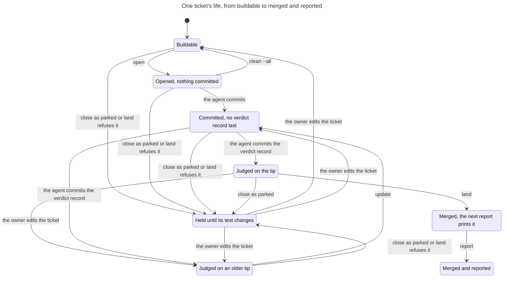
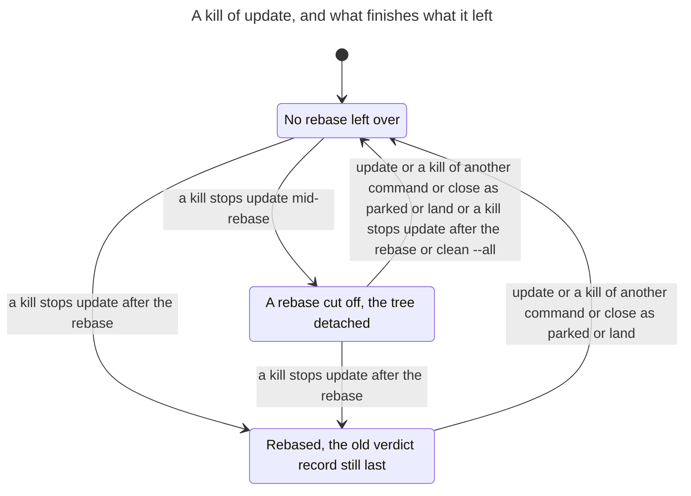
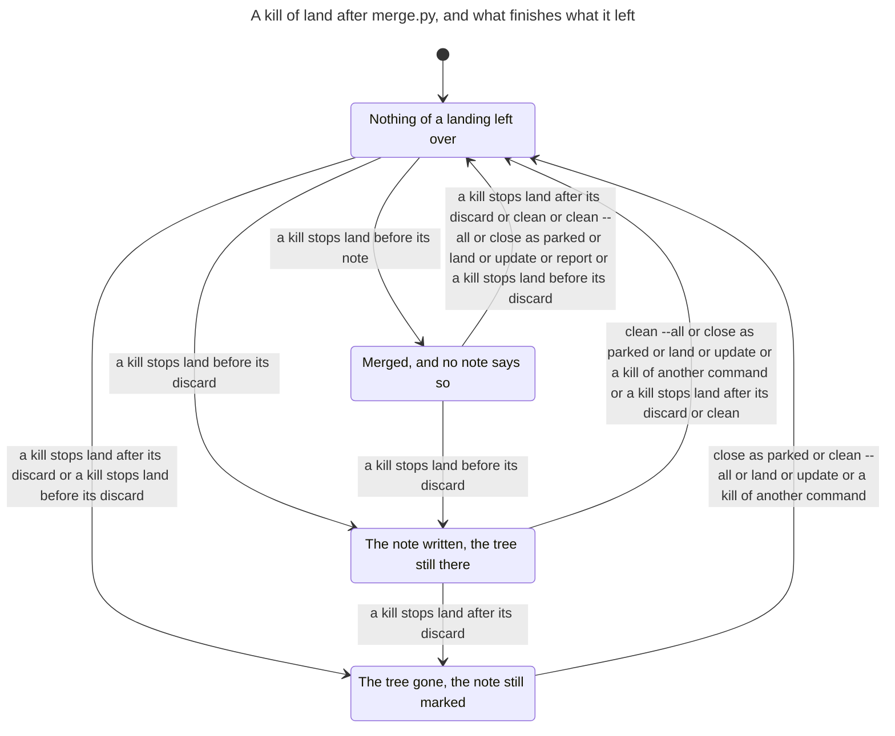
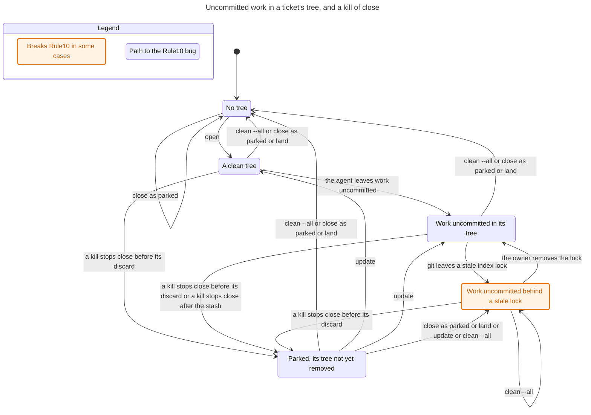
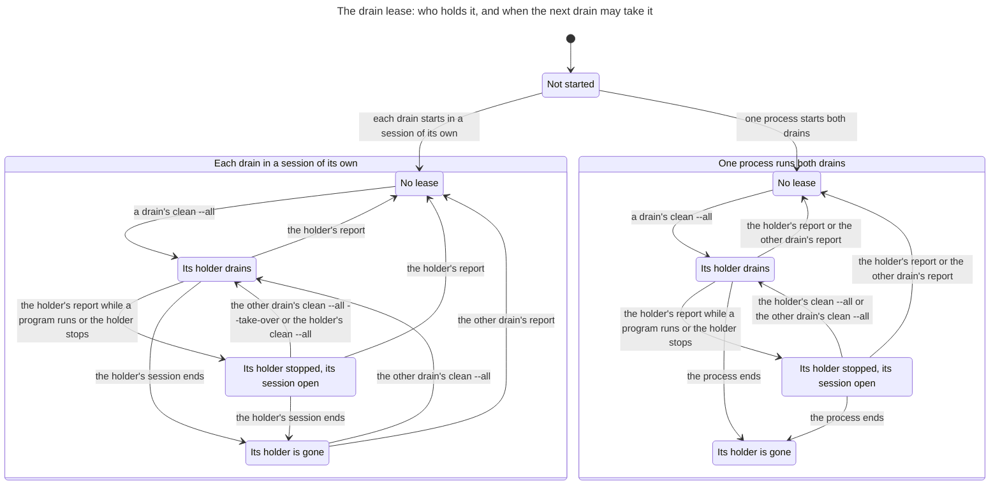
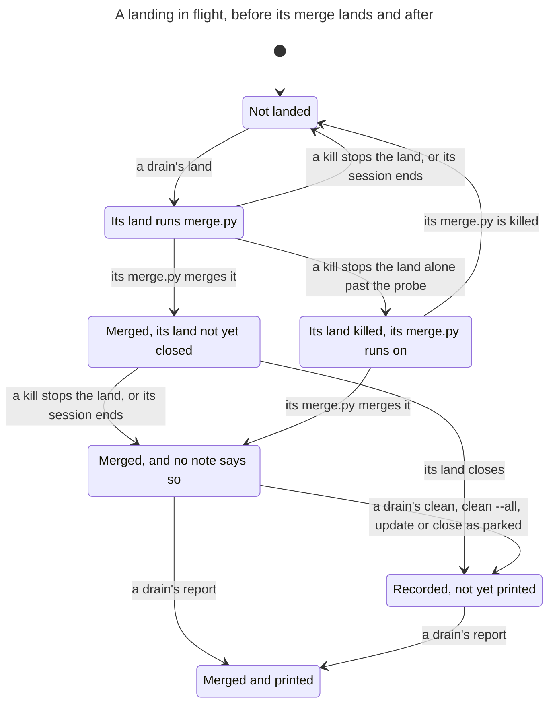
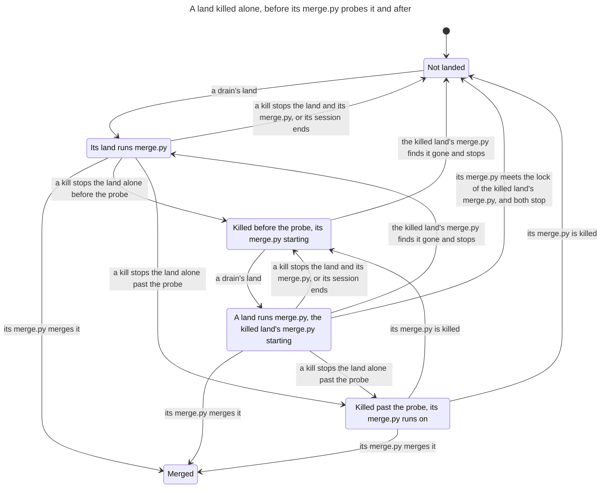
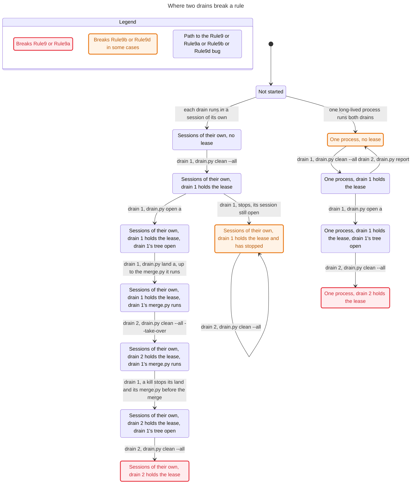

# The queue drain and its merge

`scripts/drain.py` drains the queue: `/ratchet:feature` with no ticket builds every agent-ready ticket, each in a work tree of its own, and merges them one at a time (ADR 0023). The script decides what needs no judgement and keeps what must outlive a session. `plan` says what each ticket is, `open` makes a ticket's work tree and branch only when the plan starts it, `update` rebases a built branch onto the default branch, `land` runs the merge with no forge and closes the ticket with what the judge printed, `close` removes a work tree and writes the ticket's note, `clean` removes leftover work trees, and `report` prints what merged, what waits and what is parked. `scripts/merge.py` is the merge `land` runs: it merges the branch in a scratch work tree, asks the judge and runs `check` on the result, and moves the default branch forward only when both are green.

The drain promises that an interrupted drain loses no work and repeats nothing (ADR 0023). Each command finishes from what git holds when it is run again: `update` abandons a rebase it left and starts over, `land` records a merge that landed, `clean` records the merge of a branch whose note does not yet say it, and every command first puts back what a killed `merge.py` left. One drain runs on a repository at a time: `clean --all` takes a lease and is refused while another drain is alive, and the report ends it. This page writes the drain down as a state machine, and says which of these promises the code keeps.

The model is `hooks/tests/drain_model.py`. The tests in `hooks/tests/test_drain_model.py` check each rule on every step the model reaches. They also take the model's steps on real repositories, where the real `drain.py` and `merge.py` must leave what the model says (`hooks/tests/drain_world.py`).

## Scope

The model has two graphs.

The main graph is one drain on one repository with no forge:

- three tickets, `a`, `b` and `c`, where `b` is blocked by `a`, under a cap of one;
- the drain's commands in any order, what the agent does in a work tree, what the owner does, and a stale index lock git leaves;
- a kill of `update`, `close`, `land` or the `merge.py` it runs between two of their effects;
- each ticket playing one part. The agent commits only in `a`, whose branch goes the whole way to merged, and leaves work uncommitted only in `c`, the ticket the cap holds back. `b`, which waits on `a`, is only opened. A kill stops `update` and `land` only in `a`, and `close` only in `c`;
- the owner edits a ticket at most once, the agent leaves work uncommitted once, and the retry count of a ticket left waiting stops at three, past which nothing reads it;
- a judge that passes a branch only when its verdict record is its last commit and the branch holds the default tip; a `check` that is always green; and tickets no two of which change the same file, so nothing conflicts.

The lease graph is two drains on one repository and one ticket's work tree. Its first step says how the drains run: each in a session of its own, or both under one long-lived process. Then each drain takes the lease, opens the ticket, leaves a draft or starts a program in its tree, lands the ticket, reports, cleans, stops or dies, in any order. `land` is three steps: up to the `merge.py` it runs, the merge `merge.py` lands, and the close after it. `land` holds the drain's lock for its checks and again for its close, and not while `merge.py` runs, so every other command can run in between.

A landing is seen by three locks of the kernel's, each freed when its holder dies. `land` holds the ticket's landing lock all the way through. It also holds a private lock, in a file of a fresh name it passes to `merge.py` in `RATCHET_LANDING`. `merge.py` holds a merge lock of its own on the branch from its start to its end, and once it holds it, it probes the private lock: held, its `land` is alive and it goes on; free or gone, its `land` has stopped, and it merges nothing. Every command reads the landing lock and the merge lock. A kill can stop `land` in three places:

- `land` and its `merge.py` together before the merge, as a session's end or a shell's timeout ends both; or `land` alone after the merge and before its close;
- `land` alone before its `merge.py` has probed it. For that instant no lock is held, and every command acts as with no landing. The `merge.py` then finds its `land` gone and stops, having merged nothing;
- `land` alone once its `merge.py` has probed it. The merge lock is held, so every command of either drain sees a merge running. The `merge.py` then lands the merge or ends having landed nothing.

While the landing is alive, either drain's agent can also run `update`, `close --outcome parked` or a second `land` on the ticket. The landing drain's own agent does so when its shell gave up waiting on `land`. A second `land` in the instant before a killed `land`'s `merge.py` probes it starts a merge of its own, so two `merge.py` of one ticket run: the first stops at its probe, and the second lands under its live `land`, or meets the merge lock the first holds past its tries and stops, and its `land` closes nothing.

What it leaves out is listed [at the end](#left-out).

## State

| Part | Values |
| --- | --- |
| Each ticket's work tree | none; clean; uncommitted work; uncommitted work behind a stale index lock; a rebase under way, the tree detached at the default tip |
| Each ticket's branch | none; no commit of its own; commits, the verdict record not last; commits, the verdict record last; commits, the verdict record last and certifying a tree the branch no longer has |
| Whether the branch holds the default tip, and whether it is merged | yes or no |
| Whether the verdict record was written on the tip the branch holds now | yes or no. No file holds it. The model keeps it so that a rule can read it |
| The drain's note on the ticket | none; or opened, merged, or waits or parked. A note can hold the ticket, on the text it was written on, count retries, owe a report, and carry `update`'s mark that a rebase began or `close`'s mark that it has not yet removed the tree |
| The ticket's text, and its stashes | the text the owner wrote first or after an edit; how many stashes hold its uncommitted work |
| What a killed `merge.py` left | its scratch work tree; and the ticket whose fast-forward of the default branch was cut off half-way, its files in the default branch's work tree, one part-written, and its index locked |

The plan reads a ticket as `drain.plan` does: `merged` when its branch is, the ticket still to be marked resolved, `held` when its note holds it on the text it has now, `built` when its branch holds a commit the default branch does not, `building` when it has a work tree, `waiting` while its blocker can still merge, `refused` when it cannot, and `buildable` otherwise.

From the start the main graph reaches 12,863 states and 190,251 steps.

| Part of the lease graph | Values |
| --- | --- |
| How the drains run | not yet said; each in a session of its own; or both under one process |
| The lease | none, or held by drain 1 or drain 2 |
| Each drain | its session alive or not; draining or stopped; whether it holds its token, which `clean --all` prints on stderr and a later command passes back as `--drain` |
| The ticket's work tree | none, or opened by drain 1 or drain 2; a draft in it; a program running from it; a draft kept as a stash |
| A landing | none, or the drain whose `land` is past its checks and has not yet closed, with its merge landed or not yet. It is alive while `land` holds the lock on its ticket, which it takes before its checks |
| A `merge.py` whose `land` was killed past its probe | none, or the drain whose `land` it was. It holds the merge lock until it lands the merge or ends |
| A `merge.py` whose `land` was killed before its probe | none, or one still starting. It holds no lock, and it can only stop |
| The merge | not merged; merged and no note says so; a note no report has printed says so; printed |
| Whether the ticket's note holds it | yes or no. Only `close --outcome parked` writes a hold, in the instant before a killed `land`'s `merge.py` probes it, where no landing is seen. The tests read the note's hold back after every step |

From the start the lease graph reaches 4,583 states and 60,124 steps.

## Steps

| Step | What it does |
| --- | --- |
| `drain.py open` | makes the ticket's work tree and a branch at the default tip, when the plan starts it |
| the agent commits; the agent commits the verdict record; the agent leaves work uncommitted | in the ticket's tree |
| `drain.py update` | rebases the branch when the default branch has moved, first making the work tree of a built branch that has none, and after the rebase dropping a last commit that is the verdict record. On a landed branch it records the merge and does not rebase |
| `drain.py land` | runs `merge.py`, and closes the ticket as merged, as waiting for a reason the drain resolves itself, or held for the owner |
| `drain.py close --outcome parked` | writes the note that holds the ticket, then removes the tree with its uncommitted work kept as a stash |
| `drain.py clean`, `drain.py clean --all` | removes each tree of a merged branch, or every tree, after recording each merge no note says |
| `drain.py report` | records each merge no note says, then prints each close and merge not yet printed |
| the owner edits the ticket | commits a change to its text on the default branch, which moves the default tip |
| git leaves a stale index lock; the owner removes it | in `c`'s tree |
| a kill | stops `update` mid-rebase or after it; `close` before its discard or after its stash; `land` before its note, before its discard or after it; or the `merge.py` that `land` runs, before its fast-forward or in the middle of it |

Every command first puts back what a killed `merge.py` left, and so does a command that is then killed: it sweeps the scratch work tree and puts back a fast-forward cut off half-way. So no command reads a ticket's text while a cut-off fast-forward holds the merge's.

On the lease graph, each drain can: `clean --all`, with its token, or with `--take-over`; `open a`; let its agent leave a draft or start a program in its tree; `land a` up to the `merge.py` it runs; `report`, with its token or without; `clean`; stop with its session still open; or end its session. Under one process a session's end ends both drains. A program can end. A landing goes on by its own steps: its `merge.py` lands the merge, then `land` closes the ticket. A kill can stop `land` in the three places [above](#scope). A `merge.py` whose `land` was killed past its probe lands the merge, or is killed itself before it lands. One whose `land` was killed before its probe takes the merge lock, finds the private lock free, and stops. That is one step here: the instant it holds the merge lock before it stops is [left out](#left-out). When a second `land` runs in that instant, its `merge.py` may meet that merge lock past its tries; then both stop in one step, and the second `land` closes nothing.

While a landing is seen, either drain can also run `update a`, `close --outcome parked a` or `land a` on its ticket. Each is refused and changes nothing. While `land` holds the landing lock, `update` and `close` print ``<command>: a landing of `<branch>` is running in another command; nothing was done; wait for it to end, then run plan: the landing records the ticket's outcome itself`` and exit 3, and a second `land` prints its own line and exits 2. While only the merge lock is held, `update` and `close` print ``<command>: a merge of `<branch>` is running in another command; nothing was done; wait for it to end, then run plan`` and exit 3, and a second `land` prints ``land: a merge of `<branch>` is running in another command; run land again once it ends`` and exits 2. `report` and `clean` leave the ticket alone either way, and `clean --all` keeps its tree with ``kept: <tree>: `<branch>` has a landing running`` or ``has a merge running``. `open a` changes nothing there either: the plan does not start the ticket, whose branch has commits or has merged. The graph has `update` and `close` only while a landing is alive or in the instant before a killed `land`'s `merge.py` probes it. Outside those they are the main graph's steps.

## Rules

The promises are twenty-five rules, each about a step. The model numbers them, and the tests and this page use the numbers. The module names each `Rule` and its number, as `Rule6a`.

| Rule | Says | In Python | In TLC |
| --- | --- | --- | --- |
| 1 | No more tickets build at once than the cap. | holds | holds |
| 2 | Uncommitted work is never lost. | holds | holds |
| 3 | The default branch moves only to a judged merge. | holds | holds |
| 4 | A branch does not land on a review of an older base. | holds | holds |
| 5 | A merge is recorded and reported exactly once. | holds | holds |
| 5a | A report writes only what it prints, and a merge no note says. | holds | holds |
| 6 | A held ticket stays held until its text changes. | holds | holds |
| 6a | A ticket its note holds merges only once the owner edits it. | holds | holds |
| 7 | A ticket whose blocker waits on the owner is refused. | holds | holds |
| 8 | A killed command recovers by running again or by `clean --all`. | holds | holds |
| 10 | `clean --all` leaves no queue work tree. | breaks in 5 steps | breaks in the work run, by the same 5 steps |
| 9 | A second drain never removes a work tree a live first drain uses. | breaks in 4 steps | breaks in 4 steps, by the same run |
| 9a | A second drain removes it only where the docstring says the two look alike. | breaks in 7 steps | breaks in 7 steps, by the same run |
| 9b | A drain that has stopped never blocks the next. | breaks in 4 steps | breaks in 4 steps, by the same run |
| 9c | A drain that is gone never blocks the next. | holds | holds |
| 9d | A report ends no lease but its own drain's. | breaks in 3 steps | breaks in 3 steps, by the same run |
| 9e | A merge is printed by exactly one report across both drains. | holds | holds |
| 9f | No drain discards the tree of a landing another live drain runs. | holds | holds |
| 9g | A landing's close keeps a merge another command recorded meanwhile. | holds | holds |
| 9h | No command but the landing itself removes the tree or writes the note of a live landing. | holds | holds |
| 9i | A ticket whose note holds it is not merged by the drain. | holds | holds |
| 9j | A landing is seen until its `land` and every merge of it that can still land have ended. | holds | holds |
| 9k | A landing is not seen once its `land` and every merge of the branch have ended. | holds | holds |
| 9l | No close is written while a merge that can still land is alive, but by its own landing. | holds | holds |
| 9m | At most one merge of the ticket that can still land is alive at a time. | holds | holds |

Rules 1 to 8 and 10 are on the main graph, 9 to 9m on the lease graph. In Python the main rules are proved on the whole main graph, and the lease rules on the whole lease graph. TLC checks the main rules on two runs of the main graph, as [below](#the-rules-in-the-modules) says, and the lease rules on the whole lease graph.

In 9f, 9h and 9l a live landing is a `land` that runs, or a `merge.py` it started that can still land. A `merge.py` whose `land` died before its probe can land nothing, so it keeps no landing alive. Rule 9g holds because no step reaches what it forbids: while a landing is alive no other command records its merge, which is rule 9h, so the landing's close never meets a merge recorded by another command. It stays as a rule so that a change that lets one in breaks it.

Three rules were worded again with the fix below, and two are new, each for a reason:

- 9i says "by the drain". The owner may still merge a held ticket by hand, which no step of the lease graph is.
- 9j said a landing is seen while its `land` or its `merge.py` is alive. A `merge.py` that has not passed its probe can land nothing once its `land` is dead, and it holds no lock then, so the rule is now about a merge that can still land. The code before the fix breaks it in 5 steps, at the kill of `land` alone.
- 9k said a landing is not seen once its `land` and its `merge.py` have ended. The merge lock is the branch's, not one `merge.py`'s, so the rule now says every merge of the branch.
- 9l and 9m are new. They say what the case of two `land`s across the instant must keep: no close is written for the ticket while a merge of it that can still land is alive, except by the landing that owns that merge, and the ticket is never merged twice. The code before the fix breaks 9l in 6 steps, by a `close --outcome parked` after the kill of `land` alone, and 9m in 6 steps, by a second `land` there.

Rules 9i and 9m stand for "no ticket ends held and merged" and "no ticket ends merged twice". The lease graph has one merge, which a step lands only from not merged, so it cannot hold two; 9m forbids the two live merges that a second merge would need.

### Where a rule breaks

Each break is pinned in the tests by the shortest run to it, and each run is replayed on a real repository, where the real scripts do what the model says. The docstring of `drain.py` accepts each one.

- 10, in 5 steps: `drain.py close --outcome parked a`; `drain.py open c`; `the agent leaves work uncommitted in c`; `git leaves a stale index lock in the tree of c`; `drain.py clean --all`. The docstring says: "A work tree whose uncommitted work git cannot stash (a stale lock, a merge left unfinished, a damaged index) is not removed". Rule 2 holds there: the work stays in the tree.
- 9, in 4 steps: `one long-lived process runs both drains`; `drain 1: drain.py clean --all`; `drain 1: drain.py open a`; `drain 2: drain.py clean --all`. The docstring says that "two drains run by one process on one repository, with drain 1 between commands and nothing running from its tree, cannot be told apart". Rule 9a, which allows only that, holds there.
- 9a, in 7 steps: `each drain runs in a session of its own`; `drain 1: drain.py clean --all`; `drain 1: drain.py open a`; `drain 1: drain.py land a, up to the merge.py it runs`; `drain 2: drain.py clean --all --take-over`; `drain 1: a kill stops its land and its merge.py before the merge`; `drain 2: drain.py clean --all`. The owner takes over while drain 1 is alive, and the docstring says that "`--take-over` replaces one whose drain is gone for good". It accepts what follows: "a landing that drain runs keeps its tree while it runs, and the next `clean --all` takes the tree once that landing has ended, its work all committed". The take-over leaves the tree of drain 1's live landing. Once that landing is killed, drain 2's next `clean --all` takes the tree. The kill came before the merge, so it records no merge.
- 9b, in 4 steps: `each drain runs in a session of its own`; `drain 1: drain.py clean --all`; `drain 1: stops, its session still open`; `drain 2: drain.py clean --all`. The docstring says: "A drain is alive while a process of its own is". A drain that stopped with its session open blocks the next until the owner says `--take-over`. Rule 9c, which asks only that a drain whose processes are all gone block nothing, holds.
- 9d, in 3 steps: `one long-lived process runs both drains`; `drain 1: drain.py clean --all`; `drain 2: drain.py report`. The docstring says that `report` "ends the lease of its own drain only (by its token, or when no other drain is alive)", and under one process no other drain is seen alive. In sessions of their own a report ends another drain's lease only when none of that drain's processes is alive.

### What the model found, and the code now does

The model found six defects, and the code was changed until none of them is a run of the model. The breaks that remain are the five above, which the docstring accepts. Each fix has a replay on a real repository:

1. A ticket parked while its fast-forward was cut off merged with no edit (rules 6a and 8). `close` read the ticket from the default branch's work tree, which the cut-off fast-forward left holding the merge's text, part-written, and held the ticket on that text. The next `land` put the text back, so the ticket was held no longer. Now every command first puts back what a killed `merge.py` left, so `close` holds the ticket on the owner's text and `land` refuses it (`test_a_close_after_a_cut_off_fast_forward_puts_it_back_first_and_holds_the_ticket_on_its_text`).
2. Under one process a second drain's report ended the first drain's lease, and with no lease `rival` looked for no program, so the second drain's `clean --all` ended the first drain's program and took its tree (rule 9a). Now `rival` sees a program running from a queue tree with a lease or with none, and that `clean --all` is refused (`test_under_one_process_a_program_refuses_clean_all_once_a_report_ended_the_lease`).
3. Under one process a second drain's `clean --all`, report or `clean` recorded the merge of a live landing and removed its tree (rule 9f). Now `clean --all` keeps the tree of a live landing (`drain.in_flight`), with `--take-over` or not, and report and `clean` leave a merge alone while its landing runs (`test_one_process_running_both_drains_leaves_a_live_landing_alone_and_it_is_printed_once`, `test_a_take_over_leaves_a_live_landing_and_takes_its_tree_once_the_landing_is_killed`).

The next three came once the lease graph let either drain's agent run `update` and `close` on the ticket of a live landing, before its merge lands and after. `update`, `close` and `split` did not read the landing's lock.

4. The other drain's `close --outcome parked` removed the tree of a landing whose `merge.py` still ran (rule 9f).
5. `close`, and `update` once the merge had landed, wrote the note and removed the tree of a live landing, from either drain (rule 9h). `update` recorded the merge with the reason "the merge landed, and the run that landed it stopped before it said so", which was false: the landing was still running.
6. A `close --outcome parked` while `merge.py` ran held the ticket, and `merge.py`, which reads no note, merged it anyway. The landing's close then wrote merged over the hold (rule 9i).

One guard fixed all three. While a landing of the ticket runs, `update`, `close` and `split` print that it runs, change nothing and exit 3 (`drain.act_on`). The replays are `test_a_close_as_parked_while_the_merge_runs_is_refused_and_the_landing_merges_it`, `test_another_drains_close_as_parked_while_the_merge_runs_is_refused_and_reported_once` and `test_an_update_and_a_close_after_the_merge_are_refused_and_the_landing_records_it`. Two more replays go past the lease graph. In `test_an_update_while_the_merge_runs_is_refused_and_the_landing_waits_as_behind` the default branch moves before the landing. Before the guard, `update` rebased the branch under the landing and dropped its verdict record, so the merge refused it and the landing held it for the owner. Now `update` is refused, the merge refuses the branch as behind, and the landing closes it as waiting, not held. The plan then calls it built and says to `update` it and judge it again. `test_a_split_while_the_merge_runs_is_refused_and_files_no_part` shows `split` refused with no part filed.

Two runs past the lease graph as it was then were fixed the same way, each replayed where a real landing is in flight. A second `land` of the ticket, from either drain, could run the merge again or close the ticket while the first was mid-merge. Now it is refused within about a second, changes nothing and exits 2, and the first landing records its merge once (`test_a_second_land_while_one_is_in_flight_is_refused_and_the_merge_printed_once`). That step is now on the lease graph. A `clean --all` under a live landing whose earlier close had been cut off before its discard finished that close and removed the tree the landing was using. Now it keeps the tree and the mark of a branch whose landing is alive (`test_clean_all_under_a_live_landing_keeps_the_tree_and_mark_a_killed_close_left`).

The last came once the lease graph let a kill stop `land` alone, its `merge.py` running on.

7. `land` started `merge.py` with no lock any command read, so a kill of `land` alone freed the landing lock while `merge.py` judged, checked and landed. Every command of either drain then met no landing, and four rules broke. A `close --outcome parked` held the ticket and removed its tree, and `merge.py`, which reads no note, merged it: the next report printed the ticket parked, and the one after printed it merged (rules 9h and 9i). The same drain's `clean --all`, or another drain's `clean --all --take-over`, removed the tree under the merge in flight (rules 9f and 9h). The landing was unseen from the kill on (rule 9j). A second `land` there started a second merge of the ticket, and an `update` rebased the branch under the merge in flight.

The fix holds three locks of the kernel's, none of them inherited by a child (ADR 0058). `land` holds the landing lock and a private lock, whose file it names to `merge.py` in `RATCHET_LANDING`; `merge.py` holds a merge lock on the branch for its whole run, and probes the private lock to learn whether its `land` is alive. `drain.landing_holder` reads the landing lock and the merge lock, so a landing is seen while its `land` or its `merge.py` past the probe is alive, and a `merge.py` before its probe stops once it finds its `land` gone. `merge.py` only reads the private lock file: it never creates, changes or removes it, and the file of a `land` that is gone stays until a `clean` sweeps it. A variable that names anything but a regular private lock file directly in the repository's git directory makes `merge.py` print `merge: RATCHET_LANDING names no landing of this repository; nothing was merged` and return 2, merging nothing; `hooks/tests/test_merge.py` tests it. On the code before the fix the replays below were each a break; now each is refused or left alone:

- `test_a_close_update_or_split_while_a_killed_lands_merge_runs_is_refused_and_it_lands_once`: `close --outcome parked` from either drain, `update` and `split` print the merge-only line and exit 3, changing nothing and filing no part. Once the merge lands, a report records it once and prints it once, and no note holds the ticket.
- `test_clean_all_while_a_killed_lands_merge_runs_keeps_its_tree_and_it_lands_once`, from the same drain and by `--take-over`: `clean --all` keeps the tree with ``has a merge running``. The report after the merge records it, removes the tree and prints it once.
- `test_a_second_land_while_a_killed_lands_merge_runs_is_refused_and_closes_nothing`, from either drain: `land` prints ``land: a merge of `<branch>` is running in another command; run land again once it ends``, exits 2 and changes nothing. One merge lands.
- `test_a_land_killed_before_its_merge_probes_it_merges_nothing_and_a_close_then_holds_it`: `land` is killed while its `merge.py` waits to start. No lock is held. Another drain's `close --outcome parked` holds the ticket, and a `clean` sweeps the private lock file. The `merge.py` then prints `merge: the land that started this merge has stopped; nothing was merged; run land again` and returns 2; nothing is merged. A later `land` is refused as held, and the report prints the ticket parked, not merged.
- `test_two_lands_across_the_instant_land_once_under_the_live_land_or_close_nothing`: a second `land` starts in that instant. In either order of the two `merge.py`, the first stops at its probe and the second lands under its live `land`, which records it. When the first holds the merge lock past the second's tries, the second prints ``merge: a merge of `<branch>` is already running; nothing was merged``, and its `land` prints ``land: `<command>` stopped (exit 2); run land again to finish it``, exits 2 and closes nothing; the next `land` lands it.
- `test_a_process_the_merges_check_or_shell_leaves_running_does_not_keep_the_landing_seen`: a process that the merge's `check`, or the shell of the merge entry point before `merge.py`, leaves running holds none of the three locks. Once `land` ends, or its `merge.py` past the probe ends, no landing is seen, and the merge is recorded and printed once.

The merge lock has a side effect. The owner's own run of the merge entry point on a ticket's branch holds it too, so the drain sees a merge running and refuses the ticket's commands with the merge-only lines. `test_an_owners_hand_merge_is_seen_as_a_merge_running_and_one_merge_lands` replays it three ways. With the hand merge first, `update`, `close` and `land` are refused and the next `land` records the owner's merge. With `land`'s `merge.py` past its probe first, the hand merge prints ``merge: a merge of `<branch>` is already running; nothing was merged`` and returns 2, and `land` closes its own merge. With the hand merge taking the lock while `land`'s `merge.py` waits to start, that `merge.py` meets the lock and stops, and `land` closes nothing.

### The rules in the modules

`exports()` writes five modules. Three carry the rules, each as a rule on a step. TLA+ cannot see a step that leaves every variable as it was, so a module holds each state once for each set of step rules the step into it broke. The rules are computed in Python, so TLC checks that a module carries them and finds the shortest runs to them. It does not prove them a second way.

The whole main graph is too large to export on every test run: its module is 15 MB, and writing it takes about 8 seconds. So TLC checks the main rules on two runs of it. Each run is the part of the main graph its start reaches by some of the model's own steps, so each of its states and steps is one of the graph, and a rule breaks on a step of it exactly where it breaks on that step of the graph.

- `DrainLanding`, the landing run: every step but those on `c`. Ticket `a` is built, judged, landed or parked, with every kill of `update`, `land` and `merge.py`, and `b` waits on it. It reaches 395 states and 4,157 steps. No step rule breaks, so the module has as many.
- `DrainWork`, the work run: the steps on `c` and on the queue, and parking `a`, which lets the cap start `c`. The agent leaves work uncommitted, git locks the index, and kills stop `close`. It reaches 240 states and 2,337 steps. One step rule breaks, so the module has 270 states and 2,643 steps.
- `DrainLease`: the whole lease graph, 4,583 states and 60,124 steps. Four step rules break, so the module has 5,207 states and 71,616 steps.

Together the two runs reach 632 of the main graph's 12,863 states and 6,482 of its 190,251 steps. TLC does not check a step where both `a` and `c` have gone further than that: `c` building while `a` is built, judged or landed, `b` opened while `c` is, or `update` and `land` on `c`. So rule 1, the cap, never meets two trees there. The search in the tests proves every rule on every state and step of the whole main graph, and gives each break the same shortest run as TLC.

The whole main graph was checked by TLC once, by hand, on the model as it stands here. `model_tla.export` wrote all of `drain_model.graph()` with the same step rules as one module of 15,244,560 bytes. No test writes that module, so this page names no SHA-256 for it: the five above say which model it was. With every rule but 10, TLC reached 13,560 states and counts 200,583 states generated, and found no error. The module has more states than the graph's 12,863 because it holds a state once more where a step into it broke rule 10, as `DrainWork` does. Run with rule 10 alone, TLC breaks it by the same 5 steps as above. The run took 16 minutes on four workers and 6 GB of memory, so no test repeats it. Run it again when the main graph changes.

## The real scripts against the model

The tests hold the real `drain.py` and `merge.py` to the model in four ways:

- every pinned run above, and the steps of past defects on the way, are replayed on a real repository, which must read back as the model says after each step new to the run;
- each kind of kill is taken where it first leaves a state of its own, on a landed ticket and on one not landed: 10 runs, each followed by a report and the killed command run again;
- random runs of 8 steps take the model's steps on a real repository, and compare after each one;
- two real drains, as two sessions or under one process, take every decision the code makes on the lease and on a live landing, the refusals by either lock included: 78 decisions in 11 walks of 149 steps, with 17 landings. A `land` in flight runs as a process of its own, and its `merge.py` is held before its merge lock, at its check, or once done. A kill of `land` alone is SIGKILL to its pid. After each step the test reads the landing lock and the merge lock itself, and the merge lock must be held exactly where the model has a `merge.py` past its probe whose `land` is gone. Each pinned lease run is replayed too.

Where a real command and the model disagree, the test prints the run and what each says.

## Charts

The main rules were checked on `DrainLanding.tla`, SHA-256 `8a2c2c98b20b87d922d21f30c8c713203ae3f78c9f8e06daf473aebee5833821`, and `DrainWork.tla`, SHA-256 `6ac236aa2476a5a440a5ed908c22ac26c7d59e30ea151633026f6a9256141364`. On `DrainLanding` TLC reached 395 states. Run again with every rule, it counts 4,158 states generated: the start and 4,157 steps. Every main rule holds there. On `DrainWork` TLC reached 270 states, and run again with only the rules that hold, it counts 2,644 states generated: the start and 2,643 steps. Rule 10 breaks there, by the run above, and the others hold.

The lease rules were checked on `DrainLease.tla`, SHA-256 `d8dcc245916be657678b56ad5471ff8d97346db4904020e1b9b0b9fa5fbd46a6`. TLC reached 5,207 states. Run again with only the rules that hold, it counts 71,617 states generated: the start and 71,616 steps, as many as the module has. Rules 9c, 9e, 9f, 9g, 9h, 9i, 9j, 9k, 9l and 9m hold. Rules 9, 9a, 9b and 9d break, each by the run above. Once both drains' sessions have ended no step is left, so the module tells TLC that a state with no step out is no deadlock.

The charts of a kill are drawn from `DrainLanding.tla`, and the chart of uncommitted work from `DrainWork.tla`. Four charts are drawn from summaries, each the graph seen through the few values the chart shows. `DrainLife.tla`, SHA-256 `9cf44e9bd78a6f1c2f7447bcd17d18d9688e81b7c35913af6a1213e78bd90ee8`, is the landing run with no kill, seen through what the plan and the note say of ticket `a`. `DrainLeaseShown.tla`, SHA-256 `4284a6774bcfbb061fe332b5cf5d0abc316a8d67b6a85f9225fa3d75d1baa6ba`, is the whole lease graph seen through how the drains run, the lease's holder and whether it drains, has stopped or is gone, the landing, the merge, and a `merge.py` whose `land` was killed before its probe or after. It leaves out the other drain's session and whether it drains, which no chart reads, so that it stays under the 500 states the statechart tool draws. A box groups states, and an arrow from a box leaves every state in it.

### One ticket's life

Drawn from `DrainLife.tla`, where TLC reached 105 states and 875 steps: 8 states and 17 arrows. It does not draw the 700 steps that stay in one state. A ticket is held when `close` parks it or `land` refuses it, and only the owner's edit frees it. A branch judged on an older tip goes back through `update`, and only a branch judged on the tip lands.



### A kill of `update`

Drawn from `DrainLanding.tla`, where TLC reached 395 states and 4,157 steps: 3 states and 5 arrows. It does not draw the 3,797 steps that stay in one state. A rebase cut off leaves the tree detached, and the next `update`, `land`, `close` or `clean --all` abandons it. A kill after the rebase leaves the old verdict record last, certifying a tree the branch no longer has, and the next `update`, `land` or `close` finishes from there.



### A kill of `land` after `merge.py`

Drawn from `DrainLanding.tla`: 4 states and 8 arrows. It does not draw the 3,177 steps that stay in one state. Wherever `land` is cut off after the merge, a later command records the merge once and removes the tree.



### A kill of `merge.py`

Drawn from `DrainLanding.tla`: 3 states and 6 arrows. It does not draw the 3,372 steps that stay in one state. A kill before the fast-forward leaves the scratch work tree, and one in the middle of it leaves the default branch's work tree part-written. Every command, and every kill of another command, puts it back first.


### Uncommitted work in a ticket's tree

Drawn from `DrainWork.tla`, where TLC reached 270 states and 2,643 steps: 5 states and 15 arrows. It does not draw the 1,847 steps that stay in one state. Uncommitted work behind a stale lock is where rule 10 breaks: `clean --all` cannot stash it, so it leaves the tree with the work in it. The owner removes the lock, and the next `clean --all` or `close` keeps the work as a stash.



### The lease

Drawn from `DrainLeaseShown.tla`, where TLC reached 241 states and 4,970 steps: 9 states and 18 arrows. It does not draw the 3,688 steps that stay in one state. The two drains are alike, so a step is named by its drain's part: the lease's holder, or the other drain. In sessions of their own, the other drain takes the lease from a holder that is gone, and from one that has stopped only with `--take-over`. Under one process it takes it from one that has stopped, and its report ends the lease of a holder still draining, which is where rule 9d breaks. The holder's report without its token keeps the lease while a program runs from its tree.



### A landing in flight

Drawn from `DrainLeaseShown.tla`: 7 states and 11 arrows. It does not draw the 4,146 steps that stay in one state. While `merge.py` runs, `land` holds no drain lock, so every other command can run, before the merge lands and after. `land` holds the lock on its own ticket (`ratchet-landing-` and a hash of the branch) from before its checks until it ends, and a `merge.py` past its probe holds its merge lock (`ratchet-merge-lock-` and the same hash) until it ends. By these two locks no other command records the merge or removes the tree while the landing is alive, even once its `land` is killed alone. `report`, `clean` and `clean --all` leave the ticket alone. `update`, `close` and a second `land` are refused and change nothing, so they stay in one state and the chart does not draw them. The landing's own close records the merge. After a kill a report, `clean`, `clean --all`, `update` or `close` records it, and after a kill before the merge the ticket is not landed. A `merge.py` whose `land` was killed before its probe lands nothing, so this chart draws it as not landed; the next chart draws it.



### A `land` killed alone

Drawn from `DrainLeaseShown.tla`: 6 states and 15 arrows. It does not draw the 4,594 steps that stay in one state. A kill of `land` alone before its `merge.py` probes it holds no lock, so every command acts as with no landing; the `merge.py` then finds the private lock free and stops. A second `land` in that instant runs a merge of its own, which lands under it, or meets the merge lock of the first `merge.py` past its tries, so that both stop and the second `land` closes nothing. A kill of `land` alone past the probe leaves the merge lock held until its `merge.py` lands the merge or is killed. If that was the second `land`, the first `merge.py` may still be starting, so a kill of the second one's `merge.py` goes back to the first kill. Once the ticket is merged, the chart before this one goes on.



### Where two drains break a rule

Drawn from `DrainLease.tla`, where the tool draws only the shortest run to each rule that breaks: 13 states and 14 arrows. The states say how the drains run, who holds the lease, and where drain 1's tree and landing are. The steps have the model's own names, as the tests give the runs, with a comma after the drain for the colon.



## Left out

- Forge mode. With a remote `land` is not used: the skill opens a pull request and the forge's merge job merges it.
- More than two drains on the lease graph, and more than one ticket's work tree there.
- More than three tickets, a cap above one, a ticket whose run errors, a ticket split as too large, a conflict on rebase or merge, and a red `check`. The judge gives two reasons here: `behind`, which the drain resolves itself, and a verdict record that is not last, which it does not. Its other reasons act as the second.
- A kill at a point the model does not cut: in `open`, `report` or `clean`, and in `close` after its discard, which leaves what the whole `close` leaves but for the mark that only a retry reads. A kill in `merge.py` before its fast-forward, in the merge or in `check`, leaves its scratch work tree and nothing else, so the model takes one kill there.
- A command refused while a git command still runs in the default branch's work tree, where the cut-off fast-forward left its files, so they cannot be put back yet. The command exits 2, reads no ticket and writes no note. It still sweeps the scratch work tree a killed `merge.py` left. `hooks/tests/test_drain_safety.py` tests it (`test_a_command_is_refused_while_a_cut_off_fast_forward_cannot_be_put_back`).
- The lines ``clean: a landing of `<branch>` is running in another command, so it is left alone`` and ``clean: a merge of `<branch>` is running in another command, so it is left alone``, which `clean` prints for a live landing whose tree is gone. A landing on the lease graph always has its tree.
- A `clean --all` that meets a live landing whose earlier close was cut off before its discard. The lease graph has no mark of a discard under way, and the main graph has one drain. `test_clean_all_under_a_live_landing_keeps_the_tree_and_mark_a_killed_close_left` replays it.
- An `update` while the merge runs on a default branch that has moved. On the lease graph only the merge moves the default branch. `test_an_update_while_the_merge_runs_is_refused_and_the_landing_waits_as_behind` replays it.
- `close --outcome waits` and `close --outcome merged` while a landing runs. The lease graph has only `close --outcome parked` there. `hooks/tests/test_drain_safety.py` tests all three outcomes with the landing's lock held (`test_a_close_is_refused_while_a_landing_of_the_ticket_holds_its_lock`).
- The other ways a command refuses or stops: `update` on uncommitted changes, a tree over the cap, a pushed branch or a rebase git cannot abort; `land` when the merge entry point exits with neither 0 nor 1 for a reason other than the merge lock, where it closes nothing and says to run it again; `close --outcome merged` typed by hand on a branch that is not merged; the 30 seconds a command waits for the drain's lock before it is refused.
- The instant a `merge.py` whose `land` was killed before its probe holds the merge lock and has not yet stopped. The graph folds taking the lock, the probe and the stop into one step. In that instant a command is refused once with the merge-only line, and a second `land` once, as ADR 0058 accepts. The graph keeps its effect on a second `land`'s `merge.py`, which can meet that lock past its tries; `test_a_merge_that_meets_a_held_merge_lock_stops_and_its_land_closes_nothing` in `hooks/tests/test_drain_safety.py` tests a merge that meets it.
- The instant between the fast-forward of a `merge.py` past its probe and its exit, when the merge has landed and the merge lock is still held. The graph lands the merge and ends that `merge.py` in one step. There `report` prints ``report: a merge of `<branch>` is running in another command, so it is left alone``; `test_a_report_says_a_merge_whose_land_was_killed_alone_is_left_alone` in `hooks/tests/test_drain_safety.py` tests the line.
- A `clean` that removes a `land`'s private lock file between `land` creating it and locking it. The `merge.py` then finds the file gone and stops, having merged nothing, and `land` closes nothing and says to run it again. ADR 0058 accepts it. Nothing wrong lands.
- A session's end and a `merge.py` whose `land` was killed alone. The model takes that `merge.py` to outlive the session, as a process the session did not wait on can. A session's end that also ends it is the kill of `land` and its `merge.py` together.
- An owner's own run of the merge entry point on a ticket's branch, as a step of either graph. It holds the merge lock, so the drain sees it as a merge running; `test_an_owners_hand_merge_is_seen_as_a_merge_running_and_one_merge_lands` replays it.
- Two probes at one instant. A probe takes a lock exclusively for an instant. `update`, `close`, `split`, `report` and `clean` probe under the drain's lock, and `land`'s first probe does not, so `land`'s can meet one of theirs. Then that command reads a landing and refuses once with exit 3, or leaves the ticket alone once, or `land` reads a merge and refuses once with exit 2. It fails closed, and the next `plan` goes on.
- `split`, as a step of either graph. `test_a_split_while_the_merge_runs_is_refused_and_files_no_part` replays it while a landing runs, and `test_a_split_is_refused_while_a_landing_holds_its_lock_and_files_nothing` in `hooks/tests/test_drain_safety.py` tests it with the landing's lock held.
- The processes `discard` ends when they run from a tree it removes.
- A `merge.py` killed after it took its scratch lock and before it made the work tree, and one killed after the fast-forward and before it exits.
- A hold that ends because its cause landed: a path the run named, or a safeguard or review it owed. In the model only the owner's edit frees a held ticket.
- How a process is known to be alive. The scripts read `/proc`; where it is missing no other drain is seen.
- Whether the sweep of an empty merge scratch directory leaves what the model says. The replays do not compare it.
- A second drain between `settle`'s note and its discard. `settle` runs whole under the drain's lock, so no other drain's command runs there.
- `merge.py --records`, which lands the owner's records with no ticket and takes no merge lock.
- What the plan reads besides the tickets: the preflight, a checkout not fit to build on, the agents a drain may start, and the report's text.

The real scripts agree with the model on the runs above, the kills, the random runs and the lease walks. They are not compared on every step of either graph.

## Changing the drain

Change the model first, then the code, then the page.

1. Change `hooks/tests/drain_model.py` so it says what the code should do. `hooks/tests/test_drain_model.py` says whether each rule still holds or breaks on its pinned run, and each pin changes only when the change says why.
2. Change `scripts/drain.py` or `scripts/merge.py`. The replays and the random runs say where the code does something else.
3. Draw the page again. The page test is red until the page names the SHA-256 of each current export.

To draw it again, from the `hooks` directory write the exports to a directory outside the checkout:

```sh
mkdir -p /tmp/drain-model && python3 -c 'import sys; from pathlib import Path; from tests import drain_model
for e in drain_model.exports():
    Path(sys.argv[1], e.name + ".tla").write_text(e.module)
    Path(sys.argv[1], e.name + ".cfg").write_text(e.config)' /tmp/drain-model
```

Then, as [the models' README](README.md#drawing-the-charts-again) says, run the `statechart` command once on each of `DrainLanding.tla`, `DrainWork.tla` and `DrainLease.tla` with no view for the rules, run TLC directly with only the rules that hold for the counts, and once for each rule that breaks with one worker. Draw each chart from its module and view in `docs/model/drain/`, as the chart's heading says. Put each `chart.mmd` in its block, the counts beside it, and each SHA-256 on the line that names it.
