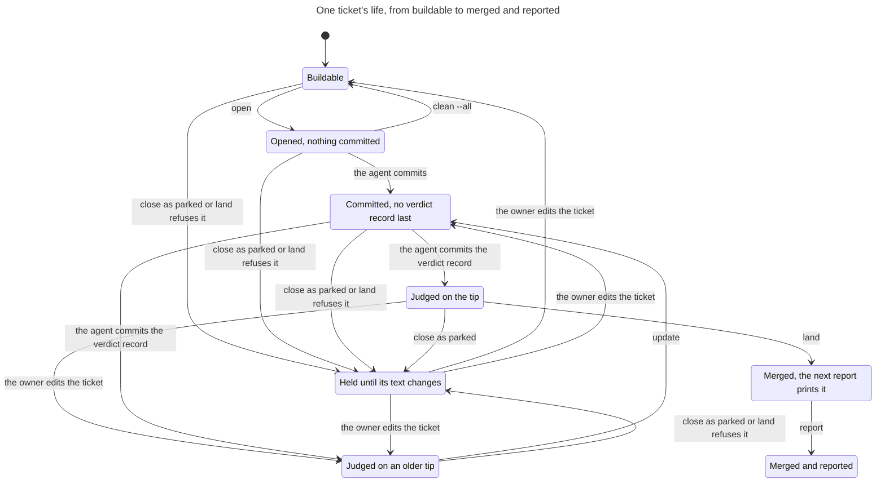
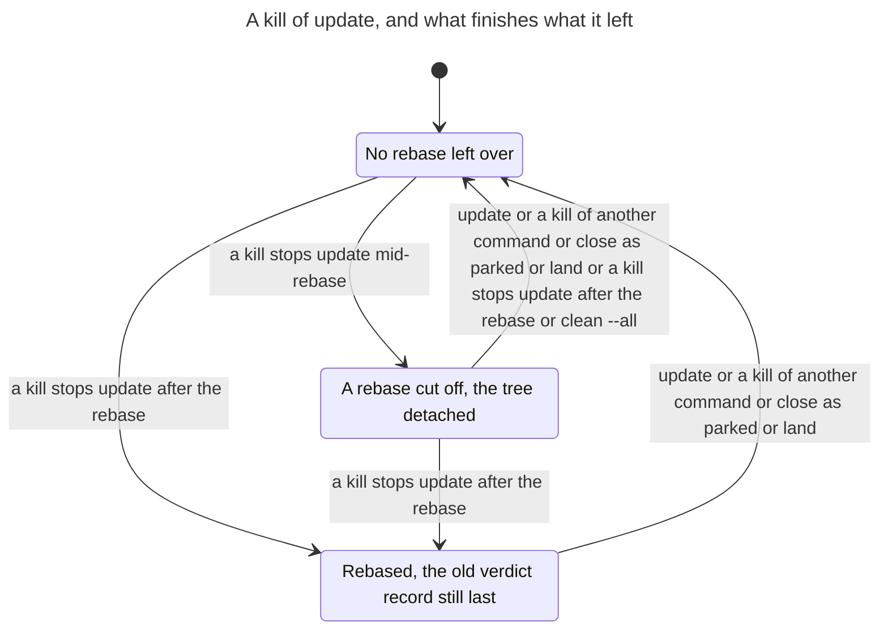
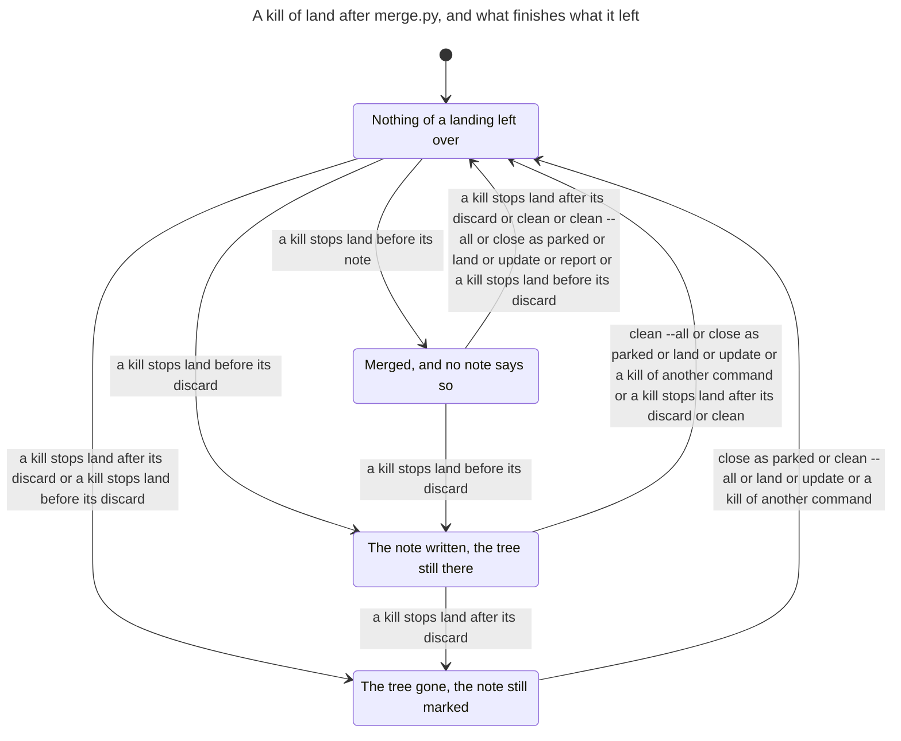
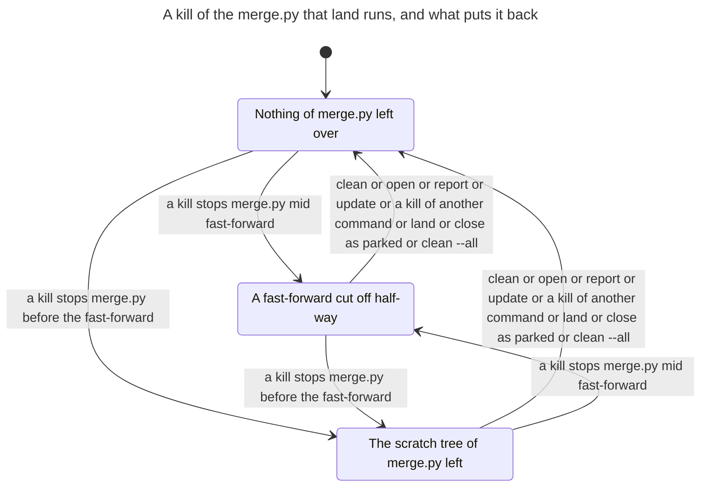
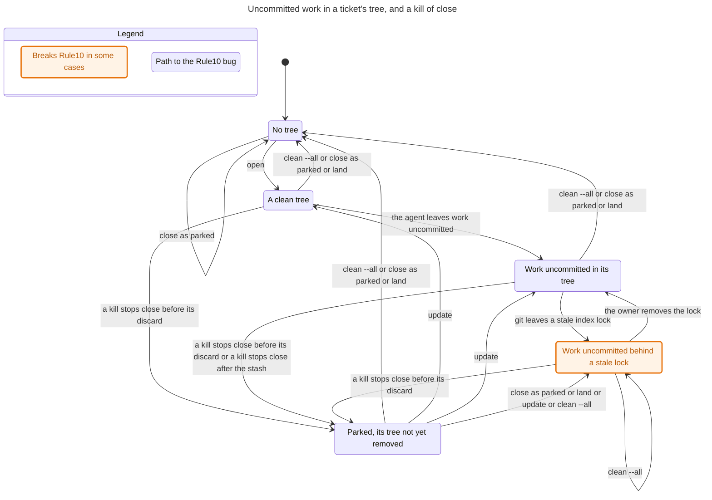
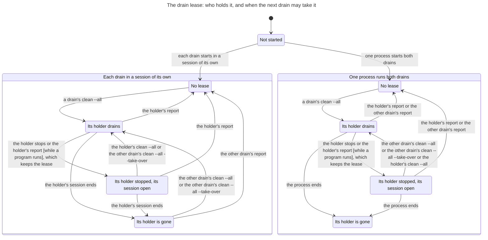
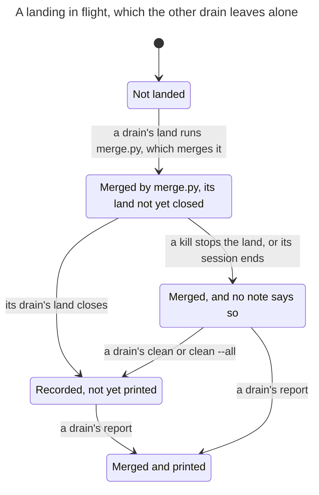
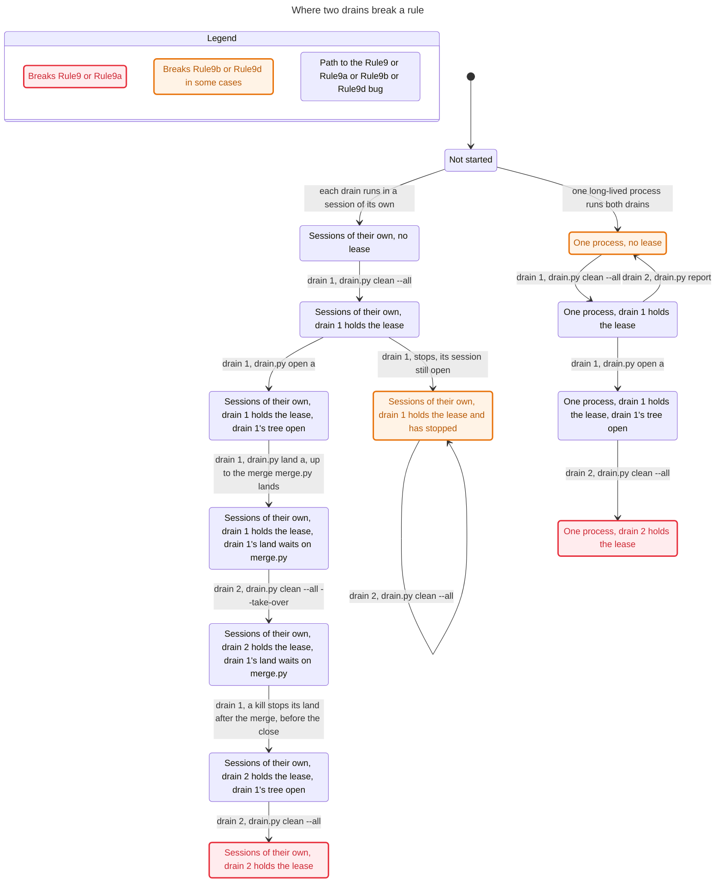

# The queue drain and its merge

`scripts/drain.py` drains the queue: `/ratchet:feature` with no ticket builds every agent-ready ticket, each in a work tree of its own, and merges them one at a time (ADR 0023). The script decides what needs no judgement and keeps what must outlive a session. `plan` says what each ticket is, `open` makes a ticket's work tree and branch only when the plan starts it, `update` rebases a built branch onto the default branch, `land` runs the merge with no forge and closes the ticket with what the judge printed, `close` removes a work tree and writes the ticket's note, `clean` removes leftover work trees, and `report` prints what merged, what waits and what is parked. `scripts/merge.py` is the merge `land` runs: it merges the branch in a scratch work tree, asks the judge and runs `check` on the result, and moves the default branch forward only when both are green.

The drain promises that an interrupted drain loses no work and repeats nothing (ADR 0023). Each command finishes from what git holds when it is run again: `update` abandons a rebase it left and starts over, `land` records a merge that landed, `clean` records a merged branch whose note was never written, and every command first puts back what a killed `merge.py` left. One drain runs on a repository at a time: `clean --all` takes a lease and is refused while another drain is alive, and the report ends it. This page writes the drain down as a state machine, and says which of these promises the code keeps.

The model is `hooks/tests/drain_model.py`. The tests in `hooks/tests/test_drain_model.py` check each rule on every step the model reaches. They also take the model's steps on real repositories, where the real `drain.py` and `merge.py` must leave what the model says (`hooks/tests/drain_world.py`).

## Scope

The model has two graphs.

The main graph is one drain on one repository with no forge:

- three tickets, `a`, `b` and `c`, where `b` is blocked by `a`, under a cap of one;
- the drain's commands in any order, what the agent does in a work tree, what the owner does, and a stale index lock git leaves;
- a kill of `update`, `close`, `land` or the `merge.py` it runs between two of their effects;
- each ticket playing one part. The agent commits only in `a`, whose branch goes the whole way to merged, and leaves work uncommitted only in `c`, the ticket the cap holds back. `b`, which waits on `a`, is only opened. A kill stops `update` and `land` only in `a`, and `close` only in `c`;
- the owner edits a ticket at most once, the agent leaves work uncommitted once, and the retry count of a ticket left waiting stops at three, past which nothing reads it;
- a judge that passes a branch only when its verdict record is its last commit and the branch holds the default tip; a `check` that is always green; and tickets that never touch one file, so nothing conflicts.

The lease graph is two drains on one repository and one ticket's work tree. The history first says how the drains run: each in a session of its own, or both under one long-lived process. Then each drain takes the lease, opens the ticket, leaves a draft or starts a program in its tree, lands the ticket, reports, cleans, stops or dies, in any order. `land` is two steps, split where `merge.py` runs, because `land` holds the drain's lock before `merge.py` runs and again for its close, and not while it runs. A kill can fall between the two.

What it leaves out is listed [at the end](#left-out).

## State

| Part | Values |
| --- | --- |
| Each ticket's work tree | none; clean; uncommitted work; uncommitted work behind a stale index lock; a rebase under way, the tree detached at the default tip |
| Each ticket's branch | none; no commit of its own; commits, the verdict record not last; commits, the verdict record last; commits, the verdict record last and certifying a tree the branch no longer has |
| Whether the branch holds the default tip, and whether it is merged | yes or no |
| Whether the verdict record was written on the tip the branch holds now | yes or no. No file holds it: a rule reads it |
| The drain's note on the ticket | none; or opened, merged, or waits or parked. A note can hold the ticket, on the text it was written on, count retries, owe a report, and carry `update`'s mark that a rebase began or `close`'s mark that it has not yet removed the tree |
| The ticket's text, and its stashes | the text the owner wrote first or after an edit; how many stashes hold its uncommitted work |
| What a killed `merge.py` left | its scratch work tree; and the ticket whose fast-forward of the default branch was cut off half-way, its files in the default branch's work tree, one part-written, and its index locked |

The plan reads a ticket as `drain.plan` does: resolved when merged, `held` when its note holds it on the text it has now, `built` when its branch holds a commit the default branch does not, `building` when it has a work tree, `waiting` while its blocker can still merge, `refused` when it cannot, and `buildable` otherwise.

From the start the main graph reaches 12,863 states and 190,251 steps.

| Part of the lease graph | Values |
| --- | --- |
| How the drains run | not yet said; each in a session of its own; or both under one process |
| The lease | none, or held by drain 1 or drain 2 |
| Each drain | its session alive or not; draining or stopped; whether it holds a token |
| The ticket's work tree | none, or opened by drain 1 or drain 2; a draft in it; a program running from it; a draft kept as a stash |
| A landing | the drain whose `land` has seen `merge.py` land the merge and has not yet closed it |
| The merge | not merged; merged and no note says so; a note no report has printed says so; printed |

From the start the lease graph reaches 1,203 states and 11,754 steps.

## Steps

| Step | What it does |
| --- | --- |
| `drain.py open` | makes the ticket's work tree and a branch at the default tip, when the plan starts it |
| the agent commits; the agent commits the verdict record; the agent leaves work uncommitted | in the ticket's tree |
| `drain.py update` | rebases the branch when the default branch has moved, first making the work tree of a built branch that has none and dropping a last commit that is the verdict record. On a landed branch it records the merge and does not rebase |
| `drain.py land` | runs `merge.py`, and closes the ticket as merged, as waiting for a reason the drain resolves itself, or held for the owner |
| `drain.py close --outcome parked` | writes the note that holds the ticket, then removes the tree with its uncommitted work kept as a stash |
| `drain.py clean`, `drain.py clean --all` | removes each tree of a merged branch, or every tree, after recording each merge no note says |
| `drain.py report` | records each merge no note says, then prints each close and merge not yet printed |
| the owner edits the ticket | commits a change to its text on the default branch, which moves the default tip |
| git leaves a stale index lock; the owner removes it | in `c`'s tree |
| a kill | stops `update` mid-rebase or after it; `close` before its discard or after its stash; `land` before its note, before its discard or after it; or the `merge.py` that `land` runs, before its fast-forward or in the middle of it |

Every command, and every kill, first puts back what a killed `merge.py` left: it sweeps the scratch work tree and puts back a fast-forward cut off half-way. So no command reads a ticket's text while a cut-off fast-forward holds the merge's.

On the lease graph, each drain can: `clean --all`, with its token, or with `--take-over`; `open a`; let its agent leave a draft or start a program in its tree; `land a` up to the merge `merge.py` lands, then the close after it, or be killed between the two; `report`, with its token or without; `clean`; stop with its session still open; or end its session. Under one process a session's end ends both drains. A program can end.

## Rules

The promises are nineteen rules, each about a step. The model numbers them, and the tests and this page use the numbers. The module names each `Rule` and its number, as `Rule6a`.

| Rule | Says | In Python | In TLC |
| --- | --- | --- | --- |
| 1 | No more tickets build at once than the cap. | holds | holds |
| 2 | Uncommitted work is never lost. | holds | holds |
| 3 | The default branch moves only to a judged merge. | holds | holds |
| 4 | A branch does not land on a review of an older base. | holds | holds |
| 5 | A merge is recorded and reported exactly once. | holds | holds |
| 5a | A report writes only what it prints, and a merge no note says. | holds | holds |
| 6 | A held ticket stays held until its text changes. | holds | holds |
| 6a | A ticket its note holds merges only once the owner edits it. | holds | holds |
| 7 | A ticket whose blocker waits on the owner is refused. | holds | holds |
| 8 | A killed command recovers by running again or by `clean --all`. | holds | holds |
| 10 | `clean --all` leaves no queue work tree. | breaks in 5 steps | breaks in the work run, by the same 5 steps |
| 9 | A second drain never removes a work tree a live first drain uses. | breaks in 4 steps | breaks in 4 steps, by the same run |
| 9a | A second drain removes it only where the docstring says the two look alike. | breaks in 7 steps | breaks in 7 steps, by the same run |
| 9b | A drain that has stopped never blocks the next. | breaks in 4 steps | breaks in 4 steps, by the same run |
| 9c | A drain that is gone never blocks the next. | holds | holds |
| 9d | A report ends no lease but its own drain's. | breaks in 3 steps | breaks in 3 steps, by the same run |
| 9e | A merge is printed by exactly one report across both drains. | holds | holds |
| 9f | No drain discards the tree of a landing another live drain runs. | holds | holds |
| 9g | A landing's close keeps a merge another drain recorded meanwhile. | holds | holds |

Rules 1 to 8 and 10 are on the main graph, 9 to 9g on the lease graph. In Python the main rules are proved on the whole main graph, and the lease rules on the whole lease graph. TLC checks the main rules on two runs of the main graph, as [below](#the-rules-in-the-modules) says, and the lease rules on the whole lease graph.

### Where a rule breaks

Each break is pinned in the tests by the shortest run to it, and each run is replayed on a real repository, where the real scripts do what the model says. The docstring of `drain.py` accepts each one.

- 10, in 5 steps: `drain.py close --outcome parked a`; `drain.py open c`; `the agent leaves work uncommitted in c`; `git leaves a stale index lock in the tree of c`; `drain.py clean --all`. The docstring says: "A work tree whose uncommitted work git cannot stash (a stale lock, a merge left unfinished, a damaged index) is not removed". Rule 2 holds there: the work stays in the tree.
- 9, in 4 steps: `one long-lived process runs both drains`; `drain 1: drain.py clean --all`; `drain 1: drain.py open a`; `drain 2: drain.py clean --all`. The docstring says that "two drains run by one process on one repository, with drain 1 between commands and nothing running from its tree, cannot be told apart". Rule 9a, which allows only that, holds there.
- 9a, in 7 steps: `each drain runs in a session of its own`; `drain 1: drain.py clean --all`; `drain 1: drain.py open a`; `drain 1: drain.py land a, up to the merge merge.py lands`; `drain 2: drain.py clean --all --take-over`; `drain 1: a kill stops its land after the merge, before the close`; `drain 2: drain.py clean --all`. The owner takes over while drain 1 is alive, and the docstring says to take over only "when it is gone for good". It accepts what follows: "a landing that drain runs keeps its tree while it runs, and the next `clean --all` takes the tree once that landing has ended, its work all committed". The take-over leaves the tree of drain 1's live landing. Once that landing is killed, drain 2's next `clean --all` takes the tree and records the merge.
- 9b, in 4 steps: `each drain runs in a session of its own`; `drain 1: drain.py clean --all`; `drain 1: stops, its session still open`; `drain 2: drain.py clean --all`. The docstring says: "A drain is alive while a process of its own is". A drain that stopped with its session open blocks the next until the owner says `--take-over`. Rule 9c, which asks only that a drain whose processes are all gone block nothing, holds.
- 9d, in 3 steps: `one long-lived process runs both drains`; `drain 1: drain.py clean --all`; `drain 2: drain.py report`. The docstring says that `report` "ends the lease of its own drain only (by its token, or when no other drain is alive)", and under one process no other drain is seen alive. In sessions of their own a report ends only its own drain's lease.

### What the model found, and the code now does

The model found three defects, and the code was changed until each rule held. Each fix has a replay on a real repository:

1. A ticket parked while its fast-forward was cut off merged with no edit (rules 6a and 8). `close` read the ticket from the default branch's work tree, which the cut-off fast-forward left holding the merge's text, part-written, and held the ticket on that text. The next `land` put the text back, so the ticket was held no longer. Now every command first puts back what a killed `merge.py` left, so `close` holds the ticket on the owner's text and `land` refuses it (`test_a_close_after_a_cut_off_fast_forward_puts_it_back_first_and_holds_the_ticket_on_its_text`).
2. Under one process a second drain's report ended the first drain's lease, and with no lease `rival` looked for no program, so the second drain's `clean --all` ended the first drain's program and took its tree (rule 9a). Now `rival` sees a program running from a queue tree with a lease or with none, and that `clean --all` is refused (`test_under_one_process_a_program_refuses_clean_all_once_a_report_ended_the_lease`).
3. Under one process a second drain's `clean --all`, report or `clean` recorded the merge of a live landing and removed its tree (rule 9f). Now `clean --all` keeps the tree of a live landing (`drain.in_flight`), with `--take-over` or not, and report and `clean` leave a merge alone while its landing runs (`test_one_process_running_both_drains_leaves_a_live_landing_alone_and_it_is_printed_once`, `test_a_take_over_leaves_a_live_landing_and_takes_its_tree_once_the_landing_is_killed`).

### The rules in the modules

`exports()` writes five modules. Three carry the rules, each as a rule on a step. TLA+ cannot see a step that leaves every variable as it was, so a module holds each state once for each set of step rules the step into it broke. The rules are computed in Python, so TLC checks that a module carries them and finds the shortest runs to them. It does not prove them a second way.

The whole main graph is too large to export on every test run: its module is 15 MB, and writing it takes about 8 seconds. So TLC checks the main rules on two runs of it. Each run is the part of the main graph its start reaches by some of the model's own steps, so each of its states and steps is one of the graph, and a rule breaks on a step of it exactly where it breaks on that step of the graph.

- `DrainLanding`, the landing run: every step but those on `c`. Ticket `a` is built, judged, landed or parked, with every kill of `update`, `land` and `merge.py`, and `b` waits on it. It reaches 395 states and 4,157 steps. No step rule breaks, so the module has as many.
- `DrainWork`, the work run: the steps on `c` and on the queue, and parking `a`, which lets the cap start `c`. The agent leaves work uncommitted, git locks the index, and kills stop `close`. It reaches 240 states and 2,337 steps. One step rule breaks, so the module has 270 states and 2,643 steps.
- `DrainLease`: the whole lease graph, 1,203 states and 11,754 steps. Four step rules break, so the module has 1,361 states and 13,992 steps.

Together the two runs reach 632 of the main graph's 12,863 states and 6,482 of its 190,251 steps. TLC does not check a step where both `a` and `c` have gone further than that: `c` building while `a` is built, judged or landed, `b` opened while `c` is, or `update` and `land` on `c`. So rule 1, the cap, never meets two trees there. The search in the tests proves every rule on every state and step of the whole main graph, and gives each break the same shortest run as TLC.

## The real scripts against the model

The tests hold the real `drain.py` and `merge.py` to the model in four ways:

- every pinned run above, and the steps of past defects on the way, are replayed on a real repository, which must read back as the model says after each step new to the run;
- each kind of kill is taken where it first leaves a state of its own, on a landed ticket and on one not landed: 10 runs, each followed by a report and the killed command run again;
- random runs of 8 steps take the model's steps on a real repository, and compare after each one;
- two real drains, as two sessions or under one process, take every decision the code makes on the lease: 46 decisions in 5 walks of 71 steps, with 5 landings. A `land` in flight runs as a process of its own. Each pinned lease run is replayed too.

Where a real command and the model disagree, the test prints the run and what each says.

## Charts

The main rules were checked on `DrainLanding.tla`, SHA-256 `8a2c2c98b20b87d922d21f30c8c713203ae3f78c9f8e06daf473aebee5833821`, and `DrainWork.tla`, SHA-256 `6ac236aa2476a5a440a5ed908c22ac26c7d59e30ea151633026f6a9256141364`. On `DrainLanding` TLC reached 395 states. Run again with every rule, it counts 4,158 states generated: the start and 4,157 steps. Every main rule holds there. On `DrainWork` TLC reached 270 states, and run again with only the rules that hold, it counts 2,644 states generated: the start and 2,643 steps. Rule 10 breaks there, by the run above, and the others hold.

The lease rules were checked on `DrainLease.tla`, SHA-256 `3464a682950aad7eee62c2a35f4cb3286944a4c16ff84388895c5964848cba9e`. TLC reached 1,361 states. Run again with only the rules that hold, it counts 13,993 states generated: the start and 13,992 steps. Rules 9c, 9e, 9f and 9g hold. Rules 9, 9a, 9b and 9d break, each by the run above. Once both drains' sessions have ended no step is left, so the module tells TLC that a state with no step out is no deadlock.

The charts of a kill are drawn from `DrainLanding.tla`, and the chart of uncommitted work from `DrainWork.tla`. Two charts are drawn from summaries, each the graph seen through the few values the chart shows. `DrainLife.tla`, SHA-256 `9cf44e9bd78a6f1c2f7447bcd17d18d9688e81b7c35913af6a1213e78bd90ee8`, is the landing run with no kill, seen through what the plan and the note say of ticket `a`. `DrainLeaseShown.tla`, SHA-256 `9614335ba1ffc83fd88c0a3aa181cdd55313469f73e3e2b3562f1b9cec0b0931`, is the whole lease graph seen through all but the tokens, the draft and the stash. A box groups states, and an arrow from a box leaves every state in it.

### One ticket's life

Drawn from `DrainLife.tla`, where TLC reached 105 states and 875 steps: 8 states and 17 arrows. It does not draw the 700 steps that stay in one state. A ticket is held when `close` parks it or `land` refuses it, and only the owner's edit frees it. A branch judged on an older tip goes back through `update`, and only a branch judged on the tip lands.



### A kill of `update`

Drawn from `DrainLanding.tla`, where TLC reached 395 states and 4,157 steps: 3 states and 5 arrows. It does not draw the 3,797 steps that stay in one state. A rebase cut off leaves the tree detached, and the next `update`, `land`, `close` or `clean --all` abandons it. A kill after the rebase leaves the old verdict record last, certifying a tree the branch no longer has, and the next `update`, `land` or `close` finishes from there.



### A kill of `land` after `merge.py`

Drawn from `DrainLanding.tla`: 4 states and 8 arrows. It does not draw the 3,177 steps that stay in one state. Wherever `land` is cut off after the merge, a later command records the merge once and removes the tree.



### A kill of `merge.py`

Drawn from `DrainLanding.tla`: 3 states and 6 arrows. It does not draw the 3,372 steps that stay in one state. A kill before the fast-forward leaves the scratch work tree, and one in the middle of it leaves the default branch's work tree part-written. Every command, and every kill of another command, puts it back first.



### Uncommitted work in a ticket's tree

Drawn from `DrainWork.tla`, where TLC reached 270 states and 2,643 steps: 5 states and 15 arrows. It does not draw the 1,847 steps that stay in one state. Uncommitted work behind a stale lock is where rule 10 breaks: `clean --all` cannot stash it, so it leaves the tree with the work in it. The owner removes the lock, and the next `clean --all` or `close` keeps the work as a stash.



### The lease

Drawn from `DrainLeaseShown.tla`, where TLC reached 391 states and 4,294 steps: 9 states and 18 arrows. It does not draw the 2,618 steps that stay in one state. The two drains are alike, so a step is named by its drain's part: the lease's holder, or the other drain. In sessions of their own, the other drain takes the lease from a holder that is gone, and from one that has stopped only with `--take-over`. Under one process it takes it from one that has stopped, and its report ends the lease of a holder still draining, which is where rule 9d breaks.



### A landing in flight

Drawn from `DrainLeaseShown.tla`: 5 states and 6 arrows. It does not draw the 3,368 steps that stay in one state. While `merge.py` runs, `land` holds no lock, so the other drain's commands can run. None of them records the merge or removes the tree while the landing is alive. Its own close records it, or after a kill a report, `clean` or `clean --all` does.



### Where two drains break a rule

Drawn from `DrainLease.tla`, where the tool draws only the shortest run to each rule that breaks: 13 states and 14 arrows. The states say how the drains run, who holds the lease, and where drain 1's tree and landing are. The steps have the model's own names, as the tests give the runs, with a comma after the drain for the colon.



## Left out

- Forge mode. With a remote `land` is not used: the skill opens a pull request and the forge's merge job merges it.
- More than two drains on the lease graph, and more than one ticket's work tree there.
- More than three tickets, a cap above one, a ticket whose run errors, a ticket split as too large, a conflict on rebase or merge, and a red `check`. The judge gives two reasons here: `behind`, which the drain resolves itself, and a verdict record that is not last, which it does not. Its other reasons act as the second.
- A kill at a point the model does not cut: in `open`, `report` or `clean`, and in `close` after its discard, which leaves what the whole `close` leaves but for the mark that only a retry reads. A kill in `merge.py` before its fast-forward, in the merge or in `check`, leaves its scratch work tree and nothing else, so the model takes one kill there.
- A command refused while a git command still runs in the interrupted landing, so the cut-off fast-forward cannot be put back yet. The command exits 2 and changes nothing. `hooks/tests/test_drain_safety.py` tests it (`test_a_command_is_refused_while_a_cut_off_fast_forward_cannot_be_put_back`).
- The `clean:` form of the landing line, which the model does not reach.
- Whether the sweep of an empty merge scratch directory leaves what the model says. The replays do not compare it.
- A second drain between `settle`'s note and its discard. `settle` runs whole under the drain's lock, so no other drain's command runs there.
- `merge.py --records`, which lands the owner's records with no ticket.
- What the plan reads besides the tickets: the preflight, a checkout not fit to build on, the agents a drain may start, and the report's text.

The real scripts agree with the model on the runs above, the kills, the random runs and the lease walks. They are not compared on every step of either graph.

## Changing the drain

Change the model first, then the code, then the page.

1. Change `hooks/tests/drain_model.py` so it says what the code should do. `hooks/tests/test_drain_model.py` says whether each rule still holds or breaks on its pinned run, and each pin changes only when the change says why.
2. Change `scripts/drain.py` or `scripts/merge.py`. The replays and the random runs say where the code does something else.
3. Draw the page again. The page test is red until the page names the SHA-256 of each current export.

To draw it again, from the `hooks` directory write the exports to a directory outside the checkout:

```sh
mkdir -p /tmp/drain-model && python3 -c 'import sys; from pathlib import Path; from tests import drain_model
for e in drain_model.exports():
    Path(sys.argv[1], e.name + ".tla").write_text(e.module)
    Path(sys.argv[1], e.name + ".cfg").write_text(e.config)' /tmp/drain-model
```

Then, as [the models' README](README.md#drawing-the-charts-again) says, run the `statechart` command once on each of `DrainLanding.tla`, `DrainWork.tla` and `DrainLease.tla` with no view for the rules, run TLC directly with only the rules that hold for the counts, and once for each rule that breaks with one worker. Draw each chart from its module and view in `docs/model/drain/`, as the chart's heading says. Put each `chart.mmd` in its block, the counts beside it, and each SHA-256 on the line that names it.
