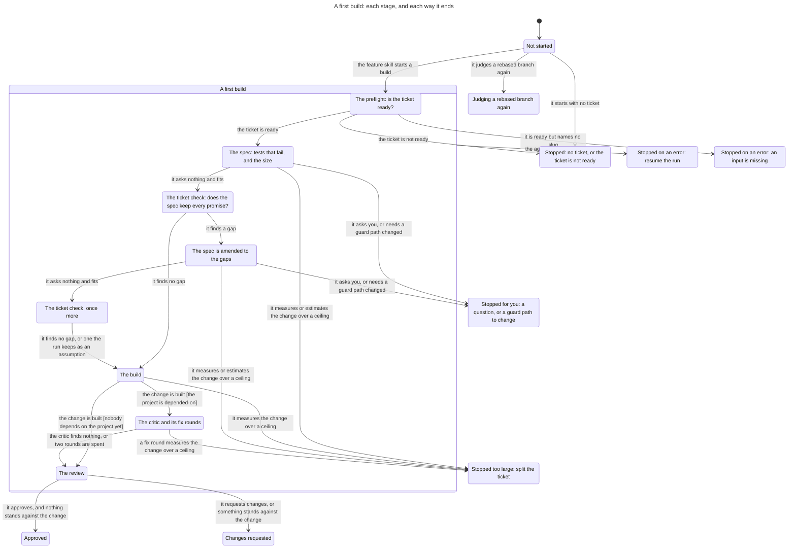
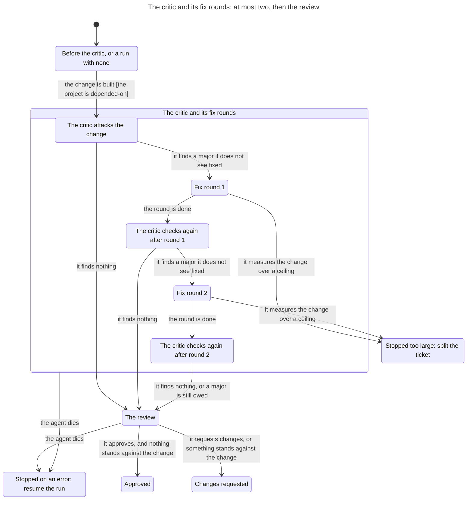
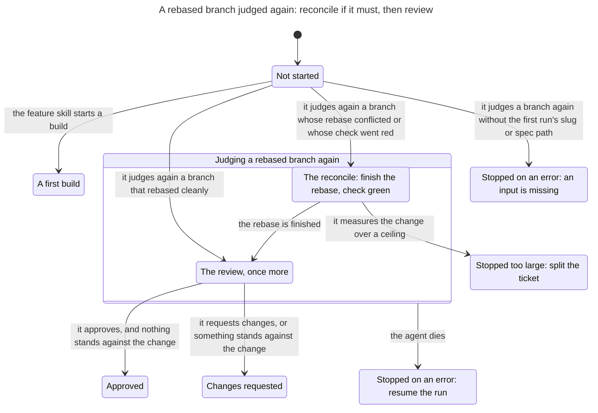
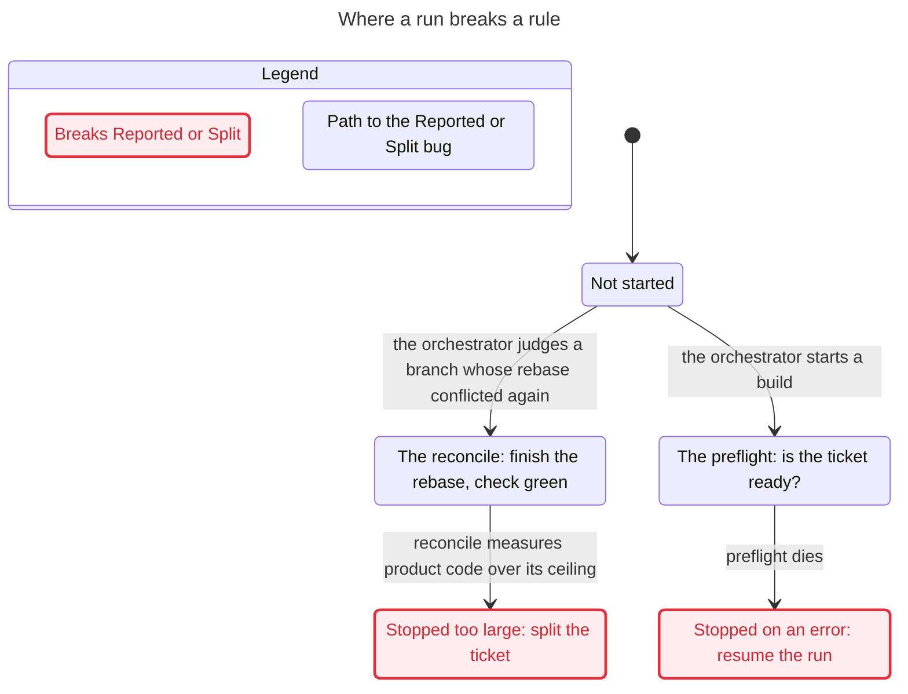

# One pipeline run

`workflows/pipeline.js` is the workflow the `/ratchet:feature` skill runs for one ticket once its own preflight is green ([the feature pipeline](../../skills/method/pipeline.md)). It spawns one agent for each role: the preflight, the spec, the ticket check, the build, the critic and its fix rounds once the project is depended-on, and the review. Given `args.rejudge`, it judges again a branch that was rebased behind another merge: a reconcile agent when the rebase conflicted or the check went red, then a second review. It never commits, pushes or opens a pull request. The orchestrator does that after it reads the result. The script is a function of its arguments and of its agents' structured answers, so one run is a state machine whose inputs are those answers. This page writes that machine down, and says which of the method's promises the script keeps whatever the agents answer.

The model is `hooks/tests/pipeline_model.py`. The tests in `hooks/tests/test_pipeline_model.py` check each rule on every step it reaches. They also play every run of the model on the real script, which must call the same agents and end the same way (`hooks/tests/pipeline_world.py`).

## Scope

The model covers one run with:

- six ways the orchestrator starts it: a build; a build with no ticket; judging again a branch that rebased cleanly; one whose rebase conflicted; one whose check went red with no conflict (`checkRed`); and one without the slug or the spec path the first run returned. A conflict and a red check each start at the reconcile, and the reconcile's prompt differs only in the paths it lists;
- each agent's answer cut down to the few values the script branches on, listed under [Steps](#steps). A dead agent is one that returns no result;
- at most two fix rounds, the script's own bound. So the graph is every run the answers allow, not a sample.

What it leaves out is listed [at the end](#left-out).

## State

| Part | Values |
| --- | --- |
| The agent the run waits on | one of the eleven below; none before the start and after the end |
| Judging again | yes or no |
| The critic | not known yet; runs, since the project is depended-on; or waits |
| The stage of the last agent that ran | preflight, spec, ticket check, build, critique, fix, reconcile or review |
| Agents spawned, and fix rounds run | counts |
| The spec's last answer | the answer that let the run go on |
| A promise kept from the ticket | yes once the second ticket check still finds a gap |
| Built, and the last builder's check | built or not; green, red or none yet |
| The last critique | whether it owes a fix, and whether it found nothing and tried nothing |
| How it ended | still running; approved; changes requested, with what forced it; stopped (blocked) with the reason, and for too large the ceiling, where it was measured, whether parts are proposed and whether the orchestrator splits it unasked; or the script's error, naming the agent and whether to resume. A verdict also carries the fix rounds, an unresolved finding, the lost promises for the next run, the kept promise in the assumptions, the verdict record, and whether the branch was judged again |

A builder is the agent that changes code: the build, a fix round or the reconcile. From the start the model reaches 1,032 states and 1,173 steps. 832 of the states are a run that has ended.

## Steps

Each step is the orchestrator's start, or the answer of the agent the run waits on. A step's name is the agent's label and its answer, as `fix-1 measures product code over its ceiling`.

| Agent | Its answers |
| --- | --- |
| the orchestrator | starts a build; starts with no ticket; judges a rebased branch again; judges a branch whose rebase conflicted again; judges a branch whose check went red again; judges a branch again without the first run's slug or spec path |
| `preflight` | dies; is red; is green with no slug; is green for a project nobody depends on; is green for a project that is depended-on |
| `spec`, and `spec-amend` once the ticket check finds a gap | dies; asks the owner a question; needs a guard path changed; measures product code over its ceiling; measures tests over their ceiling; measures tests over two thirds of their ceiling; estimates the change cannot fit and proposes parts; fits; fits with tests that fail for the wrong reason |
| `ticket-check`, and `ticket-recheck` after the amend | dies; finds no gap; finds a gap |
| `implement` | dies; measures product code over its ceiling; measures tests over their ceiling; measures tests over two thirds of their ceiling; is green; is red |
| `critique`, then `critique-1` and `critique-2` after each round | dies; finds nothing; finds nothing and tried nothing; finds a major it does not see fixed |
| `fix-1`, `fix-2` and `reconcile` | dies; is green; is red; measures product code over its ceiling |
| `review`, and `review-again` | dies; approves; requests changes; approves on a red check; approves with a blocker of its own open; approves a change that drops a promise of the ticket; approves a guard path change nothing covers |

Tests over two thirds of their ceiling stop the run only while the critic's tests are still to come (ADR 0040). After the build those tests are in, so one answer over a ceiling stands for every answer a fix round or the reconcile can give over one (ADR 0055). The start without the slug or spec path is played with a slug and no spec path. The script refuses either one missing with the same error. The start whose check went red is played with no conflict, so `checkRed` alone takes the run to the reconcile.

## Rules

The method's promises are eighteen rules, each about a step. The model numbers them as below, and the module names each after its predicate.

| Rule | In the module | Says | In Python and in TLC |
| --- | --- | --- | --- |
| 1 | `Evidenced` | A run ends approved only when the review that runs last approves with its own check green and nothing open, and the last builder's check was green. | holds |
| 2 | `Bounded` | A run never spawns more agents than the documents allow, seven before the project is depended-on, twelve after, and two to judge a rebased branch again. | holds |
| 3 | `Ordered` | Agents run in the documented order of stages, and the implementer runs only after a spec with no open question has been through the ticket check. | holds |
| 4 | `Stricter` | No answer lifts an objection the run has raised but the repair the documents name for it, and a run with an objection standing never ends approved. | holds |
| 5 | `Ceilinged` | A change measured or estimated over the product ceiling or the test ceiling stops the run as too large on that ceiling, so it is never approved. | holds |
| 5a | `Measured` | A change the spec, the implementation, a fix round or the reconcile measures or estimates over a ceiling stops the run at that stage as too large on that ceiling. | holds |
| 6 | `LoopEnds` | The fix loop runs at most two rounds, and a finding still owed after the last one reaches the result as unresolved. | holds |
| 7 | `Unpublished` | The run never commits, pushes or opens a pull request, and asks each agent only for the git and forge commands the documents give its role. | holds |
| 8 | `Reported` | A failed or malformed agent answer ends in a result that says so, never in an approval and never in an unhandled error. | breaks in 2 steps |
| 8a | `Resumable` | An agent that dies ends the run in the script's error, which names that agent and says to resume the run, with no verdict and no result. | holds |
| 9 | `JudgedAgain` | Judging a rebased branch again always ends on a second review, and only that review's own approval approves the branch. | holds |
| 10 | `Split` | A run that stops too large names the parts to split the ticket into, and stops before any implementer runs. | breaks in 2 steps |
| 10a | `SplitUnasked` | A run that stops too large stops on the answer of the role that measured it, carries the proposed parts when the spec's estimate stopped it, and tells the orchestrator to split the ticket without asking the owner. | holds |
| 11 | `Assumed` | A promise of the ticket the run keeps after the amend left it out reaches the result's assumptions. | holds |
| 12 | `CriticWaits` | The critic and its fix loop run only once the project is depended-on. | holds |
| 13 | `CheckAsksNothing` | The ticket check never stops the run unless its agent dies, so no question reaches the owner from it. | holds |
| 14 | `NeverCrashes` | A failed or malformed agent answer is never approved and never crashes the run, which ends in the script's own error naming that agent. | holds |
| 15 | `Lost` | A change the review finds dropping a promise of the ticket is refused, and a first build returns what it lost for the next run. | holds |

Two rules stand in pairs: a strong reading that breaks, beside the reading the method's pages give, which holds. Each breaks by its shortest run, the same in Python and in TLC, and both breaks are by design.

- `Reported` (8): the orchestrator starts a build; preflight dies. The script throws `preflight agent returned no result (skipped or died); resume the run to retry` and returns no result. A preflight green with no slug breaks it the same way, with an error that does not say to resume. `Resumable` (8a) is the reading that holds, and `NeverCrashes` (14) holds beside it: no failed answer is approved or crashes the run. 8a rests on ADR 0023: "One run per ticket also keeps its own run to resume, so a ticket that dies is run again alone." The pipeline page says the same: "A run in which an agent dies throws and returns no result: the drain resumes it once" (ADR 0055).
- `Split` (10): the orchestrator judges a branch whose rebase conflicted again; reconcile measures product code over its ceiling. The run stops too large with no parts named, after the code was built. A stop the spec measures rather than estimates, and a stop after the build or a fix round, break it too. `SplitUnasked` (10a) is the reading that holds. It rests on the pipeline page, which gives the spec's estimate alone a stop "with a proposed split", and says of a fix round or a reconcile over the ceiling that "the drain splits it as for any other too-large stop". The script's result says: "with no `proposedSplit`, divide the ticket's promises yourself".

The tests play each of these runs on the real script, which ends as the model says.

The tests also check that:

- every rule reads as one sentence;
- every answer of every agent is given on some run;
- on the real script, a change any measuring role finds over a ceiling stops the run as blocked, too large, on that ceiling and at that stage;
- on the real script, every dead agent ends the run in an error that names it and says to resume;
- on the real script, a run stopped too large ends on the answer that measured it, and its result tells the orchestrator to split the ticket and ask the owner nothing;
- a fix round or a reconcile over the product ceiling stops as too large. Before ADR 0055 both ended approved on a builder's green answer.

### The rules in the module

`export()` gives each rule as a rule on a step. TLA+ cannot see a step that leaves every variable as it was, so the module holds each state once for each set of step rules the step into it broke. Here no state is reached both by a step that breaks a rule and by one that keeps every rule, so the module has the graph's 1,032 states and 1,173 steps. The rules are computed in Python, so TLC checks that the module carries them and finds the shortest runs to them. It does not prove them a second way.

## The real script against the model

The answers are finite and the script is deterministic given them, so nothing here samples. The test walks every complete run of the model: 3,431 sequences of answers from the start to an end. 3,390 are first builds, 16 judge a branch whose rebase conflicted, 16 one whose check went red, 7 one that rebased cleanly, one has no slug or spec path and one has no ticket. The longest has 12 answers. Each abstract answer stands for one concrete answer the script's schema allows.

All of them run on `workflows/pipeline.js` itself in one node process, in a context whose only globals are the language's own, with `agent`, `phase` and `log` passed in. The longest first build and the longest conflicted rejudge run once more, reading the ticket from a local file. That makes 3,433 plays. Each must call the same agents in the same stages as the model, and end as the model ends: the same verdict, the same reasons it was forced, the same stop or error. Every git or forge command any prompt names must be one the model allows that role. The plays take a little over a second of processor time.

## Charts

The rules were checked on `Pipeline.tla`, SHA-256 `a351e12aa1c1ae02d0b00b150d1bd90bdea9792a7538f54d0727e2f69a2d3006`. TLC reached 1,032 states. Run again with only the rules that hold, it counts 1,174 states generated: the start and 1,173 steps. Sixteen rules hold, two break, each by the run above. A run that has ended has no step out, so the module tells TLC that is no deadlock.

That module is too large for the statechart tool to draw whole. The tool draws only the shortest run to each rule that breaks, which is the last chart. The others are drawn from `PipelineStage.tla`, SHA-256 `27f8354617e00352e611bd2d86a6aafc46437ce02544c4c3b64a0d62224be0a7`: the same graph seen through the stage a run is at. That is the agent it waits on, or how it ended and after which stage, with whether it is a rejudge, whether the critic runs, and the fix rounds. Each of those reports says that TLC reached 72 states and 142 steps. A box groups states, and an arrow from a box leaves every state in it.

### A first build

17 states and 23 arrows. It does not draw the 25 steps that stay in one state. The critic and its fix rounds are one state here, and the next chart draws them.

Something stands against the change when the spec's tests fail for the wrong reason, the last builder's check was red, a critic finding is still owed, the critic found nothing and tried nothing, the review's own check was red, the review holds a blocker or a major issue (a dropped promise among them), or a guard path changed with nothing covering it. The script then forces changes requested, whatever the review said.

### The critic and its fix rounds

11 states and 14 arrows. It does not draw the 96 steps that stay in one state. Everything before the critic, every run of a project nobody depends on yet and every rejudge is the first state.

A major still owed after the second round reaches the review, and the script forces changes requested with that finding unresolved in the result.

### Judging a rebased branch again

9 states and 9 arrows. It does not draw the 117 steps that stay in one state. Every first build is one state here.

Here a red check from the reconcile stands against the change, as a red builder's check does in a first build.

### Where a run breaks a rule

Drawn from `Pipeline.tla`, where the tool draws only the shortest run to each rule that breaks: 5 states and 4 arrows. The states have the words of the charts above, and the steps the model's own names, as the tests give the runs. The marked error breaks `Reported`, and the marked too-large stop breaks `Split`.

## Left out

- What the orchestrator does with the result: committing, the verdict record, the pull request, the merge judge, and the drain's resume, split and park. The drain has a model of its own, `hooks/tests/drain_model.py`.
- What an agent does inside its stage, and every field of its answer the script does not branch on: the criteria, the tests, the findings' titles, the assumptions other than the kept promise.
- `args.ticketFindings` from the last run, and the settled readings a rejudge passes back.
- A ticket read from a local file, but for the two runs played again reading one.
- More than one answer over a ceiling from a fix round or the reconcile, and any answer of theirs between two thirds of the test ceiling and the whole of it.
