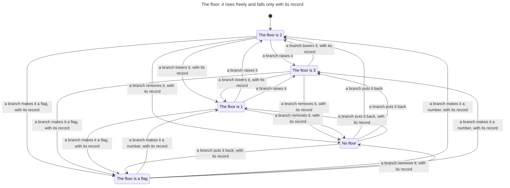
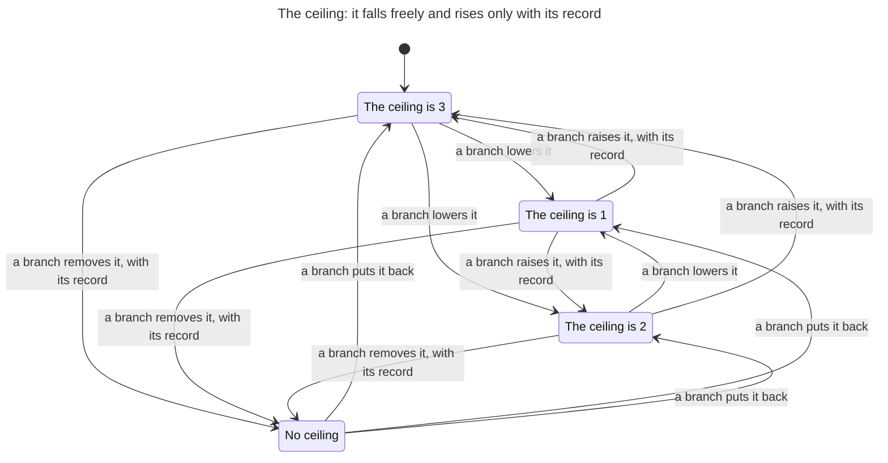

# The threshold ratchet

`scripts/lowered.py` is the gate that keeps `quality/thresholds.toml` from loosening. A threshold only rises and a ceiling only falls, unless the change that loosens it adds a relaxation record: a file under `docs/adr/` with the line `Relaxes: <key> from <old> to <new>` ([the ratchet](../../skills/method/ratchet.md), ADR 0047). `scripts/merge.py` lands a branch: it merges the branch into the default branch's tip, runs the gate on the result, and moves the default branch only when the merge is clean and the gate is green. This page writes down, as a state machine, what the default branch can hold after any history of branches that land that way.

The model is `hooks/tests/ratchet_model.py`. The tests in `hooks/tests/test_ratchet_model.py` prove its rules on every step. They also take the same steps on real repositories, where the real gate must judge each landing as the model does (`hooks/tests/ratchet_world.py`).

## Scope

The model covers one repository with:

- one threshold, `gate.floor`, at 1, 2 or 3, or the flag `true`, and one ceiling, `ceilings.gate.seconds`, at 1, 2 or 3. Either can be absent. The floor starts at 2 and the ceiling at 3, with no records;
- two branches open at a time, each forked from the default branch's tip. A branch changes one key once, or deletes the thresholds file, and adds at most one record;
- two changes that land on the default branch. Then the graph ends.

What it leaves out is listed [at the end](#left-out).

## State

| Part | Values |
| --- | --- |
| The default branch | the floor, the ceiling, the records under `docs/adr/`, and whether `quality/thresholds.toml` is there |
| What each key last held there | the value it holds, or the value it held before it was removed. No file holds this: the gate reads it from the history |
| Each of the two branches | none; or open, with the tree it forked from, what each key last held then, and its tree now |
| Changes the default branch still takes | 2, 1 or 0 |

From the start the model reaches 3,251 states and 12,106 steps.

## Steps

| Step | What it does |
| --- | --- |
| a branch opens from the default tip | |
| a branch is abandoned | |
| a branch raises, lowers, removes, retypes or adds a key | one key, on a branch that has changed and recorded nothing |
| a branch deletes `quality/thresholds.toml` | |
| a branch records its own loosening | the record its change needs |
| a branch records a loosening it does not make | the next value past the key's that the ratchet forbids |
| a branch records a line that matches no loosening | `Relaxes: gate.floor from 1 to 3` |
| a branch tries to land | merged into the tip and judged there. The default branch moves to the merge only when it is clean and green; otherwise nothing changes |

The gate is the one ADR 0047 describes. A record excuses a loosening only in the change that adds it. A key the merge base lacks is judged against the value it last held. A flag and a number are different values, so a number is left behind through a flag only by two changes, each with a record of its own.

## Rules

Each rule is about a step, the landing that moves the default branch.

| Rule | Says | In Python | In TLC |
| --- | --- | --- | --- |
| `Named` | A value on the default branch never loosens unless a relaxation record in that tree names exactly that step. | holds | holds |
| `Brought` | Every loosening that lands brings its own relaxation record in the same change. | holds | holds |
| `NotLate` | A branch that was green when it forked cannot loosen the default branch by landing late. | holds | holds |
| `Remembered` | A key that was removed comes back looser than the value it last held only with its own relaxation record in the same change, and the thresholds file never goes. | holds | holds |

`Brought` and `Remembered` broke before ADR 0047. A record that landed alone excused a later branch's loosening: two branches open, one lowers the floor, the other adds the record for that and lands, then the first lands. And a key removed with its record came back looser with none: remove the floor with its record, then add it back at 1. The tests replay both runs on a real repository and expect the gate to refuse the last landing.

The tests also check that:

- a branch left open while the ceiling fell cannot land a value between, and on a real repository its change conflicts;
- a branch left open can land its own recorded loosening late, so `NotLate` is not true for want of a late landing;
- a number is left behind through a flag by two changes, each with its record;
- a record once landed does not let the same loosening land again: three changes, one past the graph's bound;
- on real repositories, random runs of 20 steps with up to six changes landing keep every rule, and the real gate agrees with the model on every landing.

### The rules in the module

`export()` gives each rule as a rule on a step: TLA+ cannot see a step that leaves every variable as it was, and a refused landing does. The module holds each state once for each set of step rules the step into it broke, and each rule is a boolean of that state. No rule breaks, so the module has the graph's 3,251 states and 12,106 steps. The rules are computed in Python, so TLC checks that the module carries them and does not prove them a second way.

## Charts

The rules were checked on `Ratchet.tla`, SHA-256 `45038d80e4279e80ff954f093fa03131e79e5179b57c758e7353ce317b5afc22`. TLC reached 3,251 states, and its last line counts 12,107 states generated: the start and 12,106 steps. All four rules hold. The graph ends where the default branch has taken its two changes, so the module tells TLC that those states are no deadlock.

That module is too large for the statechart tool to draw, so the charts are drawn from `RatchetDefault.tla`, SHA-256 `b6146e1c18f809d4105ea0ad4ac059be176ebbd2f6b80b5e9331ed2644e79e34`: the same graph seen through what the default branch holds, each key and the steps its records name. Each chart's report says that TLC reached 148 states and 450 steps. Only a landing changes what the default branch holds, so every arrow is a landing. An arrow says "with its record" when the landing added a record of a loosening of that key to its new value.

### The floor

5 states and 20 arrows. It does not draw the 352 steps that keep the floor as it was.

A removed floor comes back at 2 or 3 with no record, since it last held 2. It comes back at 1, or as a flag, only with a record.

### The ceiling

4 states and 12 arrows. It does not draw the 347 steps that keep the ceiling as it was.

The ceiling starts at the top of its values, so a removed ceiling comes back at any of them with no record. Two changes are the bound, so the graph has no removed ceiling that last held less than 3.

## Left out

- The guard. `quality/thresholds.toml` and a `Relaxes:` line are the owner's, so a loosening also waits for the owner's merge ([guards.md](../../skills/method/guards.md)). The model is the gate alone.
- More keys, other values, and keys under other tables. The rename of `files` and `lines` to `product_files` and `product_lines` (ADR 0045).
- The owed ledger, `quality/owed.toml`, which the same gate judges (ADR 0037).
- More than two changes on the default branch, more than two branches, a branch that changes two keys or adds two records. The random runs on real repositories go to six changes.
- The first adoption, where the merge base has no thresholds file and the gate passes.
- A check on the default branch itself, where the gate's base is the commit before.
- History the gate cannot read, as in a shallow clone, where a removed key comes back as new.
