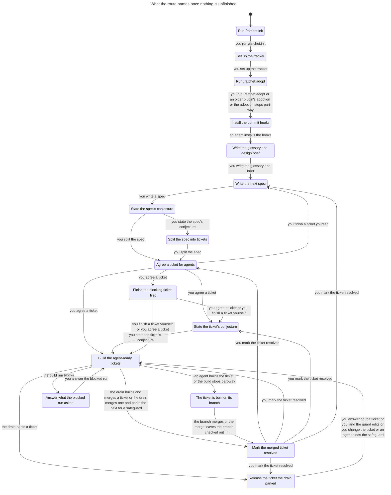
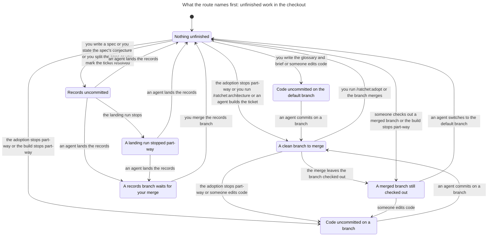
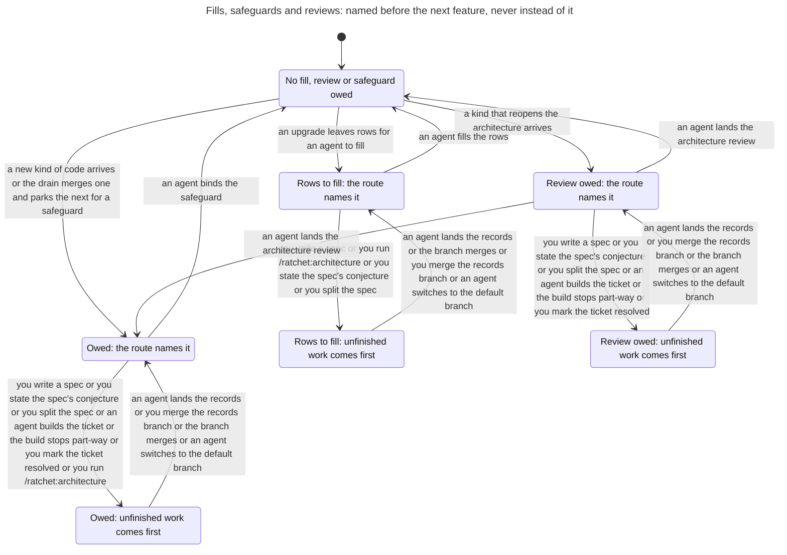
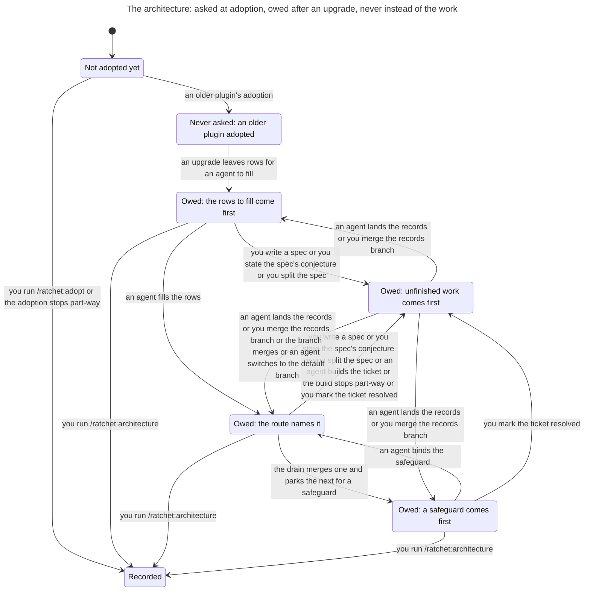

# The route

`scripts/route.py` reads the checkout and names the one command the owner types next. [The route](../../skills/method/route.md) says what it names in each case. This page writes that down as a state machine: the states the route can tell apart, what it names in each, the steps that lead from one state to the next, and the rules the steps keep.

The model is `hooks/tests/route_model.py`. The tests in `hooks/tests/test_route_model.py` prove the rules on it, take each of its steps on a real repository, and ask the real route after each.

## Scope

The model covers one repository with:

- no forge: no `origin`, tickets in the local tracker, the route asked offline;
- one spec at a time, split into two tickets, the second blocked by the first;
- one step at a time: a step on a spec or a ticket starts from a clean default branch with no records branch waiting;
- one checkout: no other work tree holds the default branch.

What it leaves out is listed [at the end](#left-out).

## State

| Part | Values |
| --- | --- |
| Setup | nothing; an init that stopped before its questions; init done; the tracker set up; an adoption that stopped before it wrote the plugin pin; adopted |
| Commit hooks | installed, or not |
| Checked out | the default branch; a working branch; a working branch the default branch already holds; a `records/<time>` branch |
| Work tree | clean; records only; more than records |
| A records branch waits for the owner's merge | yes or no |
| The glossary and the design brief | written, or not |
| A spec not yet split | none; written; stating its conjecture |
| Each of the two tickets | none; needs triage; agent-ready; agent-ready with a conjecture; held by a blocked run's stash; parked by the drain for open questions, for guard edits, for an owed safeguard, or by a note older than the kinds of hold or than the base commit a guard hold needs; built on its branch; merged but open; resolved |
| The tickets inherit the spec's conjecture | yes or no |
| A safeguard is owed | yes or no |
| An architecture review is owed | yes or no |
| An upgrade left rows an agent fills | yes or no |
| The architecture | never asked, as before adoption and after an adoption by a plugin from before ADR 0049; owed since an upgrade; recorded |

From an empty directory the model reaches 1445 states and 3601 steps. Six of the states are at rest: adopted, nothing unfinished, nothing owed, and every ticket resolved or none written; three with the architecture recorded and three with it never asked. At rest the route names the next spec.

A working branch the default branch already holds has no commit of its own to merge. A merge leaves it checked out when it is cut off before it switches, when it cannot switch, or when it is made from another checkout. A merge keeps the branch it merged, so it can be checked out again. A build that stops on the branch it cut, before it wrote anything, leaves one too: the branch is the default branch's tip. A commit on it makes it a working branch with work to merge again. In 216 states it is checked out clean, and in 6 with code uncommitted.

The architecture takes three values because each opens other steps. `/ratchet:adopt` asks it and records it (ADR 0049), so it is recorded from the adoption on. An adoption by an older plugin asked nothing, and the route reads nothing of that: it says the same as where the architecture is recorded. They part at an upgrade, which owes the architecture where it was never asked and owes nothing more where it is recorded. While it is owed the route names `/ratchet:architecture`, and recording it is the only step that ends that. In 789 states the architecture is recorded, in 466 it was never asked, and in 190 it is owed.

## What the route names

The route asks in this order, and the first case that applies is its answer. Each answer is a label. There are 28 labels; `safeguard` is named in two places.

| Label | When | What it names |
| --- | --- | --- |
| `init` | no setup, or an init that stopped | `/ratchet:init` |
| `tracker` | init done | `/mattpocock-skills:setup-matt-pocock-skills` |
| `adopt` | the tracker is set up, or an adoption stopped before the pin | `/ratchet:adopt` |
| `hooks` | the commit hooks are missing | the hooks install, which an agent runs |
| `finish-records` | a `records/<time>` branch is checked out | `just merge --records`, which finishes the stopped run |
| `land-records` | records alone are uncommitted on the default branch | `just merge --records` |
| `commit` | anything else is uncommitted | `just check`, then a commit on a branch |
| `switch` | a working branch the default branch already holds is checked out | `git switch <default>` |
| `merge` | a working branch is checked out | `just merge <branch>` |
| `merge-records` | a records branch waits | the owner's merge of it |
| `fill` | an upgrade left rows an agent writes from the repository | `/ratchet:fill` |
| `review` | an architecture review is owed | `/ratchet:architecture` |
| `safeguard` | a safeguard is owed | `/ratchet:safeguard` |
| `architecture` | an upgrade left the architecture owed | `/ratchet:architecture`, offering beside it the step it would otherwise name |
| `grill` | no glossary or design brief | `/mattpocock-skills:grill-with-docs` |
| `triage` | no agent-ready ticket, and an unblocked one needs triage | agree that ticket |
| `conjecture-spec` | no agent-ready ticket, and a spec with no conjecture | `/ratchet:conjecture` on the spec |
| `split` | no agent-ready ticket, and a spec with its conjecture | `/mattpocock-skills:to-tickets` |
| `specify` | no agent-ready ticket | `/mattpocock-skills:to-spec` |
| `resolve` | a merged ticket is still open | mark it resolved |
| `blocked` | every agent-ready ticket is blocked | finish the blocking ticket first |
| `blocked-run` | the first unblocked ticket is held by a blocked run | answer what the run asked, or land its guard edits |
| `answer` | ... parked by the drain for open questions | answer them on the ticket |
| `land-guard` | ... parked for guard edits | land the guard edits on the default branch |
| `safeguard` | ... parked for an owed safeguard | `/ratchet:safeguard` |
| `change-ticket` | ... parked by a note older than the kinds of hold or the base commit | change the ticket |
| `drain` | an unblocked ticket states a conjecture, and so does another | `/ratchet:feature` with no ticket |
| `build` | an unblocked ticket states a conjecture | `/ratchet:feature <ticket>` |
| `conjecture` | any other case | `/ratchet:conjecture <ticket>` |

## Steps

41 steps change the state, and one of them can also leave it as it was. The owner's and an agent's steps each follow one label. The others are things that happen: a command that stops part-way, a run that blocks, a park, an edit.

| Step | Follows |
| --- | --- |
| you run `/ratchet:init` | `init` |
| init stops before its questions | |
| you set up the tracker | `tracker` |
| you run `/ratchet:adopt`, which records the architecture | `adopt` |
| an adoption by a plugin from before the architecture was asked | |
| the adoption stops part-way: on its branch before the pin, committed; or after the pin, uncommitted | |
| an agent installs the hooks | `hooks` |
| you write the glossary and the brief, uncommitted | `grill` |
| you write a spec | `specify` |
| you state the spec's conjecture | `conjecture-spec` |
| you split the spec into the two tickets | `split` |
| you agree a ticket | `triage` |
| you finish a ticket yourself | `blocked` |
| you state the ticket's conjecture | `conjecture` |
| an agent builds the ticket on its branch | `build` |
| the build stops part-way: its code uncommitted on the branch, or on the branch it cut before it wrote anything | |
| the build run blocks and leaves its stash | |
| you answer the blocked run | `blocked-run` |
| the drain builds and merges a ticket | `drain` |
| the drain parks a ticket for open questions, for guard edits, or with an older note | |
| the drain merges the first ticket, which brings a new kind of code, and parks the second for the safeguard | |
| you answer on the ticket | `answer` |
| you land the guard edits | `land-guard` |
| you change the ticket | `change-ticket` |
| you mark the merged ticket resolved | `resolve` |
| a new kind of code arrives, and a safeguard is owed | |
| an upgrade leaves rows for an agent to fill, and the architecture owed where it was never asked | |
| an agent fills the rows | `fill` |
| a kind of code that reopens the architecture arrives, and a review is owed | |
| an agent lands the architecture review | `review` |
| an agent binds the safeguard | `safeguard` |
| you run `/ratchet:architecture`: the record and the parts on a branch, whose merge is yours | `architecture` |
| someone edits code | |
| an agent commits on a branch | `commit` |
| the branch merges, and the default branch is checked out; on a branch already merged it changes nothing | `merge` |
| the merge leaves the branch checked out: cut off before it switched, unable to switch, or made from another checkout | |
| someone checks out a merged branch, at rest | |
| an agent switches to the default branch | `switch` |
| an agent lands the records: merged, or on a branch that waits for you | `land-records`, `finish-records` |
| the landing run stops on its branch | |
| you merge the records branch | `merge-records` |

## Rules

A rule whose name starts `Real` is on what the real route names; the others are on what the pages say. The last four are on the architecture an upgrade leaves owed. Each holds in Python and in TLC, on every state.

| Rule | Says | On the model |
| --- | --- | --- |
| `AdviceCanBeFollowed` | The step the route names can be taken. | holds |
| `AdviceReachesRest` | Following the route's advice reaches a state with nothing left to finish. | holds |
| `FollowingAdviceLowersRank` | Each step the route names gets nearer to having nothing left to finish. | holds |
| `RealAdviceCanBeFollowed` | The step the real route names can be taken. | holds |
| `FollowingRealAdviceLowersRank` | Each step the real route names gets nearer to having nothing left to finish. | holds |
| `AdviceChangesTheState` | Taking the step the route names changes the state: its effect has not already happened. | holds |
| `RealAdviceChangesTheState` | Taking the step the real route names changes the state: its effect has not already happened. | holds |
| `AdviceNeverMergesAMergedBranch` | The route never names the merge of a branch the default branch already holds. | holds |
| `RealAdviceNeverMergesAMergedBranch` | The real route never names the merge of a branch the default branch already holds. | holds |
| `ArchitectureNamedExactlyWhenOwed` | The owed architecture is named exactly when the ledger owes it and nothing named before it is open. | holds |
| `OwedArchitectureNeverHidesTheWork` | Where the owed architecture is named, the step the route would otherwise name can be taken. | holds |
| `OnlyAnUpgradeOwesTheArchitecture` | Only an upgrade leaves the architecture owed; an adoption never does. | holds |
| `OnlyRecordingEndsTheOwedArchitecture` | Recording the architecture is the only step that ends it being owed. | holds |

The rank of a state is the longest run of advised steps from it to rest. The highest rank is 23.

On a branch the default branch already holds, the merge can still be run, and it changes nothing: the merge judge refuses the branch, as behind a merge commit that holds it, or as a change with nothing in it to judge. The model has that step, from each of the 216 states. So a route that named the merge there would name a step that can be taken, and `RealAdviceCanBeFollowed` would hold. That is how the defect this model once missed got past it: with no forge, after the merge left the checkout on the branch, the route named the same merge again, for ever. `RealAdviceChangesTheState` breaks there. TLA+ cannot see a step that leaves every variable as it was, so the rule is a fact of each state: no way of taking the step named leads back to the same state.

`ArchitectureNamedExactlyWhenOwed` names what comes before the architecture field by field, apart from the order the model asks in: the setup, the hooks, the checkout, a records branch, rows to fill, a review and a safeguard. So a change of that order breaks it. In 72 states the route names the owed architecture, and the step it would otherwise name is a build in 7 of them and the drain in 2.

The tests also check that:

- following the advice never comes back to a state it passed, except through rest;
- every state reaches rest by some steps;
- each kind of hold is released by the one step the route names for it, and by no other: a ticket parked for guard edits stays parked when another ticket is agreed or the binding changes, and a note older than the kinds of hold, or a guard hold with no base commit, waits for a change to the ticket;
- on a real repository, the real route names what the model says after every one of the 3601 steps, each taken from its source state as the shortest path from an empty directory builds it;
- on a real repository whose binding runs `merge.py`, the merge the route names, of the adoption's branch or of a working branch, leaves the default branch checked out and keeps the branch, and the route names what the model says after it; checked out again, the branch is named for the switch, a second merge of it changes nothing, and the switch goes back;
- on such a repository, a merge with a dirty tree, or with the default branch checked out elsewhere, leaves HEAD on the branch and its `next:` line names the switch first, and a merge run from the default branch leaves HEAD there; the route then names what the model says;
- on a real repository, a build that stops on the branch it cut is left by the switch and built again, and following the route from there never comes back to it;
- where the real route names the owed architecture, its `then:` names the step it names once the architecture is no longer owed, and its `why:` offers carrying on with it; that step is the one the model gives beneath;
- where the real route names a safeguard, its `then:` names the step it names once the rows are bound, which is the owed architecture exactly where the model owes one, and its `why:` still offers carrying on with the work;
- on a real repository, a commit on the default branch that a guard hold did not name leaves the ticket held, and landing the guard edits releases it;
- on a real repository, the architecture check finds nothing after `/ratchet:adopt`, and the upgrade's code then owes no architecture;
- on a real repository an older plugin adopted, the upgrade's code owes exactly what the architecture check finds, the route names the fill, then `/ratchet:architecture`, then its branch's merge, and the check finds nothing after;
- on a real repository that owes the architecture, a review and a safeguard that arrive beside it are each named before it;
- a drain note older than a blocked run's stash, or one with no base commit, does not release the run;
- on long runs of steps, a repository that loses its commit hooks is told to install them first, whatever else is true.

## Divergences

Where the pages make a promise that the rule they give for it does not keep, and the real route follows the rule, the model follows the promise and names the place as a divergence. The tests hold the route to the model with the divergences applied. Each one also has a test that expects the route to keep the promise and fails. That test turns red the day the route is fixed. Then the divergence is deleted from `route_model.py`.

There are none. The model was written with one, a guard hold that outlived the edits it asked for. It was deleted when the drain's note began to record the paths a run named as its cause, and the default branch's commit when it parked. Landing those paths releases the hold.

## Charts

The rules were checked on `Route.tla`, SHA-256 `3e3b7d82f974bf846fda4cbfddb01d1a9b52d25e2c9e473d9b8819aecf2edeb7`. TLC reached 1445 states. Its last line counts 3602 states generated: the start and 3601 steps. All 13 rules hold, and nothing deadlocks.

That module is too large for the statechart tool to draw. The charts are drawn from `RouteShown.tla`, SHA-256 `64ad33c5ea088a73087eb81275dade89cad8fb06c7fb0be6567e3d2bdae08bad`: the same graph seen through what the charts show, which is what the route names, what it would name beneath, the checkout, and what is owed. Each chart's report says that TLC reached 393 states and 1181 steps there, and that nothing deadlocks.

Each chart gives each of those states one label, and draws an arrow where a step changes the label. A step that keeps the label is not drawn. No rule breaks, so the charts have no path to a broken rule and no legend.

### The work

What the route names once nothing in the checkout is unfinished, no records branch waits and no rows to fill, safeguard, review or architecture is owed. Four labels share one state: the drain's three kinds of park and the park for a safeguard are "Release the ticket the drain parked". `build` and `drain` are "Build the agent-ready tickets". A state where the real route names something else would say so after "yet the route names"; none does.

16 states and 28 arrows. It does not draw the 832 steps that keep the label, which are most of the checkout's steps.

### The checkout

What is unfinished in the checkout, which the route names before any work. A merged branch still checked out is left by a switch, never merged again. The merge of it, which changes nothing, keeps the label and is not drawn.

8 states and 18 arrows. It does not draw the 543 steps that keep the label: the setup, the tickets, and what is owed.

### Fills, safeguards and reviews

Rows an upgrade left for an agent to fill are named first of these, and no feature or drain starts until they are written (ADR 0050); the model takes the feature run and the drain away while they are owed. A safeguard or an architecture review that is owed is named before the next feature, and after anything unfinished in the checkout. A review comes before a safeguard (ADR 0052): with both owed, landing the review leaves the safeguard named.

7 states and 13 arrows. It does not draw the 877 steps that keep the label.

### The architecture

`/ratchet:adopt` records the architecture, and an adoption by an older plugin never asked it. An upgrade owes it where it was never asked (ADR 0049). The route names it after the rows to fill, a review and a safeguard, and offers beside it the step it would otherwise name, so it never hides a build or the drain. `/ratchet:architecture` leaves the record on a branch whose merge is the owner's: this chart draws that as recorded, and the checkout's chart draws the merge.

7 states and 15 arrows. It does not draw the 1088 steps that keep the label.

## Left out

- A forge: `origin`, pull requests, issues on the forge. The route reads them online; the tests ask it offline.
- More than two tickets, more than one spec at a time, and blocking edges other than the second ticket on the first.
- A ticket too large for one change, which the agent splits itself, and the hold left when its split is refused.
- A red `check`. The model takes `just check` as green.
- The merge judge's reasons. A records landing has two outcomes, merged alone or waiting for the owner, and the model allows both whatever the records change.
- The owner's ticket edits as records. Agreeing a ticket, stating its conjecture and finishing a ticket yourself are one step each. Only marking a ticket resolved goes through records uncommitted and a landing.
- A split that stops half-way, a grill that writes only part of its records, and a safeguard run that stops.
- The drain's own states: its work trees, the merge job, and retries of a mechanical wait.
- A drain note written after a blocked run's stash on the same ticket, and a note with more than one kind of hold. The other order is in the model: a ticket the drain parked, then changed by the owner, then held by a run that blocked. The note is older than the run, so the route judges the run as if the drain had written no note, and names it until the ticket changes again.
- A note a drain wrote with its kinds of hold but before it recorded the default branch's commit. Landing its guard edits does not release it, and the route names them again; a change to the ticket does.
- A kind that reopens the architecture and owes rows of its own as well, a declared life event that reopens it, and a ticket the drain parks while a review is owed. The model's arrival owes the review alone; `test_architecture_review.py` holds the route's order where rows are owed too, the review and then the safeguard, and the release of such a park.
- Rows to fill owed together with a safeguard or a review. The model's upgrade arrives at rest and leaves rows to fill alone; `test_route.py` holds the route's order where they are owed together.
- A review or a new kind that arrives while the architecture is owed. The model's arrivals come at rest; a test walks a review and a safeguard that arrive beside it on a real repository. A safeguard beside it is in the model, from the drain.
- An adoption by an older plugin that stops part-way, an upgrade that owes the architecture and no rows to fill, and an architecture recorded a second time to revisit it. An upgrade owes the architecture once: after it is recorded, an upgrade owes none.
- The `also:` lines: signs of a life event, and standing answers.
- Another work tree that holds the default branch. There the merge cannot switch, and both its `next:` line and the route name `git switch <default>`, which git refuses while that work tree holds it. A strict expected failure in the tests turns red the day the step named there can be taken.
- A branch the default branch holds, edited anywhere but at rest. What the route makes of a dirty tree there does not depend on the tickets or on what is owed.
- Hooks lost after the setup. The model installs them once; the stateful test takes them away every seventh step and checks that the route names them first.
