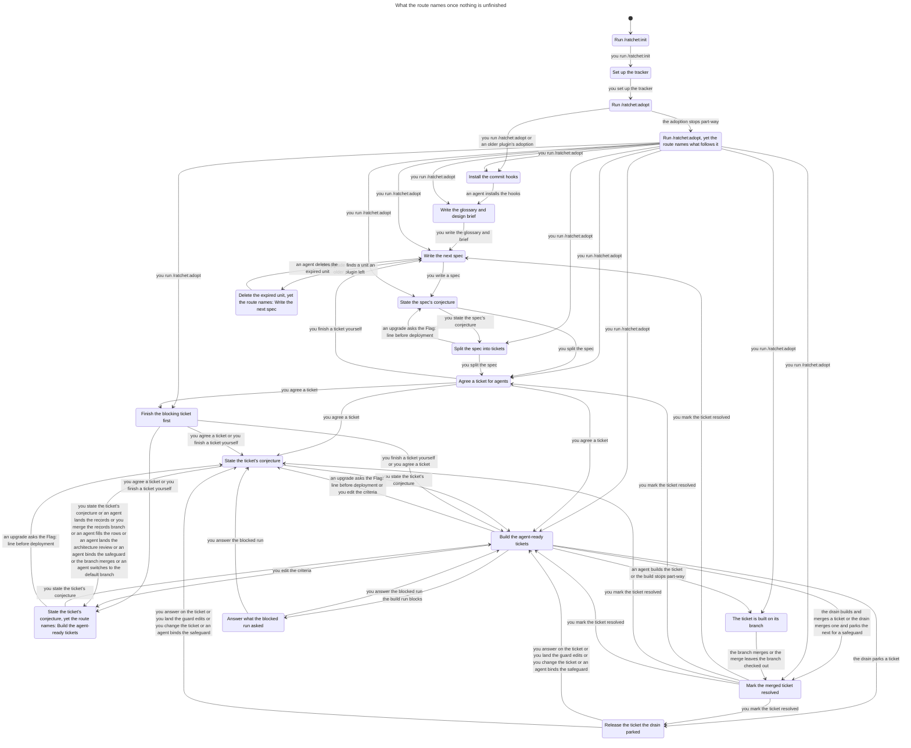
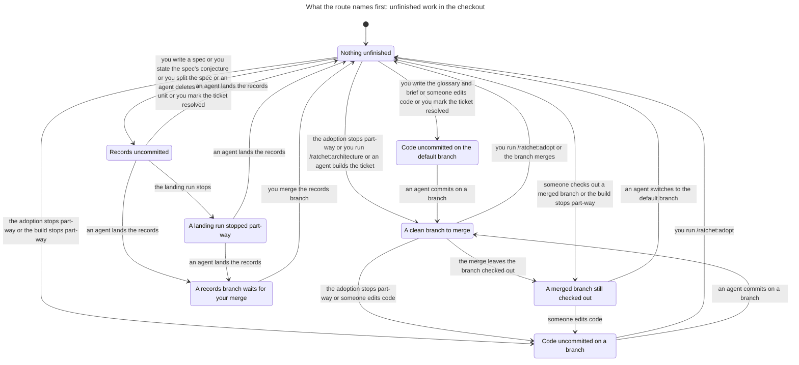
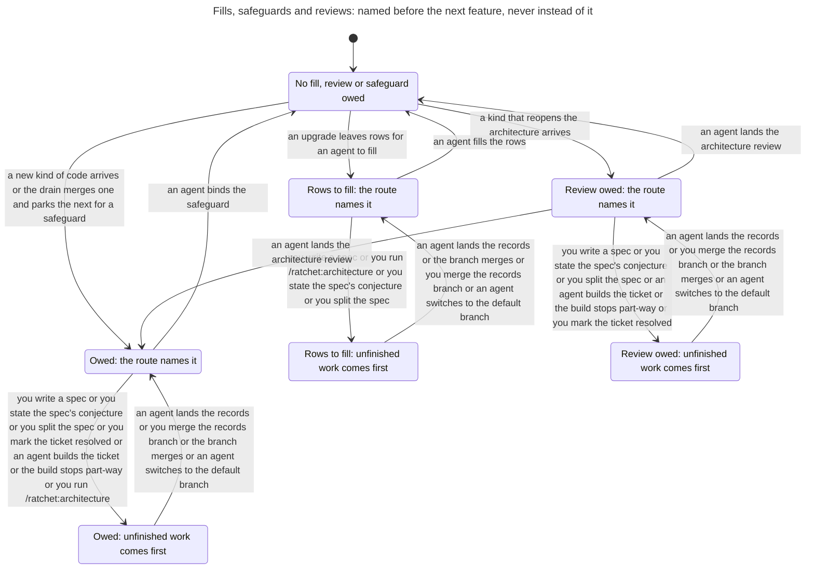
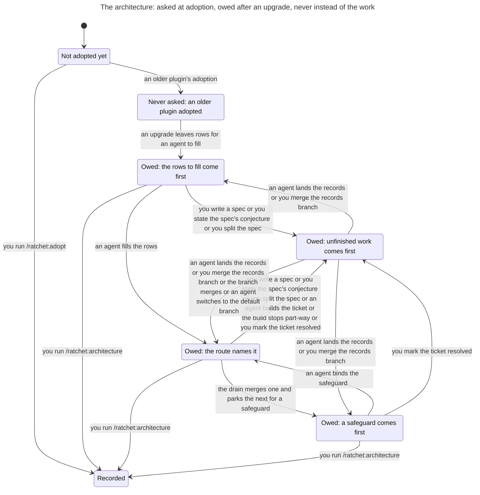
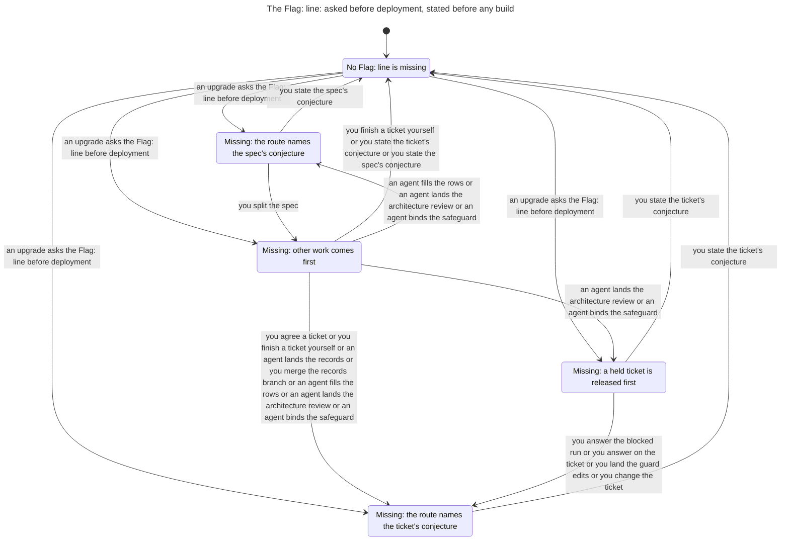

# The route

`scripts/route.py` reads the checkout and names the one command the owner types next. [The route](../../skills/method/route.md) says what it names in each case. This page writes that down as a state machine: the states the route can tell apart, what it names in each, the steps that lead from one state to the next, and the rules the steps keep.

The model is `hooks/tests/route_model.py`. The tests in `hooks/tests/test_route_model.py` prove the rules on it, take each of its steps on a real repository, and ask the real route after each.

## Scope

The model covers one repository with:

- no forge: no `origin`, tickets in the local tracker, the route asked offline;
- one spec at a time, split into two tickets, the second blocked by the first;
- one step at a time: a step on a spec or a ticket starts from a clean default branch with no records branch waiting;
- one checkout: no other work tree holds the default branch;
- one upgrade that ships ADR 0061 to a project the `Flag:` line is asked of and that is not deployed, from a plugin that already asks the architecture. A part of a split and a ticket on a forge's tracker are out of it, since the model has neither;
- one kind of edit of the criteria a stated conjecture was drafted against: a ticket's `## Acceptance criteria` where it states its own conjecture, or the spec's `## User Stories` where its tickets inherit it, made on a clean default branch;
- one steering unit at a time (ADR 0064): the local spec and its two tickets under `.scratch/<slug>/`, which the step that resolves its last ticket deletes, and one unit a plugin from before ADR 0064 left, which the upgrade that ships it finds at rest. The pipeline's feature spec under `docs/features/<slug>/` is out of it, since the model's build writes none.

What it leaves out is listed [at the end](#left-out).

## State

| Part | Values |
| --- | --- |
| Setup | nothing; an init that stopped before its questions; init done; the tracker set up; an adoption that stopped before it wrote the plugin pin; one that stopped after the pin, before its proof; adopted |
| Commit hooks | installed, or not |
| Checked out | the default branch; a working branch; a working branch the default branch already holds; the `records/<time>` branch a stopped `just merge --records` run left |
| Work tree | clean; records only; more than records |
| A records branch waits for the owner's merge: a local branch the default branch does not hold, whose change holds only records, that no run owns and no work tree has checked out | yes or no |
| The glossary and the design brief | written, or not |
| A spec not yet split | none; written; stating its conjecture |
| Each of the two tickets | none; needs triage; agent-ready; agent-ready with a conjecture; agent-ready with a stale conjecture, one whose criteria changed after it was written; held by a blocked run's stash; parked by the drain for open questions, for guard edits, for an owed safeguard, or by a note older than the kinds of hold or than the base commit a guard hold needs; built on its branch; merged but open; resolved |
| The tickets inherit the spec's conjecture | yes or no |
| A safeguard is owed | yes or no |
| An architecture review is owed | yes or no |
| An upgrade left rows an agent fills | yes or no |
| The architecture | never asked, as before adoption and after an adoption by a plugin from before ADR 0049; owed since an upgrade; recorded |
| The `Flag:` line | not yet asked, as before the upgrade that ships ADR 0061, whose plugin asked it only once `deployed` was declared; missing from the spec in flight and its tickets, which state their conjecture; asked, the conjecture writing it on the spec |
| The owner's `## Answers` lines | none; on the unit; dropped, a unit deleted without them in the brief |
| An expired unit is left in the tree | yes or no |

A waiting records branch is known by what it holds, not by its name. A feature run owns a `feature/` branch, and the drain owns a branch its note names. `just merge --records` names its branch `records/<time>`, and an agent that commits tickets on a branch of its own names it as it likes. The tests leave it on a branch an agent named in about half the states where one waits, and on a `records/<time>` branch in the others.

From an empty directory the model reaches 2798 states and 7669 steps. Nine of the states are at rest: adopted, nothing unfinished, nothing owed, and every ticket resolved or none written. In three the architecture is recorded, in three it was never asked, and in three it is recorded and the `Flag:` line is asked. At rest the route names the next spec.

`/ratchet:adopt` writes the plugin pin in its step 11, since every tier runs the plugin-pin gate first, and proves the adoption in step 12. So it can stop in two places: before the pin, with the templates committed on its branch, and after it, before its proof, with its work uncommitted there. The pages name `/ratchet:adopt` to resume either. Resumed on its branch it merges, as before; resumed off it, it proves the adoption and changes nothing else. Where it stopped after the pin, the model takes only that resume and the step the real route names, so the run it shows is that of an owner who follows today's route. In 29 states the adoption stopped after its pin, and they are not at rest.

A working branch the default branch already holds has no commit of its own to merge. A merge leaves it checked out when it is cut off before it switches, when it cannot switch, or when it is made from another checkout. A merge keeps the branch it merged, so it can be checked out again. A build that stops on the branch it cut, before it wrote anything, leaves one too: the branch is the default branch's tip. A commit on it makes it a working branch with work to merge again. In 350 states it is checked out clean, and in 9 with code uncommitted.

The architecture takes three values because each opens other steps. `/ratchet:adopt` asks it and records it (ADR 0049), so it is recorded from the adoption on. An adoption by an older plugin asked nothing, and the route reads nothing of that: it says the same as where the architecture is recorded. They part at an upgrade, which owes the architecture where it was never asked and owes nothing more where it is recorded. While it is owed the route names `/ratchet:architecture`, and recording it is the only step that ends that. In 2000 states the architecture is recorded, in 562 it was never asked, and in 236 it is owed.

The `Flag:` line takes three values (ADR 0061). Before the upgrade that ships the decision, the plugin asked the line only once `deployed` was declared, so in a project not yet deployed it waits, and nothing the route names turns on it. The upgrade moves no ticket. Where a record in flight states its conjecture and no line, the line is missing: the spec states its conjecture, a ticket inherits it, or a ticket states its own and is not yet built. A spec not yet split then reads as one with no conjecture, and the route names `/ratchet:conjecture` on the spec. A labelled ticket reads the same way. The route names `/ratchet:conjecture <ticket>`, and no feature run and no drain starts on it. The release of a hold, and the agreement of a ticket that inherits from the spec, lead there too. A built ticket goes on to its merge, since no preflight reads it again. The conjecture writes the answer and the line on the spec, which each ticket reads, so one conjecture lands the line for both tickets. Once it is on the spec, or every ticket that lacked it is closed, the line is asked: the conjecture writes it on every later spec. In 1822 states the line waits, in 368 it is missing, and in 608 it is asked.

ADR 0061 has the upgrade send each stated ticket back to agent-ready and stop the tickets inheriting until the spec states the line. The model keeps each ticket's state and reads the line beside it instead. A ticket sent back to agent-ready forgets whether it states its own conjecture, and that decides whether it is stated once the line lands on the spec. The route names the same step either way.

The upgrade arrives only where the architecture is recorded. An upgrade from a plugin before ADR 0049 is the model's other upgrade, which arrives at rest and owes the architecture.

A conjecture goes stale when the owner or an agent edits the criteria it was drafted against, after it was written. [The conjecture skill](../../skills/conjecture/SKILL.md) ends `## Conjecture` with a `- Criteria:` line, the criteria heading and a digest of that section, so one command tells whether they changed. A ticket that states its own conjecture is checked against its own `## Acceptance criteria`. A ticket that inherits the spec's is checked against the spec's `## User Stories`, so an edit of the stories makes both tickets stale at once, and a ticket agreed while the spec is stale is agreed stale. The edit moves nothing else. A stale ticket reads as one with no conjecture: the route names `/ratchet:conjecture <ticket>` where it would otherwise build it, and no feature run and no drain starts on it. The redraft, the same command, is the only step that clears it: it writes the `- Criteria:` line again on the body that holds the conjecture, for both tickets where they inherit it. A conjecture with no `- Criteria:` line is current, so a stated ticket is never stale until the edit. In 543 states a conjecture is stale: in 170 it is inherited, in 46 both tickets are stale, and in 101 the `Flag:` line is missing as well. The edit is 333 steps, 98 of them on the spec's stories. The route names the conjecture of the stale ticket in 40 states. In 5 more it names the conjecture of the other ticket first, and in 3 the build of the other ticket, whose conjecture is current. In the others something it names first comes before it: the checkout, a records branch, a fill, a review, a safeguard or the architecture, a merged ticket to resolve, a blocking ticket, or a hold.

A spec and its tickets are a steering unit ([ADR 0064](../adr/0064-a-document-has-a-kind-and-a-steering-document-leaves-with-its-feature.md)). The unit expires when its last ticket is resolved, and the step that resolves that ticket deletes it: the owner's mark of the merged ticket, or the owner finishing the ticket themself. That step runs `documents.py expire`, which deletes the unit and appends each of its `## Answers` lines, dated, to the brief's `## In the owner's words`. Every spec the world writes holds an answer, so that deletion always edits the brief, and the brief is no kind of record to the merge judge. So the mark of the last ticket leaves code uncommitted on the default branch, and the route names a commit on a branch and its merge, where it named the landing of records before. The owner who finishes the last ticket commits the deletion with it. In 41 steps the mark expires the unit, and in 60 the owner finishing a ticket does. No other step expires one: the drain's merge leaves its ticket open, as before.

A unit left in the tree after it expired comes from a plugin from before ADR 0064, which deleted nothing. The upgrade that ships the decision finds one at rest, once a feature is finished, in 6 steps. The route then names its deletion, `expire`, after the owed architecture and before the glossary and any spec or ticket. The world's older unit holds no answer, so its deletion leaves records alone uncommitted, and the route names their landing. While a unit is left the model takes no new spec. In the 6 states where one is left the route names its deletion, and the real route names the next spec: a [divergence](#divergences).

The deleter is what keeps the unit's rules, and the tests walk the model twice more without it. Where the step that makes the unit expired leaves it in the tree, the model reaches 2914 states and 7899 steps, and `NoStepLeavesTheUnitItExpires` breaks in 101 steps: the 41 marks and the 60 times the owner finishes a ticket. Its shortest run is 13 steps: `/ratchet:init`, the tracker, `/ratchet:adopt`, the hooks, the glossary and brief committed and merged, a spec written and landed, split and landed, and the owner finishing both tickets. Every other rule holds there, since the route names the deletion before any work and following it reaches rest. Where the step deletes the unit and drops its answers, the model reaches 2870 states and 7858 steps, and `TheOwnersAnswersOutliveTheUnit` breaks in 131 states, first after the same 13 steps. `ExpiredUnitBeforeTheWork` breaks without the deleter in no run; the real route breaks it.

## What the route names

The route asks in this order, and the first case that applies is its answer. Each answer is a label. There are 29 labels; `safeguard` is named in two places.

| Label | When | What it names |
| --- | --- | --- |
| `init` | no setup, or an init that stopped | `/ratchet:init` |
| `tracker` | init done | `/mattpocock-skills:setup-matt-pocock-skills` |
| `adopt` | the tracker is set up, or an adoption stopped, before the pin or after it, before its proof | `/ratchet:adopt` |
| `hooks` | the commit hooks are missing | the hooks install, which an agent runs |
| `finish-records` | a `records/<time>` branch is checked out | `just merge --records`, which finishes the stopped run |
| `land-records` | records alone are uncommitted on the default branch | `just merge --records` |
| `commit` | anything else is uncommitted | `just check`, then a commit on a branch |
| `switch` | a working branch the default branch already holds is checked out | `git switch <default>` |
| `merge` | a working branch is checked out | `just merge <branch>` |
| `merge-records` | a records branch waits, whatever its name | the owner's merge of it |
| `fill` | an upgrade left rows an agent writes from the repository | `/ratchet:fill` |
| `review` | an architecture review is owed | `/ratchet:architecture` |
| `safeguard` | a safeguard is owed | `/ratchet:safeguard` |
| `architecture` | an upgrade left the architecture owed | `/ratchet:architecture`, offering beside it the step it would otherwise name |
| `expire` | an expired unit is left in the tree | `documents.py expire` on the default branch, whose deletion lands as records |
| `grill` | no glossary or design brief | `/mattpocock-skills:grill-with-docs` |
| `triage` | no agent-ready ticket, and an unblocked one needs triage | agree that ticket |
| `conjecture-spec` | no agent-ready ticket, and a spec with no conjecture, or with no `Flag:` line where it is asked | `/ratchet:conjecture` on the spec |
| `split` | no agent-ready ticket, and a spec with its conjecture, and its `Flag:` line where it is asked | `/mattpocock-skills:to-tickets` |
| `specify` | no agent-ready ticket | `/mattpocock-skills:to-spec` |
| `resolve` | a merged ticket is still open | mark it resolved |
| `blocked` | every agent-ready ticket is blocked | finish the blocking ticket first |
| `blocked-run` | the first unblocked ticket is held by a blocked run | answer what the run asked, or land its guard edits |
| `answer` | ... parked by the drain for open questions | answer them on the ticket |
| `land-guard` | ... parked for guard edits | land the guard edits on the default branch |
| `safeguard` | ... parked for an owed safeguard | `/ratchet:safeguard` |
| `change-ticket` | ... parked by a note older than the kinds of hold or the base commit | change the ticket |
| `drain` | an unblocked ticket states a current conjecture, and so does another, each with its `Flag:` line where it is asked | `/ratchet:feature` with no ticket |
| `build` | an unblocked ticket states a current conjecture, and its `Flag:` line where it is asked | `/ratchet:feature <ticket>` |
| `conjecture` | any other case, a labelled ticket whose `Flag:` line is missing or whose conjecture is stale among them | `/ratchet:conjecture <ticket>` |

## Steps

45 steps change the state, and one of them can also leave it as it was. The owner's and an agent's steps each follow one label. The others are things that happen: a command that stops part-way, a run that blocks, a park, an edit.

| Step | Follows |
| --- | --- |
| you run `/ratchet:init` | `init` |
| init stops before its questions | |
| you set up the tracker | `tracker` |
| you run `/ratchet:adopt`, which records the architecture; resumed after its pin, off its branch, it proves the adoption alone | `adopt` |
| an adoption by a plugin from before the architecture was asked | |
| the adoption stops part-way: on its branch before the pin, committed; or after the pin, before its proof, uncommitted | |
| an agent installs the hooks | `hooks` |
| you write the glossary and the brief, uncommitted | `grill` |
| you write a spec | `specify` |
| you state the spec's conjecture, and its `Flag:` line where it is asked | `conjecture-spec` |
| you split the spec into the two tickets | `split` |
| you agree a ticket | `triage` |
| you finish a ticket yourself; the last one deletes the unit with it | `blocked` |
| you state the ticket's conjecture, or draft a stale one again, and the `Flag:` line on the spec where it is asked | `conjecture` |
| you or an agent edit the criteria a stated conjecture was drafted against: the ticket's, or the spec's it inherits | |
| an agent builds the ticket on its branch | `build` |
| the build stops part-way: its code uncommitted on the branch, or on the branch it cut before it wrote anything | |
| the build run blocks and leaves its stash | |
| you answer the blocked run | `blocked-run` |
| the drain builds and merges a ticket | `drain` |
| the drain parks a ticket for open questions, for guard edits, or with an older note | |
| the drain merges the first ticket, which brings a new kind of code, and parks the second for the safeguard | |
| you answer on the ticket | `answer` |
| you land the guard edits | `land-guard` |
| you change the ticket | `change-ticket` |
| you mark the merged ticket resolved; the last one deletes the unit and carries its answers to the brief, uncommitted | `resolve` |
| a new kind of code arrives, and a safeguard is owed | |
| an upgrade leaves rows for an agent to fill, and the architecture owed where it was never asked | |
| an upgrade asks the `Flag:` line before deployment, on the default branch or beside a built ticket's branch | |
| an agent fills the rows | `fill` |
| a kind of code that reopens the architecture arrives, and a review is owed | |
| an agent lands the architecture review | `review` |
| an agent binds the safeguard | `safeguard` |
| you run `/ratchet:architecture`: the record and the parts on a branch, whose merge is yours | `architecture` |
| an upgrade finds a unit a plugin from before ADR 0064 left, at rest | |
| an agent runs `documents.py expire`: the unit deleted, uncommitted | `expire` |
| someone edits code | |
| an agent commits on a branch | `commit` |
| the branch merges, and the default branch is checked out; on a branch already merged it changes nothing | `merge` |
| the merge leaves the branch checked out: cut off before it switched, unable to switch, or made from another checkout | |
| someone checks out a merged branch, at rest | |
| an agent switches to the default branch | `switch` |
| an agent lands the records: merged, or on a branch that waits for you | `land-records`, `finish-records` |
| the landing run stops on its branch | |
| you merge the records branch | `merge-records` |

## Rules

A rule whose name starts `Real` is on what the real route names; the others are on what the pages say. Four are on the architecture an upgrade leaves owed, five on the `Flag:` line (ADR 0061), two on the adoption's proof, five on a stale conjecture, and the last four on the steering unit (ADR 0064). Each rule on the pages holds in Python and in TLC, on every state. Five rules on the real route break, each only in states of [a divergence](#divergences) that names it. The other three on the real route hold: it names what the pages name everywhere but where an adoption stopped after its pin, a conjecture is stale, or an expired unit is left.

| Rule | Says | On the model |
| --- | --- | --- |
| `AdviceCanBeFollowed` | The step the route names can be taken. | holds |
| `AdviceReachesRest` | Following the route's advice reaches a state with nothing left to finish. | holds |
| `FollowingAdviceLowersRank` | Each step the route names gets nearer to having nothing left to finish. | holds |
| `RealAdviceCanBeFollowed` | The step the real route names can be taken. | breaks in 36 states |
| `FollowingRealAdviceLowersRank` | Each step the real route names gets nearer to having nothing left to finish. | breaks in 4 states |
| `AdviceChangesTheState` | Taking the step the route names changes the state: its effect has not already happened. | holds |
| `RealAdviceChangesTheState` | Taking the step the real route names changes the state: its effect has not already happened. | holds |
| `AdviceNeverMergesAMergedBranch` | The route never names the merge of a branch the default branch already holds. | holds |
| `RealAdviceNeverMergesAMergedBranch` | The real route never names the merge of a branch the default branch already holds. | holds |
| `ArchitectureNamedExactlyWhenOwed` | The owed architecture is named exactly when the ledger owes it and nothing named before it is open. | holds |
| `OwedArchitectureNeverHidesTheWork` | Where the owed architecture is named, the step the route would otherwise name can be taken. | holds |
| `OnlyAnUpgradeOwesTheArchitecture` | Only an upgrade leaves the architecture owed; an adoption never does. | holds |
| `OnlyRecordingEndsTheOwedArchitecture` | Recording the architecture is the only step that ends it being owed. | holds |
| `FlagLineBeforeTheBuild` | Where a labelled ticket has no `Flag:` line, on it or on its spec, the route names no build and no drain. | holds |
| `RealFlagLineBeforeTheBuild` | Where a labelled ticket has no `Flag:` line, on it or on its spec, the real route names no build and no drain. | holds |
| `NoRunStartsWithoutTheFlagLine` | No feature run and no drain starts while a ticket's `Flag:` line is missing. | holds |
| `OnlyTheUpgradeLeavesTheFlagLineMissing` | Only the upgrade that asks the `Flag:` line before deployment leaves it missing. | holds |
| `TheUpgradeMovesNoTicket` | The upgrade that asks the `Flag:` line moves no ticket and no inheritance: a built ticket stays built. | holds |
| `UnprovedAdoptionNeverBuilds` | A repository whose adoption stopped before its proof is never told to build. | holds |
| `RealUnprovedAdoptionNeverBuilds` | The real route never tells a repository whose adoption stopped before its proof to build. | breaks in 2 states |
| `StaleConjectureBeforeTheBuild` | Where a ticket's conjecture is stale, the route names no drain, and no build but of a ticket whose conjecture is current. | holds |
| `RealStaleConjectureBeforeTheBuild` | Where a ticket's conjecture is stale, the real route names no drain, and no build but of a ticket whose conjecture is current. | breaks in 33 states |
| `NoRunStartsOnAStaleConjecture` | No feature run and no drain starts on a ticket whose conjecture is stale. | holds |
| `OnlyTheRedraftClearsAStaleConjecture` | Only `/ratchet:conjecture` ends a stale conjecture, and it leaves the ticket stated. | holds |
| `TheCriteriaEditMovesNothingElse` | An edit of the criteria makes a stated conjecture stale and changes nothing else. | holds |
| `NoStepLeavesTheUnitItExpires` | A step that makes the unit expired deletes it: only the upgrade that ships ADR 0064 finds one left in the tree. | holds |
| `ExpiredUnitBeforeTheWork` | Where an expired unit is left in the tree, the route names no spec, ticket, build or drain. | holds |
| `RealExpiredUnitBeforeTheWork` | Where an expired unit is left in the tree, the real route names no spec, ticket, build or drain. | breaks in 6 states |
| `TheOwnersAnswersOutliveTheUnit` | No unit is deleted with the owner's `## Answers` lines left out of the brief. | holds |

The rank of a state is the longest run of advised steps from it to rest. The highest rank is 23.

On a branch the default branch already holds, the merge can still be run, and it changes nothing: the merge judge refuses the branch, as behind a merge commit that holds it, or as a change with nothing in it to judge. The model has that step, from each of the 350 states. So a route that named the merge there would name a step that can be taken, and `RealAdviceCanBeFollowed` would hold. That is how the defect this model once missed got past it: with no forge, after the merge left the checkout on the branch, the route named the same merge again, for ever. `RealAdviceChangesTheState` breaks there. TLA+ cannot see a step that leaves every variable as it was, so the rule is a fact of each state: no way of taking the step named leads back to the same state.

`ArchitectureNamedExactlyWhenOwed` names what comes before the architecture field by field, apart from the order the model asks in: the setup, the hooks, the checkout, a records branch, rows to fill, a review and a safeguard. So a change of that order breaks it. In 92 states the route names the owed architecture, and the step it would otherwise name is a build in 8 of them and the drain in 2.

The upgrade that asks the `Flag:` line arrives in 358 steps, and in 275 it leaves the line missing. 30 of the 358 arrive beside a built ticket's branch, and 12 of those leave the line missing; the built ticket goes on to its merge. In 23 of the 368 states where the line is missing the route names a conjecture: the ticket's in 22, and the spec's in 1. In the others something it names first comes before it: the checkout, a records branch, a fill, a review or a safeguard, a hold, triage, a merged ticket to resolve, or a blocking ticket. Three steps end a missing line: the ticket's conjecture, in 192 steps, the spec's conjecture, in 4, and the owner finishing the last ticket that lacked it, in 11.

The tests also check that:

- following the advice never comes back to a state it passed, except through rest;
- every state reaches rest by some steps;
- each kind of hold is released by the one step the route names for it, and by no other: a ticket parked for guard edits stays parked when another ticket is agreed or the binding changes, and a note older than the kinds of hold, or a guard hold with no base commit, waits for a change to the ticket;
- the edit makes a conjecture stale on a ticket and on the spec, both tickets at once there; from every state where the route names the conjecture and a conjecture is stale, the redraft clears one; and where the stale ticket is the one the route would otherwise build, the route names the conjecture while the real route names a build or the drain;
- on a real repository, every ticket the world writes has `## Acceptance criteria` and every spec `## User Stories`, and each conjecture it writes ends with a `- Criteria:` line whose digest is what the conjecture skill's own command prints, read from the skill page; the edit adds a criterion, and the redraft writes the line again;
- on a real repository, the real route names what the model says after every one of the 7669 steps, each taken from its source state as the shortest path from an empty directory builds it; where the drain parks a ticket for the safeguard, it parks on what the real `triggers.py` printed for the ticket's change;
- on a real repository whose binding runs `merge.py`, the merge the route names, of the adoption's branch before its proof or of a working branch, leaves the default branch checked out and keeps the branch, and the route names what the model says after it; checked out again, the branch is named for the switch, a second merge of it changes nothing, and the switch goes back;
- on such a repository, a merge with a dirty tree, or with the default branch checked out elsewhere, leaves HEAD on the branch and its `next:` line names the switch first, and a merge run from the default branch leaves HEAD there; the route then names what the model says;
- on a real repository, a build that stops on the branch it cut is left by the switch and built again, and following the route from there never comes back to it;
- the walk leaves records waiting on branches of both kinds of name, and on a real repository, records waiting on a branch an agent named are named for their merge, those of a spec and those of the two tickets;
- where the real route names the owed architecture, its `then:` names the step it names once the architecture is no longer owed, and its `why:` offers carrying on with it; that step is the one the model gives beneath, read as the real route reads the state;
- where the real route names a safeguard, its `then:` names the step it names once the rows are bound, which is the owed architecture exactly where the model owes one, and its `why:` still offers carrying on with the work;
- on a real repository, a commit on the default branch that a guard hold did not name leaves the ticket held, and landing the guard edits releases it;
- on a real repository, the architecture check finds nothing after `/ratchet:adopt`, and the real `upgrade.py --apply` then owes no architecture;
- on a real repository an older plugin adopted, the real upgrade owes exactly what the architecture check finds, the route names the fill, which the real upgrade settles once the rows are written, then `/ratchet:architecture`, then its branch's merge, and the check finds nothing after;
- the real upgrade also owes every other finding red at the merge base, which the route never names, and on the test's adoption, which writes the quality files the adopt templates hold, it leaves nothing red and exits 0, as every upgrade in the tests must;
- on a real repository that owes the architecture, a review and a safeguard that arrive beside it are each named before it;
- a drain note older than a blocked run's stash, or one with no base commit, does not release the run;
- on long runs of steps, a repository that loses its commit hooks is told to install them first, whatever else is true;
- the steps that expire the unit are the mark of the last ticket, which leaves code uncommitted, and the owner finishing the last ticket, which commits; a left unit is named for its deletion, which leaves records alone;
- without the deleter, `NoStepLeavesTheUnitItExpires` breaks and no other of the unit's rules does, and without the answers it carries, `TheOwnersAnswersOutliveTheUnit` does; each first breaks after the 13 steps above;
- on a real repository, the step that resolves the last ticket deletes `.scratch/<slug>/` and appends each of its `## Answers` lines to the brief, as `documents.py expire` will, and the sweep asks the real route after it.

## The `also:` lines

After `next:`, `why:` and `then:` the route prints its `also:` lines: the upgrade, a standing answer, a sign of a life event. ADR 0061 adds one more: each switch past its removal date, as `flags.py --expired` lists it, with no forge and before `/ratchet:safeguard` binds the row `no flag past its removal date`. It outranks no step.

An `also:` line needs no state of the model. The model's label is the `next:` line alone, and an `also:` line changes no step: it is read from the registry and the date, and nothing the owner or an agent does next turns on it. So the model leaves the lines out, and two tests on the real route hold the new one instead:

- `test_a_switch_past_its_removal_date_outranks_no_step` walks from an empty directory through a whole feature. At each stop where the default branch is checked out clean, the route on a copy whose default branch declares a switch past its date prints the same `next:`, `why:`, `then:` and stage as without it. This holds today.
- `test_the_route_names_each_switch_past_its_removal_date` takes the shortest run, `/ratchet:init`, the tracker, `/ratchet:adopt` and the hooks, then commits that switch on the default branch, and expects an `also:` line naming it. `scripts/route.py` prints one such line for each switch past its date, so this holds.

## Divergences

Where the pages make a promise that the rule they give for it does not keep, and the real route follows the rule, the model follows the promise and names the place as a divergence. The tests hold the route to the model with the divergences applied. Each one also has a test that expects the route to keep the promise and fails. That test turns red the day the route is fixed. Then the divergence is deleted from `route_model.py`.

The real route reads a state through every divergence that holds there, as the script does. No state of the model holds two of these: where an adoption stopped after its pin, the model takes no edit of the criteria, and a unit is left only at rest, where no conjecture is stale and the adoption is proved.

There are three.

- `adoption-proved-by-its-pin`. [The adopt skill](../../skills/adopt/SKILL.md) says of its proof: "Done when `check` is green in a fresh worktree of the commit, `conformance` and `check-deep` exit 0, no rehearsal worktree is left, and the rehearsal passed, or its second round ended with the edits it still needs named." `scripts/route.py`, `adoption_step`, reads a binding with no plugin pin as an adoption that stopped, and one with a pin as adopted. The pin is written in step 11 and the proof run in step 12, so where the adoption stopped between them the real route reads it as finished. The shortest run: `/ratchet:init`, the tracker, the adoption stopped after its pin, the hooks, its work committed and merged as the route names, the glossary and brief committed and merged, a spec written and landed, its conjecture stated and landed, split and landed, the first ticket agreed. The model names `/ratchet:adopt`. The real route names the ticket's build. In the 29 states where the adoption stopped after its pin, the real route names what it names once the adoption is done. In 2 that is a build, so `RealUnprovedAdoptionNeverBuilds` breaks. In 4 it is the commit or the merge of the adoption's own branch, or the next spec, each a step that leads further from rest, so `FollowingRealAdviceLowersRank` breaks. The sweep holds the real route to what it names today, and a strict expected failure replays the shortest run and expects `/ratchet:adopt`.
- `stale-conjecture-read-as-stated`. [The records page](../../skills/method/records.md) says of a conjecture gone stale: "When the criteria change after it, `/ratchet:conjecture <ticket>` finds another digest, drafts the three sections again, keeps every line under `## Answers`, asks only the forks the change opened, and prints what changed in the conjecture." No script reads the `- Criteria:` line. `scripts/feature_preflight.py`, `conjecture_failure`, asks only that `## Conjecture` states something, and `scripts/route.py`, `unstated`, asks the preflight. So the real route reads a stale ticket as stated, and the rule the route page gives, a build for one ticket that states a conjecture and the drain for more, sends it to a build. The shortest run, 14 steps: `/ratchet:init`, the tracker, `/ratchet:adopt`, the hooks, the glossary and brief committed and merged, a spec written and landed, split and landed, the first ticket agreed and its own conjecture stated, then an edit of its acceptance criteria. The model names `/ratchet:conjecture` on the first ticket. The real route names its build. In 33 states a stale conjecture is where the real route names a build or the drain. In 30 of them the pages name the conjecture, and the step the real route names is a run no preflight should start, so `RealAdviceCanBeFollowed` breaks there. In all 33 `RealStaleConjectureBeforeTheBuild` breaks: 21 builds of the stale ticket and 12 drains, 3 of them where the pages name the build of the other ticket, whose conjecture is current, and the drain would build the stale one after it. The same reading reaches the step the route offers beside the owed architecture: in 11 of the 92 states that name it, the real route's `then:` offers a build or the drain where the pages offer the conjecture or the build of the other ticket. The sweep holds the real route to what it names today, and a strict expected failure replays the shortest run and expects the conjecture.

- `expired-unit-unread`. [ADR 0064](../adr/0064-a-document-has-a-kind-and-a-steering-document-leaves-with-its-feature.md) says of a unit already expired at the merge base: "The route names a records change that deletes it, and the records check allows the deletion of a file `expire` lists, where today a record may not be deleted (`merge_ready.py:1115-1116`)." No script reads whether a unit has expired, and `scripts/documents.py` does not exist yet. `scripts/route.py` names the next spec wherever every ticket is resolved, as it does at rest. The shortest run, 14 steps: `/ratchet:init`, the tracker, `/ratchet:adopt`, the hooks, the glossary and brief committed and merged, a spec written and landed, split and landed, the owner finishing both tickets, then the upgrade that finds a unit an older plugin left. The model names `expire`. The real route names `/mattpocock-skills:to-spec`. In all 6 states where a unit is left the real route names the next spec, a step the model does not take there, so `RealAdviceCanBeFollowed` and `RealExpiredUnitBeforeTheWork` break. The sweep holds the real route to what it names today, and a strict expected failure replays the shortest run and expects `expire`.

Two more were deleted. `flag-line-waits-for-deployed` went when the preflight began to ask the `Flag:` line of every declared type the catalogue asks it of, whatever the life events. The model was written with the other, a guard hold that outlived the edits it asked for. It went when the drain's note began to record the paths a run named as its cause, and the default branch's commit when it parked. Landing those paths releases the hold.

## What the next script change must do

Each item below flips the pins it names. Delete each pin in the same change.

- The adoption's proof, decided by the project's owner as recommended here. `skills/adopt/SKILL.md`: the last step writes one binding line, `- Adopted: <plugin version>`, once the proof is green. `scripts/route.py`, `adoption_step`: a binding with no such line is an adoption still running, and the route names `/ratchet:adopt` to resume it. `scripts/upgrade.py` writes the line for a binding that already has a pin, so an adoption finished before the change is not sent back. `scripts/conformance.py` requires the line once the binding exists. The world's resume in `route_world.py` then writes the line as the skill does. The strict expected failure `test_the_route_names_what_the_pages_say_where_it_diverges[adoption-proved-by-its-pin]` passes, which is red; delete the entry from `DIVERGENCES`. The model has none of this until the scripts do.
- A stale conjecture, decided by the project's owner: the route and the preflight read the digest. `scripts/feature_preflight.py` refuses it, and `scripts/route.py` follows, since it reads a ticket as stated only where the preflight finds its conjecture. The strict expected failure `test_the_route_names_what_the_pages_say_where_it_diverges[stale-conjecture-read-as-stated]` then passes, which is red; delete the entry from `DIVERGENCES`. What the change must do:
  - The route reason. Where the first free ticket nothing holds has a stale conjecture, the route names `/ratchet:conjecture <ticket>`, at the stage `conjecture`, and its `why:` says that the ticket's criteria changed after its conjecture was written. A stale ticket is not counted among the tickets that state a conjecture, so it is neither built nor drained, and the other ticket is built alone where its conjecture is current.
  - The preflight refusal. `conjecture_failure` refuses a ticket whose conjecture is stale, naming the ticket, the heading its `- Criteria:` line names, and `/ratchet:conjecture <ticket>` as the command that drafts it again. The drain reads the same refusal, so it starts no run on it.
  - The digest. Read the line's heading and digest, and compute the digest of that section as the conjecture skill's command does: the lines from the heading to the next `## ` heading, carriage returns dropped, blank lines dropped, as git hashes a blob. The world computes its fixtures with that command, read from the skill page, so a script that computes another digest reads every world ticket as stale and the sweep goes red at once.
  - The line is not a statement. `states_a_conjecture` judges the section without its `- Criteria:` line, so a `## Conjecture` that holds that line alone states no conjecture. Today it counts as stated: `test_a_conjecture_that_holds_only_its_criteria_line_states_none` is a strict expected failure that passes, which is red, when this is done; take its mark away.
  - No line, no staleness. A conjecture with no `- Criteria:` line is current, as the skill says, so a ticket written before the line was added, or by hand, is not sent back.
  - Inheritance. A ticket with no `## Conjecture` of its own takes its parent spec's, and is checked against the digest of the spec's `## User Stories`, the heading the spec's line names. The ticket's own `## Acceptance criteria` are not read for it, so an edit of them is not noticed. That is a known gap of the skill, and this change does not close it.
  - Neither heading. A body with neither `## Acceptance criteria` nor `## User Stories` gets no line from the skill, so its conjecture is current. A line that names a heading the body no longer has is stale: the skill's command then prints the digest of an empty section, which is not the one the line holds.
  - The model has all of this but the two cases of the last item, which are argued here and not modelled: its tickets and its spec always have their heading, and the line always names it.

- The steering unit, decided by the project's owner in ADR 0064. `scripts/documents.py expire` lists a unit whose tickets are all resolved, deletes it, and appends each of its `## Answers` lines, dated, to the brief's `## In the owner's words`. `scripts/route.py` names it where an expired unit is left, at the stage `expire`, after the owed architecture and before the glossary and any spec or ticket; `classify` in `route_world.py` reads that stage as `expire` already. The strict expected failure `test_the_route_names_what_the_pages_say_where_it_diverges[expired-unit-unread]` then passes, which is red; delete the entry from `DIVERGENCES`. What the change must also do:
  - The route's own steps that expire a unit. The mark of a merged ticket (`resolve`) and the owner's finish of a blocking ticket (`blocked`) resolve the last open ticket of a unit as often as a feature run does, and ADR 0064 names a deleter only in the feature's own change. The merge judge is red on a change that makes a unit expired and leaves it, so each of those steps names `documents.py expire` beside the mark, or `merge --records` runs it. The world already deletes the unit at both, so the sweep stays green once the route names the deletion.
  - The brief is no record. A deletion that carries `## Answers` lines edits the brief, so it is not a records change, and the route names a commit on a branch for it, as the model has it. Only a unit with no answer leaves records alone. Either the brief's `## In the owner's words` becomes a kind of record that may only be added to, or the route's `expire` step names that commit.
  - A unit left is never red. The judge is red only on a change that makes a unit expired and leaves it, never on one that was expired at the merge base, so the head can hold a left unit until the records change the route names.

## Charts

The rules were checked on `Route.tla`, SHA-256 `18360853e8e0c781d911a8ef6a0d3c3ee82f0704e38ff405f2c6108ae1d744d8`. Run with the 24 rules that hold, TLC reached 2798 states, and its last line counts 7670 states generated: the start and 7669 steps. Nothing deadlocks. Run once for each of the five rules that break, with one worker, TLC stops at the shortest run that breaks it. For `RealAdviceCanBeFollowed` and `RealStaleConjectureBeforeTheBuild` that is the shortest run of the stale conjecture's divergence, 14 steps from an empty directory, the last of them the edit of the criteria. The expired unit's divergence breaks `RealAdviceCanBeFollowed` after 14 steps as well, and TLC meets the stale conjecture's run first. For `RealExpiredUnitBeforeTheWork` it is the shortest run of the expired unit's divergence, 14 steps, the last of them the upgrade that finds the unit. For `RealUnprovedAdoptionNeverBuilds` it is the shortest run of the adoption's, 16 steps. `FollowingRealAdviceLowersRank` breaks after 5: `/ratchet:init`, the tracker, the adoption stopped after its pin, the hooks, and the commit the real route names on the adoption's branch, where the pages name `/ratchet:adopt`.

Each of the two walks without the deleter was exported the same way and run with its one rule and one worker. TLC stops at the 13 steps the tests pin, the owner finishing the second ticket last.

That module is too large for the statechart tool to draw. The charts are drawn from `RouteShown.tla`, SHA-256 `9bfbb7b11973fe067199579d9cc6f03a5afecc34a7d1a22c5394b3d754127f69`: the same graph seen through what the charts show, which is what the route names, what it would name beneath, the checkout, what is owed, and whether the `Flag:` line is missing. Each chart's report says that TLC reached 487 states and 1706 steps there, and that nothing deadlocks.

A stale conjecture has no chart of its own. Seen with whether a conjecture is stale, the summary has 668 states, past the 500 the statechart tool draws. The work chart shows it: the edit of the criteria leads from "Build the agent-ready tickets" to the conjecture, which the real route reads as the build.

An expired unit needs no state of the summary of its own: where one is left the route names `expire`, which no other state names. The work chart shows the older unit's arrival and its deletion. The checkout's chart shows the mark of the last ticket leaving code uncommitted on the default branch, since its deletion edits the brief.

Each chart gives each of those states one label, and draws an arrow where a step changes the label. A step that keeps the label is not drawn. The summary carries no rule, so the charts have no legend. A state where the real route names something else says so in its label.

### The work

What the route names once nothing in the checkout is unfinished, no records branch waits and no rows to fill, safeguard, review or architecture is owed. Four labels share one state: the drain's three kinds of park and the park for a safeguard are "Release the ticket the drain parked". `build` and `drain` are "Build the agent-ready tickets". A state where the real route names something else says so after "yet the route names". Three do. Where an adoption stopped after its pin, the pages name `/ratchet:adopt` and the real route names what follows it, whatever the checkout and the tickets hold; that is one state here, and the resume leaves it for wherever the work stands. Where a ticket's conjecture is stale, the pages name its conjecture, and the real route names the build. Where the pages name the build of one ticket and the real route the drain, which would build a stale ticket after it, the chart shows the build alone, since both are "Build the agent-ready tickets". Where an older plugin left an expired unit, the pages name its deletion, and the real route names the next spec.

19 states and 50 arrows. It does not draw the 1179 steps that keep the label, which are most of the checkout's steps.

### The checkout

What is unfinished in the checkout, which the route names before any work. A merged branch still checked out is left by a switch, never merged again. The merge of it, which changes nothing, keeps the label and is not drawn.

8 states and 19 arrows. It does not draw the 945 steps that keep the label: the setup, the tickets, and what is owed.

### Fills, safeguards and reviews

Rows an upgrade left for an agent to fill are named first of these, and no feature or drain starts until they are written (ADR 0050); the model takes the feature run and the drain away while they are owed. A safeguard or an architecture review that is owed is named before the next feature, and after anything unfinished in the checkout. A review comes before a safeguard (ADR 0052): with both owed, landing the review leaves the safeguard named.

7 states and 13 arrows. It does not draw the 1329 steps that keep the label.

### The architecture

`/ratchet:adopt` records the architecture, and an adoption by an older plugin never asked it. An upgrade owes it where it was never asked (ADR 0049). The route names it after the rows to fill, a review and a safeguard, and offers beside it the step it would otherwise name, so it never hides a build or the drain. `/ratchet:architecture` leaves the record on a branch whose merge is the owner's: this chart draws that as recorded, and the checkout's chart draws the merge.

7 states and 15 arrows. It does not draw the 1596 steps that keep the label.

### The `Flag:` line

The upgrade that ships ADR 0061 leaves the line missing where a record in flight states its conjecture. The route then names a conjecture once nothing it names first is open: the spec's, where the spec is not yet split, and the ticket's otherwise. That conjecture lands the line on the spec for both tickets. A held ticket is released first, and then needs its conjecture. A ticket the owner finishes themself closes without it. The real route names the same in every state here.

5 states and 13 arrows. It does not draw the 1588 steps that keep the label.

## Left out

- A forge: `origin`, pull requests, issues on the forge. The route reads them online; the tests ask it offline.
- More than two tickets, more than one spec at a time, and blocking edges other than the second ticket on the first.
- A ticket too large for one change, which the agent splits itself, and the hold left when its split is refused.
- A red `check`. The model takes `just check` as green.
- The merge judge's reasons. A records landing has two outcomes, merged alone or waiting for the owner, and the model allows both whatever the records change.
- Which changes among the records are the owner's to merge. The merge judge decides it, and the judge's own tests test it. The model has only that a records branch waits for the owner or lands by an agent.
- The owner's ticket edits as records. Agreeing a ticket, stating its conjecture and finishing a ticket yourself are one step each. Only marking a ticket resolved goes through records uncommitted and a landing.
- A split that stops half-way, a grill that writes only part of its records, and a safeguard run that stops.
- The drain's own states: its work trees, the merge job, and retries of a mechanical wait.
- A drain note written after a blocked run's stash on the same ticket, and a note with more than one kind of hold. The other order is in the model: a ticket the drain parked, then changed by the owner, then held by a run that blocked. The note is older than the run, so the route judges the run as if the drain had written no note, and names it until the ticket changes again.
- A note a drain wrote with its kinds of hold but before it recorded the default branch's commit. Landing its guard edits does not release it, and the route names them again; a change to the ticket does.
- A kind that reopens the architecture and owes rows of its own as well, a declared life event that reopens it, and a ticket the drain parks while a review is owed. The model's arrival owes the review alone; `test_architecture_review.py` holds the route's order where rows are owed too, the review and then the safeguard, and the release of such a park.
- Rows to fill owed together with a safeguard or a review. The model's upgrade arrives at rest and leaves rows to fill alone; `test_route.py` holds the route's order where they are owed together.
- A review or a new kind that arrives while the architecture is owed. The model's arrivals come at rest; a test walks a review and a safeguard that arrive beside it on a real repository. A safeguard beside it is in the model, from the drain.
- An adoption by an older plugin that stops part-way, an upgrade that owes the architecture and no rows to fill, and an architecture recorded a second time to revisit it. An upgrade owes the architecture once: after it is recorded, an upgrade owes none.
- The `also:` lines, for the reason [above](#the-also-lines).
- Another work tree that holds the default branch. There the merge cannot switch, and both its `next:` line and the route name `git switch <default>`, which git refuses while that work tree holds it. A strict expected failure in the tests turns red the day the step named there can be taken.
- A branch the default branch holds, edited anywhere but at rest. What the route makes of a dirty tree there does not depend on the tickets or on what is owed.
- A project that is deployed, a library, or one whose flag row is bound `none`. The upgrade that asks the `Flag:` line changes nothing the route names there, as for any other upgrade.
- Any step but the resume and the real route's from an adoption stopped after its pin: an edit, an upgrade, a hold. The model shows where today's route leads from there, and nothing else.
- That upgrade before the glossary is written, while records or code are uncommitted or a records branch waits, or from a plugin before ADR 0049.
- A ticket whose own `## Operability` block lacks the `Flag:` line its spec states, which ADR 0061 reads line by line. The model's tickets carry no block of their own.
- An edit of the criteria of a ticket that is held, built, merged or still in triage; an edit of the spec's stories before any ticket of it is agreed, or while a ticket that inherits from it is held; an edit that puts the criteria back as they were; and an edit made while the checkout is unfinished. The model's edit comes on a clean default branch and makes a stated conjecture stale.
- An edit of the own `## Acceptance criteria` of a ticket that inherits its conjecture. The skill reads only the spec's stories for it, so that edit is not noticed and leaves it current. That is a known gap of the skill, which this page states and does not fix, and the model has no step for it.
- Hooks lost after the setup. The model installs them once; the stateful test takes them away every seventh step and checks that the route names them first.
- The pipeline's feature spec under `docs/features/<slug>/` and its verdict record, the `expire` commit a feature run makes before that record, and the judge-again run that reads a deleted spec from the parent of the commit that deleted it. The model's build writes no spec. The drain model takes these.
- Tickets of one unit built at once and merged in any order, a ticket that waits and is merged by hand later, and an update of a branch across a deletion, whose conflict resolves to the deletion. The model builds one ticket at a time, the second blocked by the first. The drain and merge models take these.
- The merge judge's check of expiry, and which deletions are the owner's to merge: a spent ticket's is not. The model's records landing waits or lands whatever it holds.
- A unit with no answer that its own feature expires, and an older unit with answers. Every spec the world writes holds one, and the older unit holds none.
- The change description as a marked commit (ADR 0064). It changes the words of the merge step, and no state.
