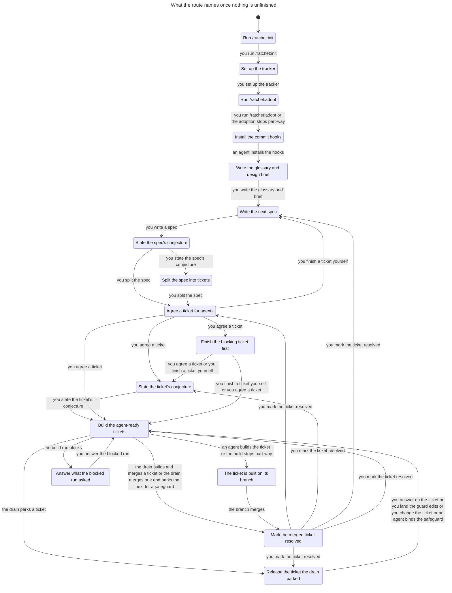
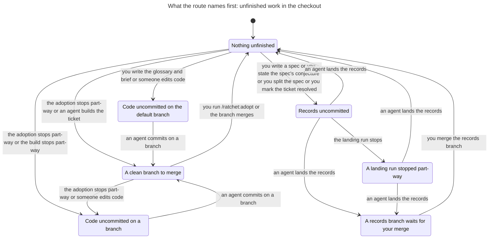
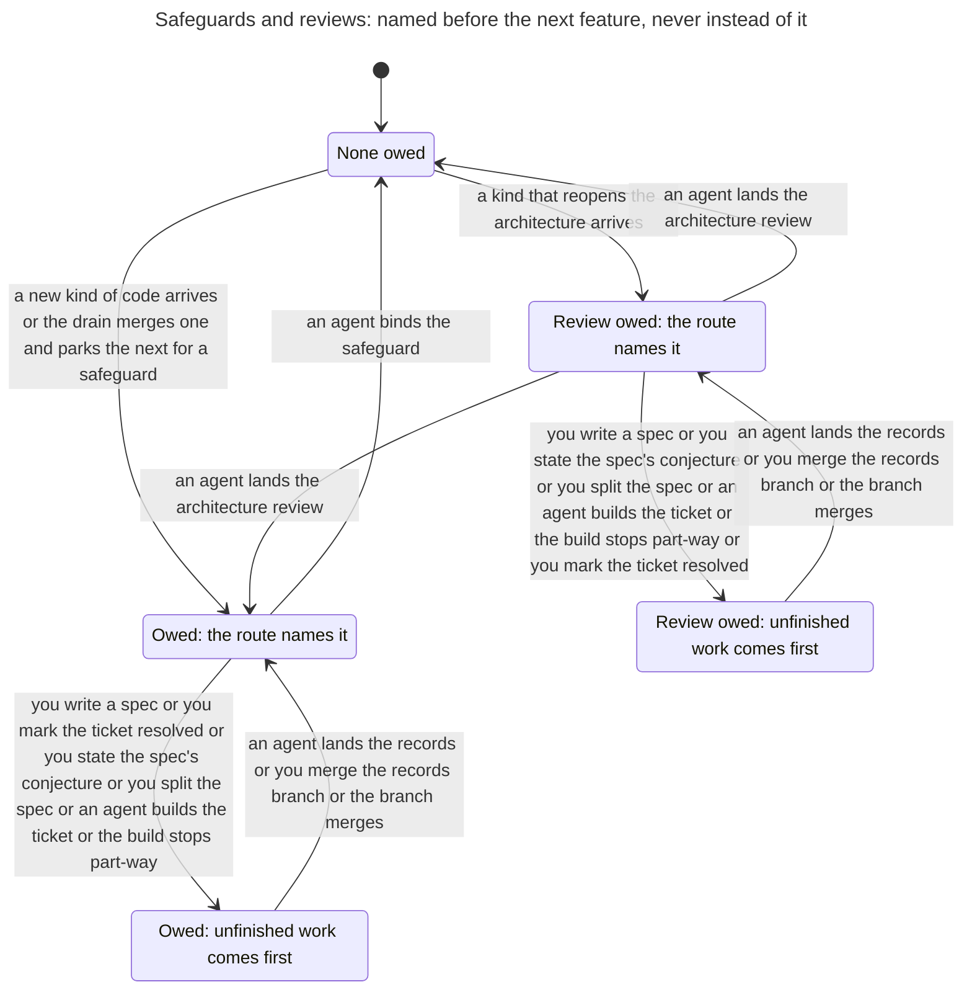

# The route

`scripts/route.py` reads the checkout and names the one command the owner types next. [The route](../../skills/method/route.md) says what it names in each case. This page writes that down as a state machine: the states the route can tell apart, what it names in each, the steps that lead from one state to the next, and the rules the steps keep.

The model is `hooks/tests/route_model.py`. The tests in `hooks/tests/test_route_model.py` prove the rules on it and ask the real route in each of its states.

## Scope

The model covers one repository with:

- no forge: no `origin`, tickets in the local tracker, the route asked offline;
- one spec at a time, split into two tickets, the second blocked by the first;
- one step at a time: a step on a spec or a ticket starts from a clean default branch with no records branch waiting.

What it leaves out is listed [at the end](#left-out).

## State

| Part | Values |
| --- | --- |
| Setup | nothing; an init that stopped before its questions; init done; the tracker set up; an adoption that stopped before it wrote the plugin pin; adopted |
| Commit hooks | installed, or not |
| Checked out | the default branch; a working branch; a `records/<time>` branch |
| Work tree | clean; records only; more than records |
| A records branch waits for the owner's merge | yes or no |
| The glossary and the design brief | written, or not |
| A spec not yet split | none; written; stating its conjecture |
| Each of the two tickets | none; needs triage; agent-ready; agent-ready with a conjecture; held by a blocked run's stash; parked by the drain for open questions, for guard edits, for an owed safeguard, or by a note older than the kinds of hold; built on its branch; merged but open; resolved |
| The tickets inherit the spec's conjecture | yes or no |
| A safeguard is owed | yes or no |
| An architecture review is owed | yes or no |

From an empty directory the model reaches 409 states and 1024 steps. Three of the states are at rest: adopted, nothing unfinished, nothing owed, and every ticket resolved or none written. At rest the route names the next spec.

## What the route names

The route asks in this order, and the first case that applies is its answer. Each answer is a label. There are 25 labels; `safeguard` is named in two places.

| Label | When | What it names |
| --- | --- | --- |
| `init` | no setup, or an init that stopped | `/ratchet:init` |
| `tracker` | init done | `/mattpocock-skills:setup-matt-pocock-skills` |
| `adopt` | the tracker is set up, or an adoption stopped before the pin | `/ratchet:adopt` |
| `hooks` | the commit hooks are missing | the hooks install, which an agent runs |
| `finish-records` | a `records/<time>` branch is checked out | `just merge --records`, which finishes the stopped run |
| `land-records` | records alone are uncommitted on the default branch | `just merge --records` |
| `commit` | anything else is uncommitted | `just check`, then a commit on a branch |
| `merge` | a working branch is checked out | `just merge <branch>` |
| `merge-records` | a records branch waits | the owner's merge of it |
| `review` | an architecture review is owed | `/ratchet:architecture` |
| `safeguard` | a safeguard is owed | `/ratchet:safeguard` |
| `grill` | no glossary or design brief | `/mattpocock-skills:grill-with-docs` |
| `triage` | no agent-ready ticket, and an unblocked one needs triage | agree that ticket |
| `conjecture-spec` | no agent-ready ticket, and a spec with no conjecture | `/ratchet:conjecture` on the spec |
| `split` | no agent-ready ticket, and a spec with its conjecture | `/mattpocock-skills:to-tickets` |
| `specify` | no agent-ready ticket | `/mattpocock-skills:to-spec` |
| `resolve` | a merged ticket is still open | mark it resolved |
| `blocked` | every agent-ready ticket is blocked | finish the blocking ticket first |
| `blocked-run` | the first unblocked ticket is held by a blocked run | answer what the run asked, or land its guard edits |
| `answer` | ... parked by the drain for open questions | answer them on the ticket |
| `land-guard` | ... parked for guard edits | land the guard edits on the default branch |
| `safeguard` | ... parked for an owed safeguard | `/ratchet:safeguard` |
| `change-ticket` | ... parked by a note older than the kinds of hold | change the ticket |
| `drain` | an unblocked ticket states a conjecture, and so does another | `/ratchet:feature` with no ticket |
| `build` | an unblocked ticket states a conjecture | `/ratchet:feature <ticket>` |
| `conjecture` | any other case | `/ratchet:conjecture <ticket>` |

## Steps

34 steps change the state. The owner's and an agent's steps each follow one label. The others are things that happen: a command that stops part-way, a run that blocks, a park, an edit.

| Step | Follows |
| --- | --- |
| you run `/ratchet:init` | `init` |
| init stops before its questions | |
| you set up the tracker | `tracker` |
| you run `/ratchet:adopt` | `adopt` |
| the adoption stops part-way: on its branch before the pin, committed; or after the pin, uncommitted | |
| an agent installs the hooks | `hooks` |
| you write the glossary and the brief, uncommitted | `grill` |
| you write a spec | `specify` |
| you state the spec's conjecture | `conjecture-spec` |
| you split the spec into the two tickets | `split` |
| you agree a ticket | `triage` |
| you finish a ticket yourself | `blocked` |
| you state the ticket's conjecture | `conjecture` |
| an agent builds the ticket on its branch | `build` |
| the build stops part-way, its code uncommitted on the branch | |
| the build run blocks and leaves its stash | |
| you answer the blocked run | `blocked-run` |
| the drain builds and merges a ticket | `drain` |
| the drain parks a ticket for open questions, for guard edits, or with an older note | |
| the drain merges the first ticket, which brings a new kind of code, and parks the second for the safeguard | |
| you answer on the ticket | `answer` |
| you land the guard edits | `land-guard` |
| you change the ticket | `change-ticket` |
| you mark the merged ticket resolved | `resolve` |
| a new kind of code arrives, and a safeguard is owed | |
| a kind of code that reopens the architecture arrives, and a review is owed | |
| an agent lands the architecture review | `review` |
| an agent binds the safeguard | `safeguard` |
| someone edits code | |
| an agent commits on a branch | `commit` |
| the branch merges | `merge` |
| an agent lands the records: merged, or on a branch that waits for you | `land-records`, `finish-records` |
| the landing run stops on its branch | |
| you merge the records branch | `merge-records` |

## Rules

The first three rules are on what the pages say. The last two are on what the real route names.

| Rule | Says | On the model |
| --- | --- | --- |
| `AdviceCanBeFollowed` | The step the route names can be taken. | holds |
| `AdviceReachesRest` | Following the route's advice reaches a state with nothing left to finish. | holds |
| `FollowingAdviceLowersRank` | Each step the route names gets nearer to having nothing left to finish. | holds |
| `RealAdviceCanBeFollowed` | The step the real route names can be taken. | holds |
| `FollowingRealAdviceLowersRank` | Each step the real route names gets nearer to having nothing left to finish. | holds |

The rank of a state is the longest run of advised steps from it to rest. The highest rank is 21.

The tests also check that:

- following the advice never comes back to a state it passed, except through rest;
- every state reaches rest by some steps;
- each kind of hold is released by the one step the route names for it, and by no other: a ticket parked for guard edits stays parked when another ticket is agreed or the binding changes, and a note older than the kinds of hold waits for a change to the ticket;
- the real route names what the model says in every one of the 409 states;
- on a real repository, a commit on the default branch that a guard hold did not name leaves the ticket held, and landing the guard edits releases it;
- on long runs of steps, a repository that loses its commit hooks is told to install them first, whatever else is true.

## Divergences

Where the pages make a promise that the rule they give for it does not keep, and the real route follows the rule, the model follows the promise and names the place as a divergence. The tests hold the route to the model with the divergences applied. Each one also has a test that expects the route to keep the promise and fails. That test turns red the day the route is fixed. Then the divergence is deleted from `route_model.py`.

There are none. The model was written with one, a guard hold that outlived the edits it asked for. It was deleted when the drain's note began to record the paths a run named as its cause, and the default branch's commit when it parked. Landing those paths releases the hold.

## Charts

The charts were drawn from the export with SHA-256 `076240ce7a140a0e893c9255e00ddd45d20a45ca68a0bdd3f3de162accc24097`.

Each chart gives each state of the model one label, and draws an arrow where a step changes the label. A step that keeps the label is not drawn, except on the path to a broken rule; no rule breaks, so the charts have no such path and no legend. Each chart's report says that TLC reached 409 states and 1024 steps, that all five rules hold, and that nothing deadlocks.

### The work

What the route names once nothing in the checkout is unfinished, no records branch waits and no safeguard or review is owed. Four labels share one state: the drain's three kinds of park and the park for a safeguard are "Release the ticket the drain parked". `build` and `drain` are "Build the agent-ready tickets". A state where the real route names something else would say so after "yet the route names"; none does.

16 states and 28 arrows. It does not draw the 566 steps that keep the label, which are most of the checkout's steps.

### The checkout

What is unfinished in the checkout, which the route names before any work.

7 states and 14 arrows. It does not draw the 597 steps that keep the label: the setup, the tickets, the safeguards and the reviews.

### Safeguards and reviews

A safeguard or an architecture review that is owed is named before the next feature, and after anything unfinished in the checkout. A review comes before a safeguard (ADR 0052): with both owed, landing the review leaves the safeguard named.

5 states and 9 arrows. It does not draw the 702 steps that keep the label.

## Left out

- A forge: `origin`, pull requests, issues on the forge. The route reads them online; the tests ask it offline.
- More than two tickets, more than one spec at a time, and blocking edges other than the second ticket on the first.
- A ticket too large for one change, which the agent splits itself, and the hold left when its split is refused.
- A red `check`. The model takes `just check` as green.
- The merge judge's reasons. A records landing has two outcomes, merged alone or waiting for the owner, and the model allows both whatever the records change.
- The owner's ticket edits as records. Agreeing a ticket, stating its conjecture and finishing a ticket yourself are one step each. Only marking a ticket resolved goes through records uncommitted and a landing.
- A split that stops half-way, a grill that writes only part of its records, and a safeguard run that stops.
- The drain's own states: its work trees, the merge job, and retries of a mechanical wait.
- A blocked run's stash and a drain note on the same ticket, and a note with more than one kind of hold.
- A note a drain wrote with its kinds of hold but before it recorded the default branch's commit. Landing its guard edits does not release it, and the route names them again; a change to the ticket does.
- A kind that reopens the architecture and owes rows of its own as well, a declared life event that reopens it, and a ticket the drain parks while a review is owed. The model's arrival owes the review alone; `test_architecture_review.py` holds the route's order where rows are owed too, the review and then the safeguard, and the release of such a park.
- An architecture an upgrade left owed in `quality/owed.toml`, which the route names after an owed safeguard and in the same way (ADR 0049). The model's repositories never owe one.
- The `also:` lines: signs of a life event, and standing answers.
- Hooks lost after the setup. The model installs them once; the stateful test takes them away every seventh step and checks that the route names them first.
