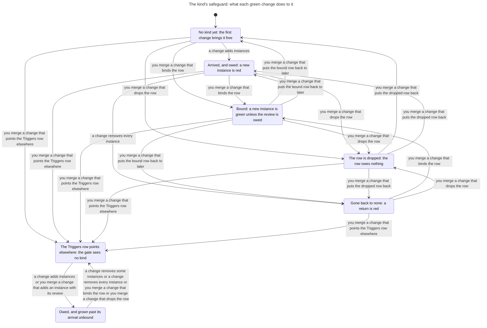
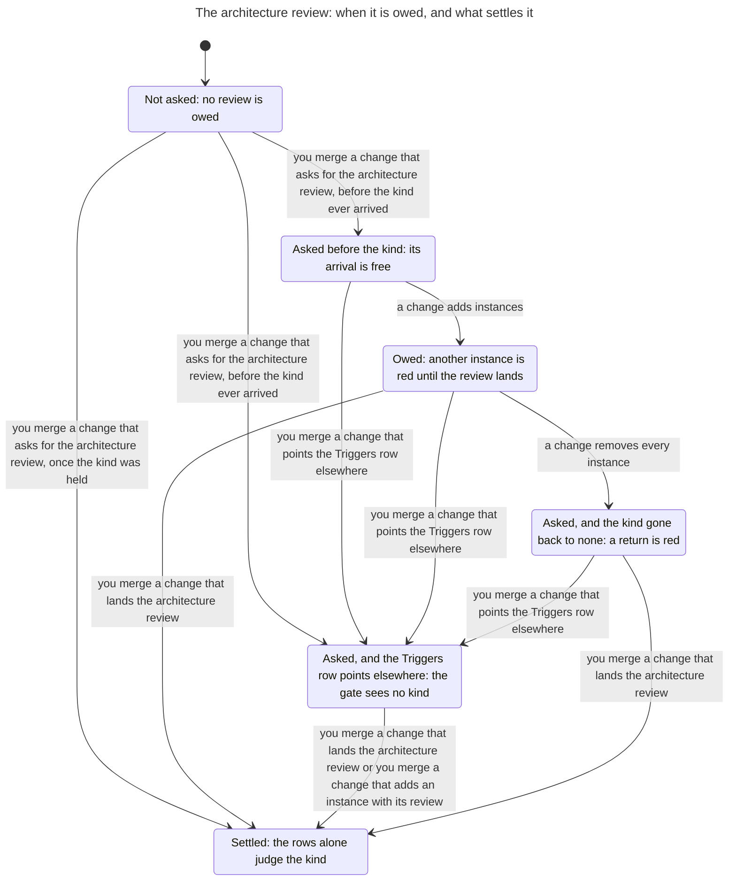
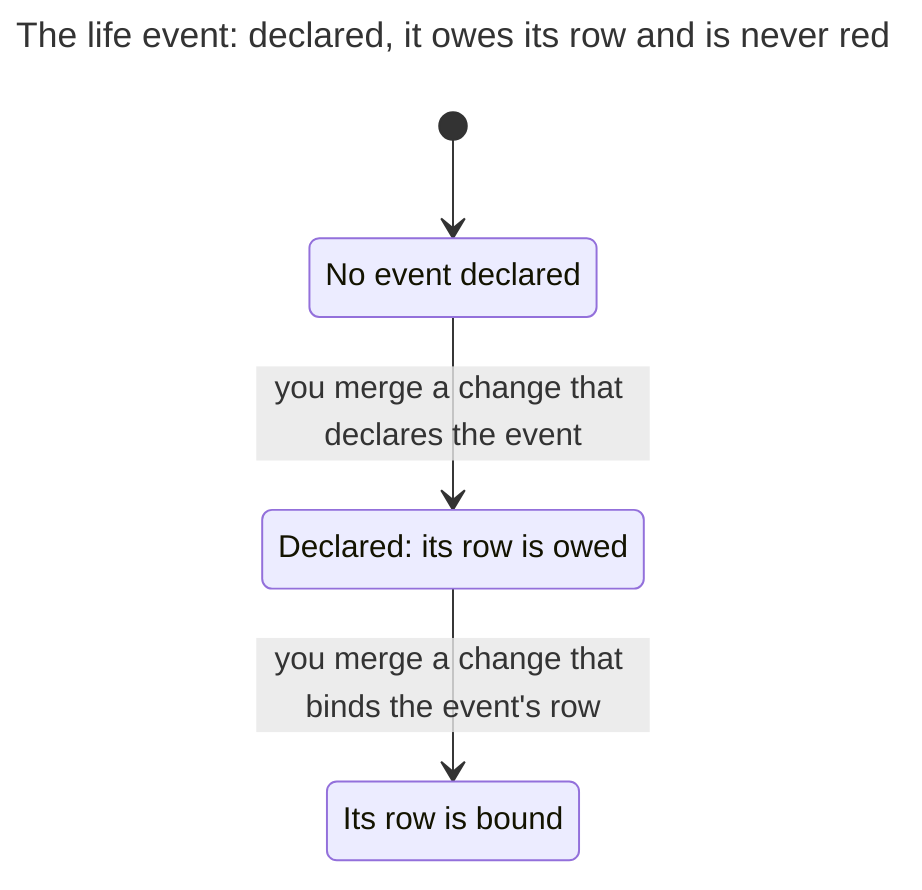

# The safeguard a project owes

`scripts/triggers.py` is the triggers gate. A safeguard is a gate the project binds once it has something to guard: a Gates row of the binding says `later: code:<kind>` until the first instance of that kind of code arrives (ADR 0028). The change that brings a kind is free, however many instances it brings (ADR 0030). Then the row is owed, and a change that adds another instance is red until the row is bound. A kind that went back to none and returns is not arriving, so its return is red (ADR 0048). A declared life event owes its rows too, and is never red. `scripts/merge.py` lands a branch: it merges the branch into the default branch's tip, runs the gate on the result, and moves the default branch only when the merge is clean and the gate is green. This page writes that down as a state machine, and says which of the owner's promises the gate keeps.

Some kinds change the project's shape when they first arrive, such as the first stored format or the first outbound call. Their arrival reopens the architecture (ADR 0052). The binding asks for an architecture review with a Gates row of its own. Once it asks, such an arrival is still free, and the gate notes that it reopens the architecture. Then the review is owed: a change that adds another instance is red until a decision record that cites the kind lands on the default branch. The record counts only when it lands on its own, not in the same change as another instance, and only when it lands after the kind first arrived: a review settles only the arrivals it could have seen. A record that landed before the kind arrived, or in the change that first brings it, settles nothing, and the arrival is still noted. A kind the default branch already held when the binding first asked counts as reviewed, so a repository never turns red for what it had.

The model is `hooks/tests/safeguard_model.py`. The tests in `hooks/tests/test_safeguard_model.py` check each rule on every state and step it reaches. They also take the same steps on real repositories, where the real gate must judge each landing as the model does (`hooks/tests/safeguard_world.py`).

## Scope

The model covers one repository with:

- one kind of code, whose arrival reopens the architecture, and one life event, which does not;
- at most three instances in its trees at once. A change that adds instances leaves at most two where it forked, and a late landing can make three;
- one open branch, forked from the default branch's tip with one change, which may wait while other branches land. Every other branch forks from the tip and lands at once;
- changes to the event, to the review and to the binding, other than binding the row, that land at once and never wait on the open branch. The event's and the review's changes land only while no branch is open. The open branch forks only where the tip's Triggers row finds the instances and either the kind's row is there or the review is owed.

Two wider models were run for this page, and each gives every rule the verdict it gives here. With every change free to wait, and the event's and the review's changes free to land while a branch is open, the model reaches 93,040 states and 724,697 steps. With a branch also free to fork from any tip, it reaches 163,849 states and 1,244,058 steps.

What it leaves out is listed [at the end](#left-out).

## State

| Part | Values |
| --- | --- |
| The default branch's tip | its instances of the kind; the kind's Gates row: `later:`, bound, or no row; its Triggers row: finds the instances, or points where none are; the event: declared or not; the event's row: `later:` or bound; the review's row: there or not; a decision record that cites the kind and landed after the kind first arrived: held or not; one that landed before it, or in the change that first brought the kind: held or not |
| The default branch ever held an instance | yes or no. The gate reads it from the log |
| Where the reviews started | not asked; asked before the kind ever arrived; or asked once the kind was held. The reviews start at the first commit of the default branch whose binding has the review's row, and the gate reads that from the log |
| The allowance | how many instances the kind had when its row came to be owed, while the row stays `later:`; none otherwise. No commit holds it. `OwedNeverGrowsUnbound` reads it |
| The open branch | none; or the tip it forked from, its one change, its tree, whether the default branch had held an instance by then, and where the reviews stood |

Two states that differ only in which instance is which are one state. So are two states the gate cannot tell apart once the review is settled. The review is settled when its record has landed, or when the reviews started with the kind held. After that the gate never reads the record or the start again. The model writes each settled state as one whose reviews started with the kind held, and with no record. That is sound because the two ways to settle differ in one verdict of the gate, the note that the arrival reopens the architecture, which needs the kind never to have been held, and a record counts only once the kind is held, so both kinds of settled state have held it. So no settled state it counts holds a record, and "asked once the kind was held" means settled. A state that is not settled can hold a record that landed before the kind, which the gate reads not.

From the start the model reaches 12,549 states and 78,681 steps. In 3,372 the review is not asked, in 6,222 it was asked before the kind and is not settled, and in 2,955 it is settled. 3,111 of the states that are not settled hold a record that landed before the kind.

## Steps

| Step | What it does |
| --- | --- |
| fork: add one instance, add several, move one, remove some, remove every one, or bind the row | opens the branch with that change, where the tip's row is there and finds the instances |
| land the branch | merged into the tip and judged there. The default branch moves to the merge only when it is clean and green; otherwise nothing changes and the branch stays open |
| abandon the branch | |
| another branch lands: any of those six changes, or put the bound row back to `later:`, drop the row, put the dropped row back, point the Triggers row elsewhere, declare the event, bind the event's row, ask for the architecture review, land the architecture review, add one instance with its review | forked from the tip and landed at once, by the same rule |

Landing the review brings its decision record alone. Adding one instance with its review brings the record and an instance in one change. A record can land only while the review was asked before the kind and is not settled. One that lands while no commit has held the kind, or in the change that first brings it, is older than the arrival: the model keeps it as a file the gate never reads, and a record landed after the arrival still settles the review. One landed before the review was asked is the same file, so only the asked case is modelled.

The binding, `docs/process/binding.md`, is a guard path. A change to it lands only when the owner merges it (ADR 0021, ADR 0033), whatever the gate says. Asking for the review is a change to the binding. A change that brings a decision record is the owner's to merge too (ADR 0052). The model is the gate alone. A rule named "with the guard" exempts a change to the binding; the same rule without the suffix holds the gate alone to it.

## Rules

The owner's eight promises are seventeen rules. Fourteen are about a landing, three about a state. The module spells each name as one word; the model and its tests spell it in words, as `arrival is free`.

| Rule | Says | In Python and in TLC |
| --- | --- | --- |
| `ArrivalIsFree` | The change that first brings a kind is free, however many instances it brings. | holds |
| `ReturnIsNotArrival` | A kind that went back to none and returns while its row is owed is red. | holds |
| `OwedTakesNoNewInstance` | While a kind's safeguard is owed, a change that adds another instance is red. | breaks in 2 steps |
| `OwedCountDoesNotRise` | While a kind's safeguard is owed, a change that raises its count is red. | holds |
| `BoundTakesInstances` | Once the row is bound and no review is owed, a change that only adds instances is green. | holds |
| `OnlyBindingLeavesOwed` | Binding the row is the only green way out of owed for a kind that still has instances. | breaks in 2 steps |
| `OnlyBindingLeavesOwedWithTheGuard` | No change that lands without the owner takes a kind with instances out of owed. | holds |
| `EventIsNeverRed` | A declared event is never red: only the rise of a kind whose row or review is owed is. | holds |
| `ReviewOwedTakesNoNewInstance` | While the architecture review is owed, a change that raises the kind's count is red. | holds |
| `ReviewedKindIsJudgedByItsRow` | Once the review is held, or the kind was there when it was first asked, rows alone judge. | holds |
| `TheRouteOwesWhatTheGateRefuses` | The route owes a kind's review exactly when the gate refuses one more of its instances. | holds |
| `AnEarlyRecordSettlesNothing` | A decision record that landed before the kind first arrived leaves its review owed. | holds |
| `OwedNeverGrowsUnbound` | No run of green changes grows an owed kind past what its arrival brought, unbound. | breaks in 3 steps |
| `OwedNeverGrowsUnboundWithTheGuard` | No run of changes landed without the owner grows an owed kind past its arrival, unbound. | holds |
| `LateLandingAddsNothing` | A branch green when it forked cannot add to a kind that became owed after the fork. | holds |
| `NothingBlindsTheGate` | No green change makes the gate stop seeing a kind or puts its bound row back to later. | breaks in 1 step |
| `NothingBlindsTheGateWithTheGuard` | No change that lands without the owner makes the gate stop seeing a kind. | holds |

The four rules of the review all hold. `ReviewOwedTakesNoNewInstance` reads "another instance" as the count rising, as `OwedCountDoesNotRise` does, so a move while the review is owed is green. `ReviewedKindIsJudgedByItsRow` compares each landing on a settled review with the gate on the same change with no review row, and they agree. `TheRouteOwesWhatTheGateRefuses` compares two separate reads of the review, the route's (`reviews_owed`) and the gate's: after each landing it asks the gate about a change that adds one instance, with the row bound so that only the review can make it red, and the route owes the review exactly when the gate says red. It replaced a rule that asked only whether a review was owed after the binding asked and the kind came after, which a route that forgets the record still answers; the tests run that mutation, which the old rule let pass and this one catches. `AnEarlyRecordSettlesNothing` holds the model to ADR 0052's reading of a review: one settles only the arrivals it could have seen. Where a record landed before the kind, or in the change that first brings it, the review stays owed once the kind has arrived. The shortest run that would break it is `another branch lands: ask for the architecture review; another branch lands: add one instance with its review`, if a route counted that record.

The four that break, each by the shortest run, the same in Python and in TLC:

- `OwedTakesNoNewInstance`: another branch lands: add one instance; another branch lands: move an instance. The move brings a new instance and removes one, so the count stays and the gate is green. Read as "the count rises", the promise is `OwedCountDoesNotRise`, which holds. Nothing needs closing: the gate counts.
- `OnlyBindingLeavesOwed`: another branch lands: add one instance; another branch lands: drop the row. The gate is green, and the row is owed no longer. Dropping the row is a change to the binding, so the guard sends it to the owner, and `OnlyBindingLeavesOwedWithTheGuard` holds.
- `OwedNeverGrowsUnbound`: another branch lands: add one instance; another branch lands: point the Triggers row elsewhere; another branch lands: add one instance. Once the Triggers row finds nothing, the gate sees no kind to judge. The guard sends the change to the Triggers row to the owner, and `OwedNeverGrowsUnboundWithTheGuard` holds.
- `NothingBlindsTheGate`: another branch lands: drop the row. The guard closes it as it closes the one before.

The tests replay each of these runs on a real repository, and the real gate lands every step of it as the model says.

The tests also check that:

- a kind arrives free with several instances, and then owes its row;
- another instance of an owed kind is red, and lands once the row is bound;
- a branch forked before the kind arrived is red when it lands late;
- a declared event owes its row, and a red landing is the kind's alone;
- a kind that arrives once the review is asked owes it beside a bound row: its arrival reopens the architecture, another instance is red, an instance with its record beside it is red, and once the record lands another instance is green;
- a kind held when the review is first asked owes none;
- a record that landed before the kind arrived, or in the change that first brings it, settles nothing: the arrival is noted as reopening the architecture, another instance is red, the route owes the review, and a record landed after the arrival ends it;
- the rule that compares the route with the gate catches a route that forgets the record, which the rule it replaced did not, and the rule on an early record catches a route that counts one;
- on a real repository, the gate holds another instance until the review lands, names the review in its red line, and owes no review for a kind held when it was first asked;
- on a real repository, a kind that went back to none and returns is red until its row is bound, and a row dropped and put back does not make the return an arrival;
- on real repositories, random runs of 15 steps take the model's steps, and the real gate agrees with the model on every landing and keeps every rule that holds.

### The rules in the module

`export()` gives each of the fourteen rules on a landing as a rule on a step. TLA+ cannot see a step that leaves every variable as it was, and the move above does: once the instances are numbered by where they are, the tip after the move is the tip before it. So the module holds each state once for each set of step rules the step into it broke, and each such rule is a boolean of that state. Three step rules break, so the module has 23,748 states and 147,769 steps where the graph has 12,549 and 78,681. 342 states of the graph are reached only by a step that breaks a rule. The rules are computed in Python, so TLC checks that the module carries them and finds the shortest runs to them; it does not prove them a second way.

## Charts

The rules were checked on `Safeguard.tla`, SHA-256 `a0b090a00e2609d021b18cae916f354da1a751593fbef592ea96cf14edfd7dc9`. TLC reached 23,748 states. Run again with only the rules that hold, its last line counts 147,770 states generated: the start and 147,769 steps. Thirteen rules hold, four break, each by the run above, and nothing deadlocks.

That module is too large for the statechart tool to draw whole. The tool draws only the shortest run to each rule that breaks, which is the last chart. The others are drawn from `SafeguardKind.tla`, SHA-256 `51489f411e31959e0226059b1283ce51060a32dd9f77a26683150e6515521e62`: the same graph seen through what the tip holds of the kind, the event and the review, and the histories. Each of those reports says that TLC reached 369 states and 4,176 steps. They draw no open branch, so an arrow is a change that lands, from whichever branch.

### The kind

7 states and 22 arrows. It does not draw the 3,345 steps that keep the label.

Each way out of owed other than binding the row or removing every instance is a change to the binding, and so is each change that leaves the gate blind: you merge it. The gate alone would land it with no one asked. A bound row lets a new instance in only while no review is owed; the next chart draws the review.

### The architecture review

6 states and 11 arrows. It does not draw the 3,792 steps that keep the label.

Whether the default branch ever held the kind decides where asking for the review leads, so each arrow out of "Not asked" says it. Once the review is asked, the arrival is free and the review is owed. Only a record that lands after the kind arrived settles it. A record that lands before the kind arrived, or with the first instance, settles nothing: the chart does not draw it, since it leaves the review in the state it was in, and the first instance that brings one is still free and noted. Once the review is owed, the record must land on its own: an instance with its record beside it is red, so no arrow leaves "Owed" that way. The kind going back to none does not settle it either: its return is red. Pointing the Triggers row elsewhere leaves the gate blind to the kind, as in the chart before. Once settled, the review is never owed again, and the rows alone judge the kind.

### The life event

3 states and 2 arrows. It does not draw the 3,930 steps that keep the label.

### Where the gate alone breaks a rule

Drawn from `Safeguard.tla`, where the tool draws only the shortest run to each rule that breaks: 5 states and 6 arrows. The states have the words of the chart of the kind, and the steps the model's own names, as the tests give the runs. No run that breaks a rule takes a step of the review. A rule on a landing breaks in the state the landing reaches. Most states with that label were reached some other way, so the chart marks the label as breaking the rule in some cases.

## Left out

- The guard itself. The model takes a change to the binding as landing by the gate alone; the rules "with the guard" say what the owner's merge adds.
- More than one kind and one event, a kind whose arrival does not reopen the architecture, a trigger that joins parts (`life:deployed and code:stored-format`), and the Triggers table's paths and patterns. An instance is a file of its own. A kind that does not reopen the architecture is judged as the model's kind is while the review is not asked.
- A life event that reopens the architecture. ADR 0052 makes a declared event the table names owe a review, which is never red. The model's event owes its rows alone.
- What the gate checks of a decision record: its `- Architecture review:` line, its outcome, its date and its sections. The model's record cites the kind, and counts when the commit that added it is after the kind's first arrival.
- Four instance ids and three instances on the tip. With them, every change free to wait, and the event's and the review's changes free to land while a branch is open, the model reaches 173,641 states and 1,482,980 steps. With a branch also free to fork from any tip, it reaches 328,810 states and 2,743,857 steps. Each gives every rule the verdict it gives here.
- More than one open branch at a time.
- A branch that forks where the Triggers row finds nothing, or where the row is dropped and no review is owed. Where the Triggers row finds nothing the kind is never red again, and a branch lands as it would at once. Where the row is dropped, a new instance is red only while the review is owed, so a branch waits there when it is. Elsewhere the kind cannot be red, and a branch lands as it would at once. The wider model above lets a branch fork from any tip, and gives every rule the verdict it gives here.
- A record that landed before the review was asked. It is the same file as one that landed after the review was asked and before the kind arrived, and the gate reads both by the commit that added them, so only the second is modelled. A record that is renamed after the arrival is read as added then; a rename of a decision record is a change to `docs/adr`, which the owner merges.
- History the gate cannot read, as in a shallow clone, where every arrival reads as free.
- What the route names when a safeguard or a review is owed, and the `/ratchet:safeguard` and `/ratchet:architecture` runs that bind the row and land the review. [The route](route.md) models those.
