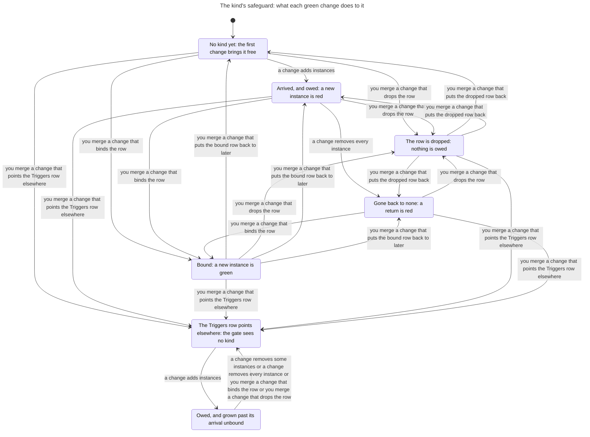
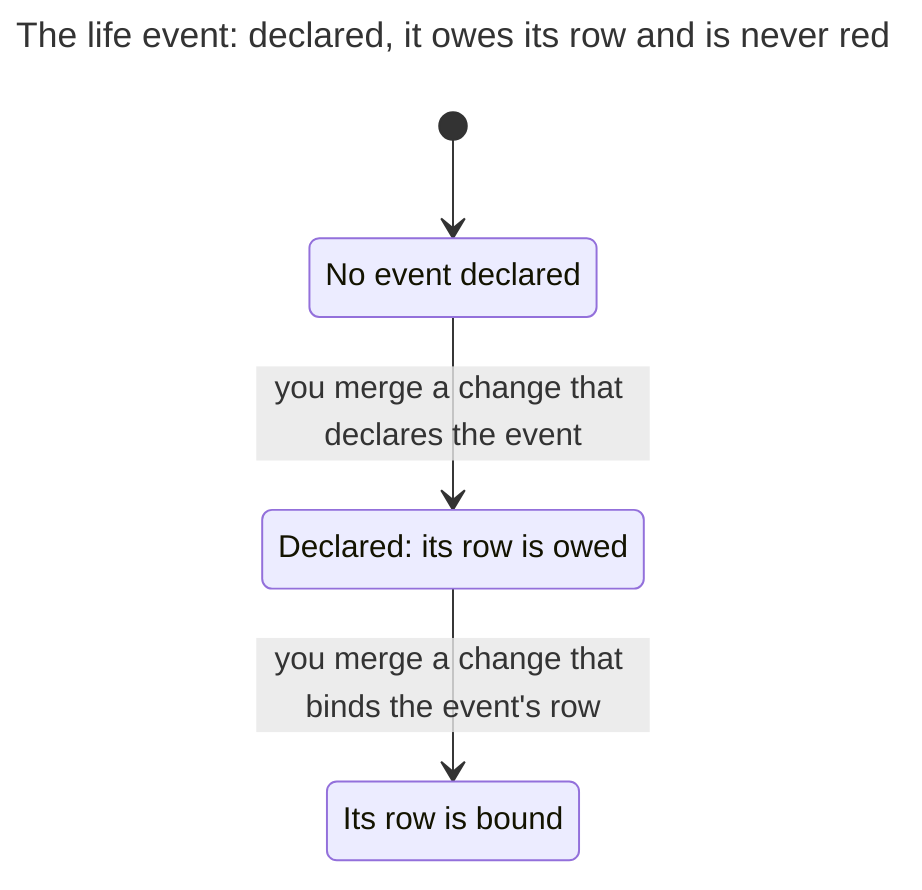
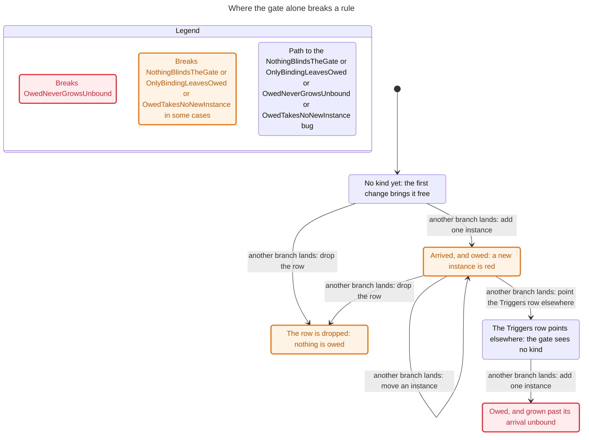

# The safeguard a project owes

`scripts/triggers.py` is the triggers gate. A safeguard is a gate the project binds once it has something to guard: a Gates row of the binding says `later: code:<kind>` until the first instance of that kind of code arrives (ADR 0028). The change that brings a kind is free, however many instances it brings (ADR 0030). Then the row is owed, and a change that adds another instance is red until the row is bound. A kind that went back to none and returns is not arriving, so its return is red (ADR 0048). A declared life event owes its rows too, and is never red. `scripts/merge.py` lands a branch: it merges the branch into the default branch's tip, runs the gate on the result, and moves the default branch only when the merge is clean and the gate is green. This page writes that down as a state machine, and says which of the owner's promises the gate keeps.

The model is `hooks/tests/safeguard_model.py`. The tests in `hooks/tests/test_safeguard_model.py` check each rule on every state and step it reaches. They also take the same steps on real repositories, where the real gate must judge each landing as the model does (`hooks/tests/safeguard_world.py`).

## Scope

The model covers one repository with:

- one kind of code and one life event;
- at most three instances in its trees at once. A change that adds instances leaves at most two where it forked, and a late landing can make three;
- one open branch, forked from the default branch's tip with one change, which may wait while other branches land. Every other branch forks from the tip and lands at once;
- changes to the event and to the binding, other than binding the row, that land at once and never wait on the open branch. The open branch forks only where the tip's row is there and finds the instances. With every change free to wait and a branch free to fork from any tip, the model reaches 27,501 states and gives every rule the same verdict.

What it leaves out is listed [at the end](#left-out).

## State

| Part | Values |
| --- | --- |
| The default branch's tip | its instances of the kind; the kind's Gates row: `later:`, bound, or no row; its Triggers row: finds the instances, or points where none are; the event: declared or not; the event's row: `later:` or bound |
| The default branch ever held an instance | yes or no. The gate reads it from the log |
| The allowance | how many instances the kind had when its row came to be owed, while the row stays `later:`; none otherwise. No commit holds it. `OwedNeverGrowsUnbound` reads it |
| The open branch | none; or the tip it forked from, its one change, its tree, and whether the default branch had held an instance by then |

Two states that differ only in which instance is which are one state. From the start the model reaches 3,372 states and 20,991 steps.

## Steps

| Step | What it does |
| --- | --- |
| fork: add one instance, add several, move one, remove some, remove every one, or bind the row | opens the branch with that change, where the tip's row is there and finds the instances |
| land the branch | merged into the tip and judged there. The default branch moves to the merge only when it is clean and green; otherwise nothing changes and the branch stays open |
| abandon the branch | |
| another branch lands: any of those six changes, or put the bound row back to `later:`, drop the row, put the dropped row back, point the Triggers row elsewhere, declare the event, bind the event's row | forked from the tip and landed at once, by the same rule |

The binding, `docs/process/binding.md`, is a guard path. A change to it lands only when the owner merges it (ADR 0021, ADR 0033), whatever the gate says. The model is the gate alone. A rule named "with the guard" exempts a change to the binding; the same rule without the suffix holds the gate alone to it.

## Rules

The owner's seven promises are thirteen rules. Eleven are about a landing, two about a state. The module spells each name as one word; the model and its tests spell it in words, as `arrival is free`.

| Rule | Says | In Python and in TLC |
| --- | --- | --- |
| `ArrivalIsFree` | The change that first brings a kind is free, however many instances it brings. | holds |
| `ReturnIsNotArrival` | A kind that went back to none and returns while its row is owed is red. | holds |
| `OwedTakesNoNewInstance` | While a kind's safeguard is owed, a change that adds another instance is red. | breaks in 2 steps |
| `OwedCountDoesNotRise` | While a kind's safeguard is owed, a change that raises its count is red. | holds |
| `BoundTakesInstances` | Once the row is bound, a change that only adds instances is green. | holds |
| `OnlyBindingLeavesOwed` | Binding the row is the only green way out of owed for a kind that still has instances. | breaks in 2 steps |
| `OnlyBindingLeavesOwedWithTheGuard` | No change that lands without the owner takes a kind with instances out of owed. | holds |
| `EventIsNeverRed` | A declared event owes its rows and is never red: only the rise of a kind whose row is unbound is. | holds |
| `OwedNeverGrowsUnbound` | No run of green changes grows an owed kind past what its arrival brought, unbound. | breaks in 3 steps |
| `OwedNeverGrowsUnboundWithTheGuard` | No run of changes landed without the owner grows an owed kind past its arrival, unbound. | holds |
| `LateLandingAddsNothing` | A branch green when it forked cannot add to a kind that became owed after the fork. | holds |
| `NothingBlindsTheGate` | No green change makes the gate stop seeing a kind or puts its bound row back to later. | breaks in 1 step |
| `NothingBlindsTheGateWithTheGuard` | No change that lands without the owner makes the gate stop seeing a kind. | holds |

The four that break, each by the shortest run, the same in Python and in TLC:

- `OwedTakesNoNewInstance`: another branch lands: add one instance; another branch lands: move an instance. The move brings a new instance and removes one, so the count stays and the gate is green. Read as "the count rises", the promise is `OwedCountDoesNotRise`, which holds. Nothing needs closing: the gate counts.
- `OnlyBindingLeavesOwed`: another branch lands: add one instance; another branch lands: drop the row. The gate is green, and the row is owed no longer. Dropping the row is a change to the binding, so the guard sends it to the owner, and `OnlyBindingLeavesOwedWithTheGuard` holds.
- `OwedNeverGrowsUnbound`: another branch lands: add one instance; another branch lands: point the Triggers row elsewhere; another branch lands: add one instance. Once the Triggers row finds nothing, the gate sees no kind to judge. The guard sends the change to the Triggers row to the owner, and `OwedNeverGrowsUnboundWithTheGuard` holds.
- `NothingBlindsTheGate`: another branch lands: drop the row. The guard closes it as it closes the one before.

The tests replay each of these runs on a real repository, and the real gate lands every step of it as the model says.

The tests also check that:

- a kind arrives free with several instances, and then owes its row;
- another instance of an owed kind is red, and lands once the row is bound;
- a branch forked before the kind arrived is red when it lands late;
- a declared event owes its row, and a red landing is the kind's alone;
- on a real repository, a kind that went back to none and returns is red until its row is bound, and a row dropped and put back does not make the return an arrival;
- on real repositories, random runs of 15 steps take the model's steps, and the real gate agrees with the model on every landing and keeps every rule that holds.

### The rules in the module

`export()` gives each of the eleven rules on a landing as a rule on a step. TLA+ cannot see a step that leaves every variable as it was, and the move above does: once the instances are numbered by where they are, the tip after the move is the tip before it. So the module holds each state once for each set of step rules the step into it broke, and each such rule is a boolean of that state. Three step rules break, so the module has 6,414 states and 39,597 steps where the graph has 3,372 and 20,991. 108 states of the graph are reached only by a step that breaks a rule. The rules are computed in Python, so TLC checks that the module carries them and finds the shortest runs to them; it does not prove them a second way.

## Charts

The rules were checked on `Safeguard.tla`, SHA-256 `a86f06df8675cb1b723d244e8010eac3cd3217247aecd2fa4c684809b59e18df`. TLC reached 6,414 states. Run again with only the rules that hold, its last line counts 39,598 states generated: the start and 39,597 steps. Nine rules hold, four break, each by the run above, and nothing deadlocks.

That module is too large for the statechart tool to draw whole. The tool draws only the shortest run to each rule that breaks, which is the last chart. The others are drawn from `SafeguardKind.tla`, SHA-256 `93116ceedaafcb63b27a85cfce463f8b46400e2345e520812690f703e6a2ad02`: the same graph seen through what the tip holds of the kind and the event, and the two histories. Each of those reports says that TLC reached 135 states and 1,449 steps. They draw no open branch, so an arrow is a change that lands, from whichever branch.

### The kind

7 states and 22 arrows. It does not draw the 1,134 steps that keep the label.

Each way out of owed other than binding the row or removing every instance is a change to the binding, and so is each change that leaves the gate blind: you merge it. The gate alone would land it with no one asked.

### The life event

3 states and 2 arrows. It does not draw the 1,359 steps that keep the label.

### Where the gate alone breaks a rule

Drawn from `Safeguard.tla`, where the tool draws only the shortest run to each rule that breaks: 5 states and 6 arrows. The states have the words of the chart of the kind, and the steps the model's own names, as the tests give the runs. A rule on a landing breaks in the state the landing reaches. Most states with that label were reached some other way, so the chart marks the label as breaking the rule in some cases.

## Left out

- The guard itself. The model takes a change to the binding as landing by the gate alone; the rules "with the guard" say what the owner's merge adds.
- More than one kind and one event, a trigger that joins parts (`life:deployed and code:stored-format`), and the Triggers table's paths and patterns. An instance is a file of its own.
- Four instance ids and three instances on the tip. With them, every change free to wait and a branch free to fork from any tip, the model reaches 60,099 states and gives every rule the verdict it gives here.
- More than one open branch at a time.
- A branch that forks where the tip has no row or its Triggers row finds nothing. From there the kind is never red again, and a branch lands as it would at once.
- History the gate cannot read, as in a shallow clone, where every arrival reads as free.
- What the route names when a safeguard is owed, and the `/ratchet:safeguard` run that binds it. [The route](route.md) models those.
